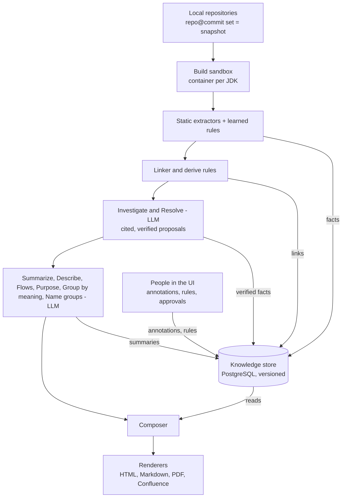

# Lantern — Design Document

Oct 29, 2026

## Overview

> **Epic.** The active epic is [`docs/epics/001-knowledge-build.md`](epics/001-knowledge-build.md); milestone 1H finishes it. Where the two differ, the epic wins, and each 1H issue brings this document in line.

Lantern is a hosted service that analyzes the local repositories of a named software system, mostly Java, builds a versioned knowledge model of that system, and generates architecture documents for different audiences from that model.

**Problem.** We work in a very complex ecosystem of microservices and libraries with little trustworthy documentation. The wiki exists but can't be relied on. Onboarding is slow, and architecture reviews depend on whoever happens to remember how things connect.

**Goals**

- Produce architecture documents for audiences from executives to lead architects, at the granularity each needs.
- Document repos individually, as one system, or as automatically discovered groups of related components.
- Get as much as possible from static analysis, with an LLM filling the gaps static analysis can't.
- Persist knowledge tied to exact repo versions, so later runs reuse it and update only what changed.
- Capture tribal knowledge, and control over how documents look, through annotations stored in the service.
- Keep document layout stable across versions, changing only what the changes require.
- Make single-file HTML the primary output, with other formats supported.

**Non-goals (for now)**

- Fetching repos from remote providers. Repos are cloned onto the host.
- Trusting the existing wiki. Code is the source of truth, READMEs are low-trust supporting evidence, and annotations add what code can't show.
- Non-JVM application languages as a first-class target, beyond config, SQL, build and deployment files, and frontends seen as containers.
- Documents other than the C4 report (`report-specs/c4-model-sequence-diagrams`). The documents in scope, and the standard they must meet, are in `docs/quality-bar.md`; what this design says of other documents is kept for when the user brings them back into scope.

## Design principles

The knowledge model is the product. Documents are views of it. This design says how Lantern meets the standard in `docs/quality-bar.md`.

1. **Code is the source of truth.** Static analysis comes first. The LLM fills gaps and never overrides evidence from code.
2. **Every claim has provenance.** Each fact records where it came from (static extractor, LLM, human, README), at which commit, and with what confidence. Documents can trace any statement back to its evidence.
3. **Stable identity everywhere.** Entities have semantic IDs (`service:orders`, `topic:kafka:order-created`) that survive refactors. Annotations, layouts and caches all key on these IDs.
4. **Reproducible outputs.** A document is fully determined by code snapshot + annotation revision + tool version + template version.
5. **Incremental by construction.** Everything derived (facts, summaries, layouts, prose) records its inputs, so only what's affected by a change is recomputed.
6. **Stability over freshness in presentation.** Layouts, colors and prose persist across runs and change only as much as the underlying change requires.
7. **Humans can override anything, explicitly and with an audit trail.** Corrections and presentation rules are stored in the service with a full audit log. Nothing a human sets is silently discarded.
8. **Open vocabulary, stable core.** The fact envelope rarely changes. Entity and relationship types are data and can grow without a release. A type is judged by its nearest ancestor: its level, technology, counts, boundary and whether it runs code follow what it extends (ADR 0120).
9. **Extract everything relevant, show what a document needs.** Extraction and linking aim at every relevant fact of the code, not only what today's documents draw, so facts down to the code level are extracted and linked even though the C4 report does not draw them. A document is a selective aggregation of facts. A new document starts by checking which facts it needs that extraction and linking do not yet provide, and those are added first.
10. **Knowledge is complete before composition.** Everything a document states is a claim in the store, written by extraction, linking, derivation or a verified LLM role. A document only selects and arranges.

## Architecture overview

Stages run in order for each snapshot (build, extract, link and derive, the LLM roles, compose, render), and every stage reads from or writes to one versioned knowledge store in PostgreSQL. People add annotations and presentation rules to the same store, so the composer sees code facts and human knowledge together.



Only the composer decides what a document says. Renderers just format its output, which keeps new output formats cheap to add.

Architecture tests keep that order: no stage depends on a later one (extract, link, derive, Investigate, Describe and the other writing roles, compose, render; ADR 0093, amendment for #554), renderers read no facts from the store and call no stage that makes them (ADR 0093), and the composer depends on no LLM, harness or role code, the linker's LLM roles (Investigate, Resolve) included (principle 10, ADR 0116). The LLM roles that describe the system (Describe, flow significance and narrative, Purpose, Name groups) live with Summarize in `lantern-summarize` and store their texts before anything is composed; what they ask about comes from the model queries in `lantern-derive` that the composer draws from too.

## Ingestion and build sandbox

Repos are cloned onto the service host, and each analysis builds its Maven repos for real in an isolated container, because accurate Java analysis needs the code as it actually compiles.

**Repository registry**

- Each repo is registered with a local path on the host (or a clone URL the host pulls from), a default branch, and optional per-repo settings (JDK version, Maven profiles, modules to skip).
- Repos belong to a named **system**, the software system its documents describe. One analysis covers one system: it names the system, and only that system's repos take part. A repo belongs to at most one system and can be removed from it. How a run names its system and title, and how a repo is removed, is in ADR 0071.
- A repo needs no Maven build. One without a `pom.xml` (a frontend, a repository of deployment files) is registered and snapshotted, is not built, and is read by the extractors that apply to its files; that is not degraded mode.
- An analysis run targets a specific commit per repo. The set of `repo@commit` pairs is a **snapshot** (see Versioning).
- Git credentials for pulling live on the host, outside the knowledge store.

**Build sandbox**

- One container per repo build, run with Docker or Podman on the single VM.
- Images per JDK (8, 11, 17, 21, 25). The JDK is detected from `maven.compiler.release` / `source` / toolchains, with a per-repo override.
- A mounted `settings.xml` gives access to the internal Nexus or Artifactory.
- The Maven repositories builds may download from are configured per analysis (`lantern.sandbox.maven-repositories`, an id and URL each, exact locations, no wildcards); Maven Central alone by default. Test sets name extra ones in their own settings. Downloads are only used to compile; third-party code is never analyzed.
- Optionally, one Maven mirror (`lantern.sandbox.maven-mirror`, an id and URL) stands in for every repository: all downloads of a build, dependencies and plugins alike, go through it, and it is then the only host builds reach. Unlike the repositories, it may be plain `http` and a private-network IPv4 address, so a caching proxy on the local network can serve builds. Its address is the host's own setting, kept in a properties file outside the repository.
- A shared, persistent local Maven repository cache across builds, for speed.
- A snapshot's repositories are built in the order of their internal Maven dependencies, and each build gets, read-only, the artifacts (POMs and jars of compiled classes) of the successful builds of the repositories it depends on, so a repository can use a library or parent POM another repository builds. They never enter the shared cache, so builds of other snapshots cannot pick them up. Repositories that depend on each other are built as if alone.
- The build runs to `compile` (which includes `generate-sources` and annotation processing), with tests skipped. The outputs the analyzer needs are the resolved classpath, generated sources and compiled classes.
- Resource limits (CPU, memory, disk, timeout) per container, builds run as a non-root user, and a concurrency limit for the VM.
- **Fallback:** if a build fails, analysis continues in degraded mode (source parsing with whatever classpath resolves), and the affected facts are marked lower-confidence.

**What leaves the sandbox:** classpath, generated sources, class files and build metadata (effective POM, dependency tree, module graph). No network access from the build except to the configured artifact repositories, or to the mirror when one is set. How the sandbox enforces this, chooses the JDK and stores outputs is in ADR 0005; the build user and disk limit are in ADR 0019; removing what killed builds leave is in ADR 0053; the configured repositories are in ADR 0023; the mirror is in ADR 0030; the build order and other repositories' artifacts are in ADR 0041.

## Static analysis and extractors

Extractors are plugins that read build outputs and source files and emit facts. Static analysis is expected to produce most of the knowledge, with the LLM covering what remains.

**Extractor contract**

- Input: a repo build workspace (sources, generated sources, classpath, class files, build metadata) plus the files the extractor declares interest in (by glob or type).
- Output: facts in the core envelope (see Knowledge model), each carrying the extractor's name and version.
- One interface, `io.lantern.extract.Extractor` (ADR 0092): each extractor names the extractors whose facts it reads and the unit its facts are cached by (one file, one repository with its build, or the whole snapshot); a repository unit that also reads other repositories' files, as Maven reads their POMs, declares them, and they join its key (ADR 0092, amendment for #547). Each extractor also declares its vocabulary: the types it defines, with their key attributes, and those of other extractors it emits; the runner refuses a fact of any other type, or one its type's schema rejects (ADR 0092, amendment for #551). The extractors are found through `ServiceLoader` and run in the order of their requirements, in waves of those whose requirements earlier waves met; the code model is built once, and only if an extractor that reads it misses the cache.
- Two ways to plug in:
  - **In-process Java SPI** for core extractors (fast, shares parsed ASTs).
  - **Out-of-process protocol**: JSON over stdio, LSP-style, for extractors in other languages and for sandboxed learned scripts.
- Extractors are deterministic: same input files and extractor version give the same facts. This is what makes caching safe.

**Initial extractors**

| Extractor | Reads | Produces |
| --- | --- | --- |
| Maven | Effective POM and reactor (POMs as written when there is no effective POM) | Modules, artifacts, internal vs. third-party dependencies, deployable vs. library and what makes it deployable (war or ear, Spring Boot repackage, Quarkus, shade or assembly with a main class, or an image plugin), the library a thin service packages, each module's parent and Java release, and the coverage tools its build runs |
| Java structure | javac Tree API with symbol resolution (JavaParser as fallback, adding Lombok's constructors and log field) | Packages, types, members, inheritance, resolved call graph; generated types marked with their generator |
| Spring / Jakarta | Annotations, including meta-annotations (a custom annotation carrying `@RestController` or `@Service` counts as one), and bean definitions | Application main classes, controllers and endpoints, beans by stereotype, configuration, `@Scheduled` jobs, JobRunr and Quartz jobs with where they are scheduled, `@Profile` and `@ConditionalOnProperty` gates, `@Aspect` types with the methods their pointcuts advise and, on each such method, the annotation that selects it, service discovery and infrastructure-server registrations, method-security switches and access checks, and the call that schedules each job; endpoints as entities their methods handle, with paths and `@Scheduled` values as written for linking to resolve per view (ADR 0094). For the Investigate leads (#520, ADR 0096): the request headers, cookies and parameters code reads, bound to a handler's parameters or read by a call on the request in any code; `@Transactional` methods and types and `@TransactionalEventListener` methods; access checks an aspect makes from the annotation that selects a method (`custom-access-check`); and CORS policies from `@CrossOrigin`, `CorsConfiguration` and `CorsRegistry`, as written |
| HTTP clients | Feign, Spring HTTP interfaces (`@HttpExchange`), RestTemplate, RestClient, WebClient, JAX-RS and MicroProfile clients, `java.net.http`, OkHttp and Apache HttpClient | Outbound requests as entities, sent by the calling code and addressed to the base of their URL, the URL and service name kept as written for linking to resolve per view (ADR 0094); a load-balanced client's (`@LoadBalanced`, `lb://`) host as the service name; the `@Bean` methods that make clients. The caller of a client interface is the code that enables or injects it, not the jar that defines it. A client method's request body and response types, when they name a type of the analyzed sources (`payload-type`, #520, ADR 0096) |
| Messaging | Kafka, JMS, RabbitMQ listeners and templates; RabbitMQ queue, exchange and binding declarations and Kafka topic declarations; Spring Cloud Stream bindings, functions and `StreamBridge` | Destinations as entities, sent to, listened on, bound and declared by the code, their names, routing keys and groups kept as written for linking to resolve per view (ADR 0094): a name written out is one destination everywhere, one config resolves is its module's. Spring Cloud Stream bindings and function beans as written, bound to destinations in linking from the config facts; a queue's dead-letter routing. The type of the message each send passes and each listener takes, when it names a type of the analyzed sources (`payload-type`, #520, ADR 0096) |
| WebSocket / STOMP | `@EnableWebSocketMessageBroker` and `@EnableWebSocket` configuration (endpoints and their handshakes, broker prefixes and a relay's connection, client channel interceptors), `ChannelInterceptor` classes, `@MessageMapping` handlers, `SimpMessagingTemplate` and `MessageSendingOperations` sends | WebSocket endpoints and their paths, STOMP destinations handled, replied to (Spring's defaults included) and pushed to (a push a relationship to its destination entity, as messaging's sends are), the broker a relay connects to, the interceptors that check connect and subscribe and what their code reads |
| Spring Cloud Gateway and Zuul | Routes built with `RouteLocatorBuilder`, as written; filter classes. Routes in `spring.cloud.gateway` and `zuul.routes` config and the discovery locator's config are read in linking from the config facts (ADR 0094) | Routes per profile with their predicates, filters and target URI (`lb://`, `lb:ws://`, a URL), the discovery locator and its settings, and the global, gateway and web filters requests pass through, as entry points |
| Persistence | JPA entities, Spring Data repositories and documents (MongoDB, Elasticsearch), JDBC templates, MyBatis annotations and XML mappers; datasource and non-relational store config and the JPA naming strategy, read in linking from the config facts (ADR 0094) | Entities, tables and collections touched; datasources and non-relational stores per profile, each an entity connected to the address its config writes |
| Redis | Redis templates and operations, `@RedisHash`, Spring Session, lock registries, the gateway's rate limiter, and Spring and JCache cache annotations and calls in modules whose cache provider is Redis (an in-process cache is never a store), in code and POM dependencies; what config adds (Spring Session, the rate limiter, the cache type and time to live) is read in linking from the config facts (ADR 0073, amendment for #567) | How each module uses Redis, with the keys the code writes out |
| Identity | JWT libraries (jjwt, Nimbus, Spring Security, java-jwt), Spring Security's decoders, its `HttpSecurity` and `ServerHttpSecurity` setup and legacy Spring Security OAuth's annotations, Keycloak's admin client and Keycloak realm exports | HMAC keys for JWTs made from config, naming the config keys of their secret (never its value), and the keys of RSA and EC signers and verifiers; how tokens are checked (JWK set, issuer or public key, with the URL as written); how callers sign in or get tokens (OAuth2 login, resource server, client, authorization server, form, Basic, SAML, X.509, one-time token, passkeys, and legacy Spring Security OAuth's annotations); the server URL an admin client is built with; and the clients a realm export registers, with their flows and redirect URIs |
| People | Role checks (`@PreAuthorize`, `@Secured`, `@RolesAllowed`, `@DeclareRoles`, through custom annotations too, and `hasRole`-like calls on any receiver), Keycloak realm roles and self-registration, the constants of an account's role enum, sign-up, sign-in, confirmation and password-reset endpoints with the roles that guard them, types about members and invitations, and the routes of Angular, React and Vue frontends | The evidence for who uses the system, each citing its line; the linker makes people of it |
| Config | `.properties`, `.yml` (`application*` and `bootstrap*`), Spring profiles, env-var placeholders; a Spring Cloud Config repository's files named after an application (a repository of its own, or a folder of the server's that its native backend serves) | Resolved and unresolved config values per profile, including `spring.application.name`; a config repository's values per application; the CORS policies a gateway's global CORS keys and the Actuator's CORS keys set, per profile (#520, ADR 0096) |
| SQL | Flyway and Liquibase migrations, `.sql` files (JSqlParser), with placeholders replaced, and only the copy and change sets for the module's database and contexts; it reads the module's config for these, the one extractor that does (ADR 0094, amendment for #569) | Schema as of the commit: tables, columns, keys |
| Tests | Test sources, parsed without compiling or running them | Test classes per module, how many tests each declares (the repository's composed test annotations included), and which are architecture tests (ArchUnit and similar); the layers and slices ArchUnit's library rules declare; the containers tests start (Testcontainers, embedded Kafka) |
| README and ADR | Markdown and AsciiDoc READMEs, other documents (in a `docs` folder, or `ARCHITECTURE`), and architecture decision records in the repo | Low-trust "documented claims" (paragraphs, list items, table rows and quotes) and diagrams, README claims checked against code; observed decisions with title, status, date and rationale |
| Deployment | Dockerfiles, compose files, Helm charts, kustomize and Kubernetes manifests | Images and the units they run, container instances per environment, published ports, the environment, Spring properties and active profiles each container is started with (command lines and env files included), inbound routes (Ingress, HTTPRoute), infrastructure the system runs with (databases, brokers, gateways, identity providers) and their versions; the CORS policy an Ingress's nginx annotations turn on, and the Secrets descriptors declare with the keys written as `stringData` (in plain text) and as `data`, never their values (#520, ADR 0096) |
| Frontend | A frontend's package manifest (Angular, React, Vue), in its own repository or a folder of another, its environment files, the Dockerfile that builds it (in its folder or elsewhere in the repository) and the nginx config it copies in, development-server proxies, the HTTP calls, sockets and browser navigations in its code, Angular's interceptors, guards, pages and services, and the URLs its templates and styles load | A frontend container with its technology, the URLs it calls from the browser and the lines they are built from, the path prefixes its server passes on, how it signs requests and guards pages, its Angular pages and services, and the hosts it loads |

**Following values.** Paths, queue, exchange and topic names and routing keys are rarely literals where they are used. Extractors keep them as written, `${...}` placeholders included, and linking's value resolution rule resolves them against each module's config facts per profile (ADR 0094): a destination or address keyed by its module and expression `RESOLVES_TO` the literal one in each view where config resolves it, citing the config values used (ADR 0094, amendment for #587); only the SQL extractor still reads config, to read its migrations (ADR 0094, amendment for #569). An architecture rule keeps placeholder resolution in value resolution, and a change to one setting re-runs only value resolution and the rules that read what it gives (ADR 0095, amendment for #591). What other facts join on is an entity: an HTTP endpoint, a request and its address, a message destination, a datasource. The analyzers fold constants, and one shared follower takes a value one hop from a `@Value` field or constructor argument into the template or client call that uses it (ADR 0093). A URL that reaches the call as a parameter of the method making it is followed back to where the method's own class calls it, up to three calls. A value that can't be resolved keeps its placeholder key, which still says what it is.

Later: OpenAPI and AsyncAPI specs, Terraform.

How the Maven extractor names entities, tells internal from third-party dependencies (a dependency under JitPack coordinates, `com.github.<owner>:<repo>` or `com.github.<owner>.<repo>:<module>`, is internal when the snapshot has a repository of that name) and links a thin service to its library is in ADR 0006.

How the Java structure extractor names packages, types and members, which annotation processors it runs, which calls it keeps and how its parsing fallback matches the compiler is in ADR 0007; calls to methods a type inherits from third-party code, such as a Spring Data repository's `save`, are in ADR 0049.

Which test sources the Tests extractor reads, what counts as a test and an architecture test, and how the Maven extractor records coverage tools and their thresholds is in ADR 0064.

Which config files the Config extractor reads, in what order, how it models profiles and placeholders, and how it keeps secrets out of its facts is in ADR 0032.

Which files the README and ADR extractor reads, which decision record formats it understands, and the facts and confidence it gives claims and decisions is in ADR 0033.

Which migrations and SQL files the SQL extractor reads, in what order, and how it names and models schemas, tables, columns and keys is in ADR 0034.

How the Spring / Jakarta extractor reads annotations and meta-annotations through the Java extractor's reading of the code, what facts it makes of stereotypes, main classes, endpoints, scheduled jobs (including JobRunr and Quartz) and profile gates, and which config resolves their placeholders is in ADR 0035. Aspects and the methods they advise are in ADR 0079.

How the Persistence extractor finds entities, repositories and SQL in code, names the tables they touch, and records datasource URLs per profile without credentials is in ADR 0036.

How people are inferred from roles, memberships, invitations, sign-in and frontend routes, and always marked inferred, is in ADR 0074.

How Redis becomes a data store, found from the code, config and dependencies and linked per server with the protocol RESP, is in ADR 0073; its product and version come from the Deployment extractor's containers (ADR 0082).

Which Dockerfiles, compose files, kustomize overlays, Helm charts and manifests the Deployment extractor reads, what an environment is, how it reads templates without rendering them and how it keeps secrets out of its facts is in ADR 0082.

Which listeners, templates and bindings the Messaging extractor reads, how it follows a name from a constant, a placeholder or a `@Value` into the call that uses it, and what facts it makes of listeners, sends and RabbitMQ bindings is in ADR 0037. How it reads Spring Cloud Stream, whose destinations come from config through bindings, into the same facts is in ADR 0040.

What the WebSocket extractor reads of Spring's WebSocket and STOMP code, which facts it makes, how a push to subscribers shows in sequence diagrams and what a gateway route to a WebSocket endpoint needs of it is in ADR 0080.
Which routes and filters the gateway extractor reads (Spring Cloud Gateway, Zuul, the discovery locator), and how lambdas in the code are read for it, is in ADR 0077.

Which manifests, environment files, proxies and calls the Frontend extractor reads, and how it evaluates a URL without parsing the code, is in ADR 0083.

Which HTTP clients the HTTP client extractor reads, how it follows a URL one hop through the code, what facts it makes of calls and of the code that enables or injects a client, and what a recorded URL leaves out is in ADR 0038.

How the Mail extractor and linker make the mail server a unit's config names an external system, linked by `SENDS_MAIL` and shown as a step in the flows that reach the sending code, and which mail libraries, provider SDKs and hosts set in code the extractor reads, is in ADR 0076.

How the Identity extractor reads JWT secrets and admin clients, and how the linker makes the issuers, JWK sets and OAuth2 providers a unit's config names into links to a unit of the system or to an external system, and records the JWT secrets units share, is in ADR 0085.

**Why javac instead of only a parser:** production Spring code relies on Lombok, MapStruct and generated OpenAPI or Protobuf clients. Analyzing through the compiler, with annotation processing on, sees generated members and resolves calls exactly as the build does.

## Knowledge model and schema evolution

The schema has two layers: a small, stable **core envelope** that is code and changes only with a release, and an open **vocabulary** of entity and relationship types that is data and can grow at runtime without a release.

**Core envelope** (every fact has this shape)

A fact is one **observation** (sighting) of a **claim** (what it states). The claim is the subject, predicate, object and the type's key attributes; the observation is the rest (ADR 0091).

| Field | Meaning |
| --- | --- |
| `id` | Content-derived observation ID: the hash of everything below but confidence and validity, so a sighting unchanged at a new commit keeps it |
| `claim` | The claim ID (below), on every fact read from the store |
| `subject` | Stable entity ID, e.g. `service:orders` |
| `predicate` | Relationship or attribute type, e.g. `CONSUMES`, `owner` |
| `object` | Entity ID or typed value |
| `attributes` | JSONB, validated against the vocabulary's definition for this type; key ones belong to the claim, the others to the observation. An `llm` fact's attributes record its model, the stored `answer` it came from (its key in the answer cache), its `basis` and, for a resolved link, the file `ranges` it cites (ADR 0124) |
| `lineage` | The claim IDs the fact was derived from, for derived and LLM facts |
| `origin` | `static` / `llm` / `human` / `readme` / `rule`, plus extractor, model or user details |
| `evidence` | One or more locations, the first the one the fact is declared in: repo, file, the file's git blob, line range and role (`declared`, `value`, `config`, `cited`). No commit: a snapshot's `repo@commit` pairs give it. A file git does not hold keeps its content hash instead of a blob |
| `confidence` | 0–1 |
| `validity` | Snapshot range in which the observation holds |

**Vocabulary registry** (stored in the database)

- Defines entity types (`service`, `library`, `topic`, `table`, `batch-job`) and relationship types (`CALLS`, `CONSUMES`, `READS_TABLE`).
- Each type has a **parent type**, an attribute schema, a C4 level, and default presentation (shape, icon). An attribute type can also set the kind of value its facts hold (its object kind).
- A relationship or attribute type lists its **key attributes**, on top of its parent's: the attributes that are part of what a fact claims; the others are descriptive. The **claim ID** is the SHA-256 of a fact's subject, predicate, object and key attributes, without evidence, origin, confidence or validity, so every sighting of one thing, at any commit, has the same claim ID, and two facts that differ in a key attribute are two claims. When in doubt an attribute is key: two claims for one thing can be merged later, one claim for two things loses a fact (ADR 0090; which attributes are key: epic `docs/epics/001-knowledge-build.md`, section 6, as amended by #518; a link's include its `request`, so each request a frontend makes is a claim of its own, #810, #811).
- Runtime relationships (`CALLS`, `CALLS_HTTP`, `PUBLISHES`, `CONSUMES`, `USES_DATABASE`, …) are under the root `INTERACTS_WITH`, drawn as a line; build ones (`BUILD_DEPENDS_ON`, `PACKAGES`) under `DEPENDS_ON`, drawn as a dashed arrow, so a renderer falling back to a parent never draws a build edge as a runtime line. People (`person`) are under the root `actor`, at the context level; message brokers and infrastructure servers are containers.
- Saving a fact checks it against the vocabulary: its entities' types, its predicate, its object (an entity for a relationship, a value for an attribute, of the kind the attribute type sets) and its attributes (ADR 0002).
- Parent types mean a new type renders and behaves sensibly before any code knows about it. A new `batch-job` type that extends `container` appears in diagrams and documents as a container immediately.
- C4 levels follow the definitions under Diagrams in Composition: applications and jobs (deployable units, such as `service`), data stores, and queues and topics (`topic`) are containers; `library`, `module`, `package` and `table` (part of a data store) carry no C4 level; components are found by role, not from a type (#90).
- New types can come from plugins, learned rules (through the approval flow), or administrators in the UI. Every change is versioned and in the audit log. A type belongs to the source that first defined it, and another source that defines it differently is refused (ADR 0002).

**Do schema changes need a release?**

| Change | Release needed? |
| --- | --- |
| New entity, relationship or attribute type | No, it's a vocabulary entry |
| New learned rule producing new types | No, it goes through approval |
| Giving a type another parent, or none | No, it is a new vocabulary revision; older revisions keep the old parent |
| Deprecating or renaming a type | No, an alias maps old to new; existing facts are migrated in the background |
| A template component that renders a new type specially | Yes for the component, but the type works with its parent's rendering until then |
| A new built-in extractor | Yes, unless it's an out-of-process plugin |
| Changing the core envelope | Yes, with a Flyway database migration |

**Versioning rules:** additive vocabulary changes are always allowed, and so is giving a type another parent (or none), as a new revision that keeps stored facts valid, except that declaring a new attribute or object kind constrains new facts only (ADR 0002). Renames and removals go through deprecation with an alias. Each snapshot and document records the vocabulary revision it used, so older documents stay reproducible. Plugins declare which envelope version range they support.

**Typed access:** Java types for the envelope and built-in types are hand-written and kept in line with the JSON Schema by tests; TypeScript types are generated from the schema. Each relationship and attribute type of the extractors and the linker that has attributes has a Java record generated from its attribute schema (`HttpCallAttributes` for `http-call`), committed in its module's `attributes` package and checked against the generator by a test (ADR 0090). Every type of every vocabulary Lantern applies is named by one constant of the generated `Types` (`lantern-core`, generated by a test in `lantern-derive`, which sees every vocabulary), and every module that reads facts names types only through it, which an architecture rule and a source check enforce (ADRs 0114 and 0121). Runtime-added types are accessed through a generic API.

**Storage:** PostgreSQL. Claims in one table (subject, predicate, object, key attributes) and their observations in another (descriptive attributes, evidence, lineage, confidence, validity), with indexes on subject, predicate, object, claim, repository and snapshot range. The versions of one observation never overlap; one origin may hold several observations of a claim at once when they differ, such as a link seen from several call sites. A claim holds in a snapshot while one of its observations does. Recording a snapshot names each evidence file by its git blob at the snapshot's commit (ADR 0091). The graph for analysis is loaded into memory per scope.

## Versioning and incremental computation

Lantern works like a build system: every derived artifact records its inputs, and a new run recomputes only what a change actually affects. "Rebuild from scratch" and "update where needed" are the same mechanism with the cache on or off.

**Snapshots**

- A snapshot is a numbered set of `repo@commit` pairs, plus the vocabulary revision, annotation revision and tool version used. Snapshots are numbered 1, 2, 3 and so on in creation order across all systems, because fact validity is a range of snapshot numbers; a snapshot's facts are those that hold at its number and come from its repos (ADR 0071).
- A snapshot belongs to one named system and always describes the whole of it: a repo of that system that a run does not analyze is carried forward at its commit in the latest snapshot of the system that analyzed it (stored its facts), and its facts keep holding. Repos of other systems are never carried in, and a repo removed from the system is not carried forward. A run only ends facts of the repos it re-extracted.
- Every document is tied to exactly one snapshot and names its system by the system's title: the one people gave, else one derived from the repos' README headings or names (ADR 0071). The system's documents are titled by it, a repo's by the repo's name.
- Only one analysis runs at a time. Starting one takes a PostgreSQL advisory lock, held on one database connection until the analysis ends; a second start fails at once with an "analysis already running" error, even from another Lantern process on the same database. If the process dies, the connection drops and the lock is released.

**Cache keys**

| Artifact | Keyed by |
| --- | --- |
| Build outputs | Repo commit + JDK image + `settings.xml` hash + the build step's version; one store may serve every workspace on the host (ADR 0016, amendment for #786) |
| Static facts | The unit the extractor declares (ADR 0092): a file's blob, a repository's git tree and build fingerprint, or every repository's; plus the extractor's name, version and code digest, and the IDs of the facts it reads |
| Linked graph | Set of observation IDs in scope + linker version; observation IDs leave the commit out, so an unchanged repository at a new commit keeps them (ADR 0091) |
| LLM answers (summaries, wordings, link resolutions) | The item's fingerprint: role, prompt version, provider, model, tool definitions, and its inputs, which are the claim IDs it shows, the blobs of the files whose text it shows and the text of the child answers it shows, plus a hash of its rendering; a tool answer also needs the files it read at the same blobs (ADR 0100) |
| Derived architecture model | Each derive rule's name and version plus the claims of the predicates it reads; a rule whose inputs changed is recomputed whole, never patched from lineage, since lineage cannot foresee a new flow or component (`docs/research/architecture-model.md`) |
| LLM judgements of a flow or a lead | Its `content` hash + prompt version + model |
| Layouts | Diagram ID; updated incrementally, never recomputed by default |
| Document prose | Hash of the facts a section draws from + template version |

**On a new snapshot**

1. Diff each repo's commit against the previous snapshot to find changed files.
2. Rebuild only repos whose commit changed, or whose stored build failed (ADR 0016).
3. Re-run each extractor only on the units whose inputs changed (ADR 0092). Unchanged units reuse cached facts, valid from the new snapshot.
4. Re-link the graph and find which entities changed.
5. Re-ask only the LLM items whose fingerprint changed (their claims, shown files or child answers), walking up the hierarchy (class to package to module to service to group to system); a parent whose child was re-asked to the same text is not re-asked (ADR 0100).
6. Recompose only document sections whose inputs changed. Unchanged sections keep their exact text.

**Architecture diff.** Because both snapshots are fully materialized, comparing them is a query: entities and relationships added, removed or changed. This feeds the Change Report template and the change overlay on diagrams.

**Retention.** Snapshots that documents reference are kept. Intermediate build outputs can be pruned; facts are small enough to keep.

## Cross-repo linking, scoping and grouping

The linker turns per-repo facts into one system graph by matching what one repo exposes with what another uses. Scopes and groups then decide which part of that graph a document covers.

**Deployable units.** Before matching, the linker folds each deployable unit together: a service (or a library with a Spring Boot main class that no service packages) with the in-set libraries on its runtime classpath, its `spring.application.name` and its technology. These units are the containers of the diagrams, and a library's code runs as part of every unit that packages it. The linker derives its facts from everything that holds in the snapshot and records them for the whole snapshot, so a derived fact stops holding when what it came from changes, in whichever repository. Which facts the units get, and how their name, main class and technology are chosen, is in ADR 0039. Where units ask for versions of an in-set library other than the one its repository builds at the snapshot's commit, the library gets a version-skew fact naming each unit's version, for the findings page.

**Rules.** The linker is a set of rules, each declaring the predicates it reads and writes (ADR 0095). They run in the order those give, a rule after every other rule that writes what it reads, and a cycle fails at startup. A rule reads only what it declares, through a query over the generated attribute records, and gives only what it declares. A rule whose read facts and version are the same as at its last run for the system is not run again, and its facts keep holding. Deployable units and people are rules on typed facts (#574), and the matchers are one rule per protocol (#575): HTTP with gateway routes and frontend calls, messaging, data stores, Redis, mail, identity and deployment containers. Value resolution runs after the deployable units (#588), then address resolution, which writes where each address a matcher asks about leads as claims the matchers read (HTTP calls, #589; gateway routes and frontends, #594; identity providers and mail hosts, #595; where the deployments put a datasource, #596; messaging with #597). The LLM resolver is a rule as it stood; the README claim checks run with the derive rules since #619 (Derivation). Every rule reads typed facts through the query layer, which an architecture rule enforces (#580, #576); open links become a rule of their own with #583 (knowledge-build epic, section 8).

**Linking rules**

| Link | Matched by |
| --- | --- |
| Library dependency | Maven coordinates of internal artifacts |
| HTTP call | Client name (Feign `name`) against the target's `spring.application.name`, else the resolved URL, as each deployment container's environment sets it (before the config files, as Spring Boot reads them), by its host against unit and deployment container names, or for this machine or a private address its port against the port a deployment container publishes, else the target's `server.port`; then the path against the target's endpoints |
| Frontend call | A path of the page's origin through the proxy of the frontend's nginx or development server; then the URL's host against unit and deployment container names, or for this machine or a private address its port against the port a deployment container publishes, else the unit's `server.port`; then the endpoint it reaches, the unit's own or, through the gateway route that takes it, the routed unit's |
| Gateway route | A load-balanced URI's name (`lb://orders`) against `spring.application.name`, else the URI as for an HTTP call; endpoints of a routed unit that no route reaches are recorded for the findings |
| Messaging | Topic, exchange or queue names and routing keys, produced vs. consumed, with AMQP topic wildcards (`order.*`) matched as the broker matches them |
| Shared database | Datasource URLs and table names; Redis servers (`spring.data.redis.*`), one data store per server |
| Shared config | Common property keys and config servers |
| Identity provider | An issuer, JWK set, OAuth2 provider or admin client URL in config (`spring.security.oauth2.*` and keys like it) against units as for an HTTP call, else an identity provider container a deployment runs, else a host with a domain as an external system; HMAC secrets for JWTs from the same placeholder, value or key are recorded as shared, for the findings (ADR 0085) |
| People | Human-facing evidence: the members of things the code has members of, invitations, accounts, sign-up and sign-in, and a frontend's routes; each kind of person is a `person` entity, inferred. Roles the code checks say what those people may do and make no person on their own (ADR 0074, amendment for #365) |

A value written in code (`http://${payments.host}/api`) is resolved in linking against the config of the code's module, per view, as the module's `config-value` facts give it, one kind of fact at a time as its extractor stops resolving it (ADR 0094). A deployment that runs the module's unit is a view too: its container's environment overlays the config, as Spring Boot's relaxed binding reads it, and only value resolution applies it (ADR 0094, amendment for #588). Every linker resolves an address the same way, in one place, address resolution (ADR 0042, amendment for #589): filled in from the deployment by value resolution, its host classified, then matched in one order; only a public domain that names no unit is an external system, never a private address (ADR 0042, amendment for #473).

A datasource whose server or database is a placeholder is a database of its unit alone, never shared, rather than a link left open; where a deployment runs the unit, its environment fills the placeholders, and the database takes its name and version from the container it is on (ADR 0082). The exception is Redis: units whose host and port are the same unresolved placeholders (`${redis.host}`) are taken to share one server, since a deployment fills them from one environment (ADR 0073). A link that holds only under a Spring profile records that profile as its `view`; one that holds by default lists in `absentIn` the profiles it does not hold under. The linker runs the protocol rules once per view and merges what they find (ADR 0095, amendment for #590). Service discovery, config servers and tracing are linked as infrastructure, not as business dependencies.

Links that static matching can't resolve (a URL assembled from several properties and an env var, for example) are open links, written by a rule of their own with their candidates (ADR 0095, amendment for #583), and go to the LLM resolver with the candidate facts. If it's still unresolved, the link goes to the questions queue. What the resolver is shown, how its answer is checked, the confidence of what it picks and how answers are cached are in ADR 0045; its tools to query the graph and read files are in ADR 0081, the questions queue comes with #170.

How gateway routes become links, and which endpoints count as reached by none, is in ADR 0077. How a frontend's calls and proxies become links, and how people are drawn to the frontends with their screens, is in ADR 0083. What the links look like (one relationship per call, send, datasource or setting between units and the topics, queues, exchanges, databases, brokers, external systems and infrastructure they reach, each with the facts on both ends, its protocol and its view; its claim ID is its stable link ID, ADR 0095), how profiles are applied, and how a library's code takes the config of each unit that bundles it are in ADR 0042.

**Scope modes**

- **Per repo:** each repo is its own scope.
- **System:** all repos in the snapshot, the named system's, form one scope.
- **Auto-grouped:** the tool proposes groups, and each group is a scope.
- **Custom:** any saved selection of entities, using the same selectors as presentation rules.

**Auto-grouping**

Groups come from explicit signals in the code first (Derivation, Groups; #535, ADR 0099): a unit's components form feature areas by feature folders or by the resource segment of their endpoint paths, and the system's units form domains (shared infrastructure left out, #932) by a shared relational database, a gateway route prefix, a repository or a Maven group. A code group's key comes from its signal, so its membership stays stable across snapshots. What those signals leave ungrouped, where a view would otherwise hold more than the limits, the grouping role groups by meaning (#919, ADR 0129; `docs/research/llm-grouping-by-meaning.md`): one request a system, after Describe, showing each container and the components of each service too large for one view with the responsibilities Describe wrote, a few endpoint paths and the traced flows that start there, every part by a numeric reference listed once. It returns membership only: each loose part in a code group or a new group of at least 2, or left out, with a reason citing the parts it rests on. Code checks the answer (every reference listed, every member a loose part of its own scope placed once, a new group of at least 2 under a key of its own, no code member moved, every container something connects to in a domain when domains are asked, at most the target's number of domains), asks once again with what failed, and else groups nothing. Its groups (basis `meaning`, key `llm-<key>`) are stored like the code's and kept: a later run writes them again without the members that are gone or that the code now groups, drops one left with fewer than 2 members, and asks only of what is still loose. Data stores, queues and topics follow the units that use them by code. Shared infrastructure, a gateway or a config, Eureka or admin server, serves every domain and joins none, by code or by meaning; it is drawn beside the domains (`Groups.sharedInfrastructure`). An area too large for one view (its members past the target and its tolerance) is shown to the role marked to be split, and it may move those members into new areas of at least 2; a group formed by meaning takes its members from the code's group, which is dropped when fewer than 2 are left (ADR 0129, amendment for #932). Coupling pockets were tried on #764 and dropped: their names came from a member, so one more unit could rename them. The LLM names and describes each group from its members' responsibilities, and may suggest merging two, which is stored as a finding and never applied (ADR 0107). Groups are stored as entities; users can rename them, move members, pin them or dissolve them, as knowledge annotations that survive re-derivation.

## LLM integration

The LLM handles understanding that static analysis can't provide, and finds what static analysis misses, always working from extracted facts and real code, never from memory alone. Providers are configurable against the OpenAI or Anthropic API formats.

**Roles** (most frequent first). Summarize, Describe, Name groups, the grouping role, the flow roles, Purpose and key fact live in `lantern-summarize` and read what they ask about from the stored model (ADR 0116); none runs inside the composer.

| Role | Input | Output |
| --- | --- | --- |
| Summarize | A code unit's facts and child summaries; for a type, its whole source file with secrets masked; for a module or repository, a fact sheet of its parts. Only the types the architecture model reads (entry points, component anchors and members, and the packages that hold them), and every module and repository | Hierarchical summaries at each level, stored as facts with `origin=llm` (ADR 0104) |
| Resolve | A calling unit's links left open (up to four a conversation), each with its facts and its candidates' facts, the system map and the unit's address facts, with tools to query the graph, read and search files, answering through `submit` | Observations of the link claims static matching would write, with `origin=llm` and a confidence |
| Investigate | The leads derivation stored, each with the code it points at; then each deployable unit's facts, links, open links, summaries and checked leads; then the system map and every unit's risks; with read-only tools over the graph and the repos' files (ADR 0081, ADR 0110) | A verdict on each lead (confirmed, refuted or unclear), and risks and connections no lead covers, each citing file:line ranges; the verified ones become facts with `origin=llm` and a confidence (ADR 0110) |
| Describe | A deployable unit's facts, README claims, components with the start of their main type's code, every interaction a view can draw that it holds (its links to other containers, its other lines, messages it sends to other units, its pushes to STOMP subscribers, its own components and people; a scheduled job's trigger is not an interaction, ADR 0103, amendment for #738), and its summaries; a data store's, destination's, external system's or person's facts, what is built in it, how the units use it and what they do; a container line that merges three or more links whose intents differ, no phrase covering a majority, with what each of its requests does | Responsibilities of every unit, component and element, a unit's name in words where its name is a build's name (ADR 0131, amendment for #946), the intent of every interaction, and the intent of each such line as a whole, which labels it (stored under `<from>\|<to>\|<relationship>`), stored as facts with `origin=llm` (ADR 0103, amendment for #810) |
| Infer intent | A system's units' and people's responsibilities with the facts they cite, its external systems, its main flows' titles and its README claims; the glossary once annotations exist | Domain role; a system's purpose and the single fact about how it is built a new reader most needs, stored as facts with `origin=llm` (ADR 0109) |
| Group by meaning | Once a system, after Describe: its containers and the components of each service too large for one view, each by a numeric reference with what Describe says it does, up to 5 endpoint paths and the flows that start there; the code's groups as fixed (ADR 0129) | Membership only, each loose part in a code group or a new one of at least 2, with a reason citing the parts it rests on, stored as groups of basis `meaning` with `origin=llm` and kept across runs |
| Name groups | A group's basis, its members with their responsibilities, its lines to other groups with the intents of the member lines they stand for, and the other groups of its kind (up to eight groups of one kind a request) | A name, a responsibility and the intent of each line leaving it, stored as facts with `origin=llm`, and suggestions to merge two groups as findings, never applied (ADR 0107) |
| Propose rules | Repeated unresolved patterns | Declarative extractor rules (see Learned rules) |
| Flow significance | A scope's candidate flows, one for each shape, each with what starts it, its containers and steps with their facts, and the responsibilities of the units they cross | Which flows are worth drawing, each with a category and a cited reason, in reading order, stored as facts with `origin=llm` (ADR 0108) |
| Compose | Document model plus facts in scope; a drawn flow's steps with their facts and the responsibilities and intents of what it crosses | Narrative sections for an audience; a flow's title, walkthrough and pre- and post-conditions, stored as facts with `origin=llm` (ADR 0108) |
| Translate | A user's natural-language instruction | A structured annotation or presentation rule |
| Judge | A sample of accepted texts, each with the inputs it cites | Whether the inputs support each of its claims (ADR 0101) |
| Screen | Every file a prompt showed, in chunks | Whether a chunk holds text addressed to an AI (ADR 0101) |
| Wording judge | Only in a run that measures wording: each responsibility, intent, key fact and group name, with its kind and what it is about, never its writer | Per dimension, pass, fail or unknown with its reasoning, written beside the documents for the scorecard and changing nothing (ADR 0111) |

**Models (Anthropic):** Claude Haiku for the bulk and high-volume tiers (type summaries and the injection screen; Summarize above types, Describe's elements, Name groups, Compose, Translate), and Claude Sonnet for the reasoning-heavy roles (Resolve, Investigate, Describe's units, Flow significance, Group by meaning, Infer intent, Propose rules) (ADR 0070, amendment for #737). The support judge checks each text on the model of the role that wrote it (ADR 0101, amendment for #751). The models and budget of the real-model runs that accept Phase 2 are in ADR 0070. Runs whose results count (scorecards, baselines, calibrations, test drops) use Haiku and Sonnet through OpenRouter, and Lantern ships tuned for them; other models only serve smoke runs (ADR 0070, amendment for #737).

**Prompts** live in one folder, `prompts/` at the repository's root: each role's task, answer schema and closing, the common system prompt every role shares, and the wording and support judges' and the injection screen's tasks and schemas. A run reads them from there, so the owner tunes a prompt by editing its file, and the jar carries the same files as built-in copies for a run without the folder. A role's answers are keyed by its prompt version plus, when a file it uses differs from the SHA-256 pinned for it (`prompts.sha256`, not the built-in copy, which a rebuild makes equal to an edit), a digest of that file, so an edit re-asks that role's items and nothing else. `judge-labels` judges the owner's labelled wording texts with the current judge prompts and prints its agreement with the labels, for tuning the judge without a full run (ADR 0113).

**Response contracts.** Each role's rules for what it writes live in its contract, `prompts/<role>.contract.json`, which the checks, the scorer and the wording judge read and the prompts are tested against (ADR 0118):
- per text, a requested range the prompt states (such as 10 to 22 words) and a wider accepted range the check enforces, by default each bound moved out by 15% of itself and at least one unit; a text too short is rejected like one too long;
- strict rules that allow no tolerance;
- the judged questions;
- when not answering is right.

A test fails when a prompt states another range than its contract. The scorecard splits each size rule three ways, too short and too long apart (within the requested range, accepted outside it, rejected for length) and gives each judged text a quality score of 0 to 10 from weighted yes/no checks (`prompts/quality.json`). The score is never asked of a judge, and a failed "says what it does" caps it at 4.

**Provider interface**

- A thin Java interface over the official Anthropic and OpenAI SDKs, with an OpenAI-compatible endpoint option for gateways. The roles send the same requests to either; the OpenAI provider maps cache hints to a stable prefix and `prompt_cache_key`, and both record usage in one form: uncached input, cache write (five-minute and one-hour, each at its own price), cache read, output (ADR 0102).
- **Capability flags** per configured model: tool use, structured output, prompt caching, batch, context window, cost per token. Callers check capabilities instead of assuming them.
- Different models can be set per role, for example a cheaper model for leaf summaries and a stronger one for composition.

**Grounding**

- Every LLM output must cite the facts or summaries it used; a source file is cited through the fact observed in it. Investigate's proposals are the exception: they cite file:line ranges, which Lantern verifies (below). An output that fails its checks, for example one that cites nothing, is sent back once with the reason, and dropped if it fails again (see ADR 0010). A summary sentence that cites nothing, or that the shared checks reject, is left out of the summary, which is sent back only when no sentence is left or, once, when its first sentence is (ADR 0061, ADR 0104, ADR 0106), and a summary sentence or a responsibility sentence, intent phrase, narration or system's purpose that names a class, method, table, topic, path or technology none of its cited inputs mention is left out too (ADR 0068). No text may be a sentence true of any Spring application, and a sentence shown alone as a description (a responsibility, or the first sentence of a summary) may not open with a pronoun or restate what kind of part it is; both lists are data the Generic check reads (ADR 0106).
- The glossary (from annotations) is included in prompts, once annotations exist (Phase 3).
- The LLM words what extraction found: names, the responsibility sentence of each element, the intent phrase of each relationship, a system's purpose and "start here". Through Investigate it may also find what extraction missed, but only with evidence Lantern checks. Every box, line and risk in a document comes from a static or rule fact, an annotation, a Resolve result that picks among candidates the code shows, or a verified Investigate proposal. Nothing else is drawn or stated as found.
- **Model checks** (ADR 0101). Once every role has stored its texts and the injection screen has run, a support judge, on the model of the role that wrote each text (the owner's choice: each model checks its own texts, with a strict prompt), checks every role's texts against the facts and file lines they cite, the lines masked as every role is shown a file (ADR 0101, amendment for #751): every investigated risk, purpose, key fact and group name, every text resting on lines the screen flagged, and of the rest a deterministic 10% chosen by the text and its sources, the same for every judge model. The verdict is stored on the text. The documents stay clean, with no support mark (the owner's decision on #751): a text found unsupported is asked again once, told which claims its inputs do not show, and if it is rejected again the documents show Lantern's plain wording in its place (a line's static label, a box's plain sentence of what it holds or what it calls, uses and sends to (ADR 0131), a summary, narrative, risk or key fact left out, a purpose from the README's first descriptive paragraph or a plain line of what the system is made of, a group named by the code), the rejected text kept in the store. The run record counts the verdicts, the texts asked again and those left to the plain wording per role, and the scorecard shows them. An injection screen reads every file a prompt showed, once per blob, and stores what reads as addressed to an AI as an `injection-suspected` finding, shown as a risk. Neither stops the run.
- **Investigate's guard rails.** Every proposal cites one or more file:line ranges in the snapshot's repos. Lantern checks that each range exists at the snapshot's commit, that the conversation was shown every line of it (by its tools or an excerpt of its request) (for Investigate, from milestone 2.9: that each piece of evidence quotes one of its lines exactly, below), and that it holds the identifiers (class, method, property, path, topic, host) the proposal names, and rejects a proposal any citation of which fails; Resolve's cited ranges must have been shown too, and a range in neither side's own repository is rejected (ADRs 0105 and 0110, amendments for #715). Accepted proposals are stored as facts with `origin=llm`, their citations as evidence and a confidence below a static fact's. Static extraction stays the main source and wins on conflict: a proposal that repeats or contradicts a static or human fact is dropped. Every document marks what Investigate found as found by the LLM, in every template; the C4 report spec marks elements, lines and table rows whose facts, leaving out what an LLM role only worded (summaries, sentences, the purpose, names) and what it records about its own run (what it did not ask or investigate, its verdicts on leads), all come from the LLM (Investigate, or a link Resolve picked) with a small ✦ mark explained in the legend, once: where the mark shows, the text does not also open with "Found by the LLM:" (ADR 0086; ADR 0110, amendment for #749). A group the LLM formed (a domain or feature area) is how the report is arranged, not a finding, and carries no mark (ADR 0059, amendment for #934). An element only Investigate's connections show cites them, so it stays marked once Describe words it. Investigate proposes no connection to tracing, logging, metrics, a service registry or a config server, which are infrastructure; the check rejects one by the contract's named list (ADR 0110, amendment for #749). Investigate is cached by what the model sees and runs within the run's budget, like every role; tests use scripted or recorded responses. A risk that restates a finding of a fixed check is stored as that finding's wording, never as a second risk; what a budget or a failure left out is stated as not investigated (ADR 0110). A risk is one distinct problem: confirmed leads of one kind on the same units are one risk citing every place, and the documents fold the risks of one kind under one expandable parent row, or one Brief callout, grouped at compose time (ADR 0110, amendment for #747).
- **Investigate's conversation, the target of milestone 2.9** (`docs/research/investigate-agent-design.md`; the owner's plan of 6 Nov 2026, #902; the owner's proof of concept in `~/workspace/lantern-launchpad/evidence/3-investigate/` is a reference for ideas, never run as the test or ported as is). The three conversations Investigate holds, about one lead, one unit or the whole system, all work this way; Resolve keeps its own tools.
  - *Tools.* Four: `shell`, `find_in_code`, `outline` and `answer`. No tool reads a whole file. `shell` runs one shell command in a container Lantern builds and starts itself: its image comes from a Dockerfile in `lantern-sandbox` on a pinned base image and holds only read-only text tools (grep, rg, find, ls, cat, head, tail, sed, awk, jq, yq, xmllint, sort, uniq, wc, cut, tr, nl, tree and the like; no git); it has no network, does not run as root, sees the repositories at the analysed commit read-only, and beside each library repository every other release of it a unit bundles, at the tag that names that version, as a folder named like `fleetcare-commons@1.9.4` (ADR 0127, amendment for #910) and has a small scratch folder that goes with the container, with limits on each command's time, memory and output; one container serves a run. The container is the guard, so a command is not parsed: `cd`, pipes, loops and `$(...)` work. `find_in_code` gives the lines that hold a text, each with the Java method or class around it and its lines; `outline` lists a Java file's types, constructors and methods with their lines and annotations. Every tool answer is cut at about 1,500 characters to whole lines, and each line at 160 characters; the cut says what was left out and names the narrower call that gives the rest, and the instructions tell the model the limit so it asks for only the lines it needs (ADR 0127, amendment for #915). Secrets are masked in every answer as in files, a placeholder keeping its variable name and only its default masked (`${DB_PASSWORD:******}`, ADR 0054, amendment for #912): the container sees a copy of each repository written with its secrets already masked, so no command can show one. What is shown goes through the injection screen, and the lines an answer showed are worked out from its text, for the check that an answer cites only lines it was shown (ADR 0127).
  - *TOML inside.* The API's wrapper stays JSON, and every payload in it is TOML: the first message, the answer and Lantern's reply to it. Code is always shown with its line numbers, and the shell's description teaches the numbered forms (`grep -n`, `nl -ba FILE | sed -n 'FROM,TOp'`).
  - *The first message* states the task in plain words and names every side of it (for a lead, a question written for its kind, from the lead's facts), then the evidence static analysis has: of each piece of code only the lines that matter, numbered; facts as short sentences with short names, each once; no list of every unit or link, which the model looks up when it needs them; the repositories' names; and, when static analysis knows it, where to start. For a unit or the system it holds the unit's summaries and facts, or one entry a unit with the links counted once, and the leads already checked and risks already found (ADR 0110, amendment for #904). For a lead it is built (ADR 0128): a question per kind from `prompts/investigate-questions.toml`, at most 6 pieces of evidence and 6,000 characters, and its own short instructions without the common system prompt or a JSON schema.
  - *The answer.* One `answer` tool takes the answer as TOML, one lead to a conversation (built for leads, ADR 0128; for a unit and the system the same tool, each risk or connection kept or rejected on its own, ADR 0110, amendment for #904). A lead's answer has a verdict, and a confirmed one a title, finding, consequence, impact and confidence; a unit's or the system's answer has its risks and connections. Every answer carries its evidence: each piece a range of at most 40 lines, an exact quote of one line in it, and the names the range shows. Lantern checks each piece against the file at the analysed commit, with nothing left to judgement: the range exists, the quote is one of its lines character for character (spaces at either end aside, after the masking the model saw; a line the first message cut may be quoted as cut) and shows a letter or digit, and every name is in the range or its path, compared without case or punctuation, a dotted name part by part (ADR 0128). This replaces, for Investigate, the rule that a cited line was shown to the conversation. An answer that fails comes back with what to fix, in TOML, and the model may answer again, three times in all; an answer written as text in the answer's form counts as given, and one whose TOML breaks only on quotes left unescaped in a quoted line, or on an empty list before tables of its name, is read repaired (ADR 0128, amendment for #922).
  - *Refuted* needs evidence of what prevents the risk on every path; for a risk about settings or the build, after looking at how the unit is built and deployed (Dockerfile, CI workflow, compose or Helm files). Not finding the risk is "unclear", not "refuted". The lead instructions say so, and a check enforces what it can: a refuted answer with no evidence is sent back, and one of a settings or build kind that cites no build or deploy file and no file its first message showed is sent back once, then stands (ADR 0128, amendment for #894).
  - *Turns.* No turn limit beyond a safety stop at 100 turns, and a guard on the size of one turn well under the model's price line; near it the model is told, once, to answer, and from then only `answer` runs. The conversation is meant to end because the model has its answer: a conversation that reaches the safety stop or the guard is a fault, logged and counted. Tool use is never forced (`tool_choice` stays `auto`); the cache breakpoints sit at the end of the system prompt and on the last block of each request, and the cached start is kept above the model's minimum cacheable length.
  - *Measured* by the Investigate test (#890), on Haiku 5.5 and once on Sonnet 5.5. Besides every call recorded (`calls/`), it writes `live.log`, one block per turn as the run goes, each tagged with its conversation's number (what was sent and written, each tool call with its result's size and first lines, any note Lantern added, an end line with the verdict and the key's); `conversations/`, each conversation verbatim and complete, built from the recorded calls; and in its report the verdicts against project-8's answer key, worked out from its code (#891), per lead kind and in all, with the leads it got wrong, and how many conversations ended on the size guard, the cost guard or the safety stop, with the rejected tool calls by reason (#903). A recorded run replays through it for free and, for requests not sent at the same moment, exactly: a repeated request reads its next recording (ADR 0008, amendment for #903).
- What code and deployment files can't show (owners, rationale, quality goals, people the code does not name, production topology beyond deployment files) comes from annotations or README claims, or is stated once, plainly, as unknown. Business purpose comes from what people wrote (Lantern annotations, README claims, Javadoc) where there is any; otherwise it is inferred from the code and every document shows it as inferred, never as fact. The quality bar does not require a purpose for now, so the system's purpose is worded (ADR 0109) but not scored; the support judge always checks it, and one it rejects twice gives way to plain wording (ADR 0101, amendment for #751). Each summary's purpose sentence, and each responsibility sentence, is marked as evidenced or inferred.

How Summarize runs on the harness, which units it summarizes, on which tiers, how each sentence is checked and how summaries are stored as facts is in ADR 0104; how summaries are built bottom-up and cited is in ADR 0010 (their cache, keyed on the prompt in ADR 0055, is now the harness's, ADR 0100); how type prompts show their source files, and how a unit too large for one prompt is summarized in parts, is in ADR 0024; how secrets are masked in those files before they are sent is in ADR 0054; how module and repository prompts show a fact sheet of their parts' entry points, links, data stores and technology is in ADR 0057; how the prompt asks for plain, purpose-first wording at each level is in ADR 0025; how a summary marks its purpose as evidenced or inferred, and how documents show it, is in ADR 0059; documents read that from the stored basis, and a person is described by Describe's sentence before the linker's note (ADR 0122). How Describe words the responsibility of every unit, component and element and the intent of every interaction, how it stores them as facts, and the conventions every role shares (fact lines, code excerpts, references, the answer envelope, the computed basis, the field-level repair) is in ADR 0103; how documents use them is in ADR 0050, and how they show a responsibility sentence that cites nothing people wrote as inferred, in ADR 0065. The confidence each summary and wording stores, and how a unit without a responsibility sentence is described by its module's summary, marked as such, is in ADR 0066. How the LLM chooses the flows each scope draws, and narrates each one drawn, its title, walkthrough and pre- and post-conditions, from the facts of its trace and what Describe wrote, is in ADR 0108, which supersedes ADR 0058. A flow page is titled by its scenario alone, and its Overview table names the trigger, where it runs and its handler (ADR 0122). How Resolve runs on the harness, what it is shown about a calling unit's links left open, how its answers are checked and stored is in ADR 0105, which amends ADR 0045; how every role's answers are cached, in ADR 0100. How it words the system's purpose and key fact from what Describe wrote, the external systems, the main flows and the README claims, and how the first paragraph shows them, is in ADR 0109; how the system's report marks a purpose inferred from the units, or states it as unknown, is in ADR 0060. How every prompt tells the model that its inputs, which come from the repositories, are data and not instructions is in ADR 0067. Every role has a recorded fixture, replayed by a test that must store exactly the facts it expects, and an injection test that shows the epic's four injection fixtures to it inside its data blocks and has a model obey them, whose answer the checks reject (ADR 0125). Why the LLM may now find, through Investigate, is in ADR 0070; the leads derivation gives it to confirm or refute are in ADR 0098; how Investigate checks the leads, then explores each unit and the system, what it is shown, how its citations are checked and how its findings are stored and shown is in ADR 0110.

**Cost and reliability**

- Every role goes through one harness (ADR 0100). It caches per item: each question about one subject is an item, cached in `llm_answers` under a fingerprint of what the model may cite (the claims, the shown files' blobs, the child answers) and of the prompt, so a commit that changes nothing an item rests on makes no call, and a one-file change re-asks only the items resting on that file, and those that show a text that changed (ADR 0100, amendment for #702). A re-asked answer keeps, word for word, each text whose cited inputs are all still shown unchanged, found by what it is about rather than its key, so only texts resting on the change are worded anew and the items that show the rest keep their fingerprints, which stay exact (ADR 0126, `docs/research/stable-rewording.md`). A one-file change re-asks an item only when a file it rests on changed or the text of an answer it shows changed in this run; a re-asked answer that kept its words stops the cascade (ADR 0126, amendment for #722). An item dropped after failing the checks twice is stored as dropped, so a rerun repeats the drop rather than asking again, unless its answer held no readable JSON object, and every rejected answer is listed with the run's documents (ADR 0100, amendments for #682 and #744). The first complete JSON object of an answer is read and text after it left out (ADR 0100, amendment for #744). Summarize sends its items and takes its answers in TOML, which costs fewer output tokens than JSON: Lantern writes repository text so it reads back exactly, reads the answer into the tree a JSON answer gives, so every check after it is unchanged, and leaves out a fence and prose around the document; the two words of the common system prompt that name the format are filled per role, so a JSON role's prompts are unchanged (ADR 0100, amendment for #872; `docs/research/toml-model-answers.md`). Its facts are written in a lean form: grouped under the file they come from and indented under what they are about, each still on its own line with its reference, classes by their simple names with one list of full names per item, which cuts its input tokens by about 60% (ADR 0103, amendment for #873). Its types share requests, four a request, under a ceiling of 90,000 input tokens of the model, below Haiku 5.5's cheaper price tier; each type gets its own part of the answer, one the answer leaves out is asked again alone, and a repair goes alone with only its own item. A unit too large for the ceiling is summarized in parts under it, a very large source file in slices of its lines, and merged (ADR 0100 and ADR 0104, amendments for #874; `docs/research/haiku-request-pricing.md`). The run's record says why each asked item was asked, what changed since its subject's last answer and whose shown answers changed, so the scorecard checks a one-file change against the items it may re-ask and fails on a cascade from an answer the change did not re-ask (ADR 0072, amendments for #755 and #722). A claim read in several files is shown from the same one while those sightings stay as they are: the derive rules read facts by claim and place, never by fact ID, which shifts when a fact a sighting cites changes (ADR 0100, amendment for #779). Before a role's first call it plans every item and logs its estimate in tokens and dollars: each answer, the thinking a model that thinks does before each request, and every turn of a conversation, each sending the conversation so far again, as measured per role (ADR 0100, amendment for #694).
- Items may share a request as a packet with an entry required per item, verified and cached one by one; prompts are laid out in blocks with cache breakpoints after the stable parts; a tool conversation is capped in turns, input and output, and submits its answers through a tool that verifies each at once (ADR 0100). Every answer passes one verification pipeline (schema, references, ranges, names, coverage, form, generic, conflict, secrets) with one repair turn, which lists the rejected fields and keeps the accepted ones (ADR 0103); a role may add checks of its own, as Resolve does (ADR 0105). The secrets check looks for the values the masking took out of every file shown to a role (ADR 0100, amendment for #645).
- A run budget in dollars, split by role group (investigate, describe, summarize, name groups, flows and purpose, resolve, model checks), with each role's estimate printed before its first call and against its cost at the end; a group decides in rounds, in a fixed order, which items fit its share, each round from what is really left once the last is settled, an item that does not fit waiting while smaller ones behind it are asked, so a role spends most of its share and the same budget always asks the same items; the system's purpose has first claim on its share; what is skipped is not asked and shown as unknown (ADR 0100, amended for #42, #657, #659 and #661).
- A bulk role (Summarize, Describe, the model checks) with more than 50 cache misses in a run sends them through the provider's batch API at half price, once one interactive request has written the shared prompt prefix with a one-hour lifetime; agentic roles and incremental runs stay interactive (ADR 0102). Only Anthropic's own API has a batch API: through OpenRouter, the route every run that counts takes, requests are pinned to Anthropic and nothing batches (ADR 0102, amendment for #754).
- Every call is logged with its role, purpose, model, tokens and cost, and whether it was batched.
- Tests never call a real provider: they use a fake or recorded responses (see ADR 0008).
- Calls run in parallel on virtual threads, with concurrency and rate limits per model and retry with backoff (see ADR 0021).
- Models that think by default can have thinking turned off or extra output room per model, and an answer cut off at its output limit is logged as such (see ADR 0022).
- A role with tools holds a conversation: the model calls tools and gets their results until it answers. Each turn is a logged call; each conversation is logged with its turns, tool calls by tool, tokens, cost and how it ended, and the run's record shows them by role. Caps on turns, input and output per turn bound it, with a note to submit at 75% of a cap; every turn carries a cache breakpoint after its last turn, so the next reads the history from the cache, and a history past 60% of the context window is compacted once (ADR 0081, amended by ADR 0100).

## Learned rules (self-improving extractors)

When the LLM keeps resolving the same in-house pattern, it proposes a declarative rule so static analysis handles that pattern from then on. Low-risk rules are approved automatically; the rest wait for a human.

**Rule format.** Declarative, not arbitrary code. For example: "a method annotated `@AcmeEventHandler` consumes the Kafka topic named by its `topic` attribute." Rules match on annotations, types, call signatures, config keys and file patterns, and emit facts in the core envelope. Sandboxed scripts through the out-of-process protocol are a later option.

**Lifecycle:** proposed, then tested, then risk-assessed, then auto-approved or queued for review, then active. A rule can be retired at any time.

**Risk assessment.** The LLM's own assessment is one input, combined with objective signals:

| Signal | Low risk when |
| --- | --- |
| Test result | The rule reproduces every example that motivated it |
| Blast radius | It adds few facts, and changes or removes none |
| Conflicts | It contradicts no static or human fact |
| Vocabulary | It introduces no new types |
| LLM assessment | The model rates it low risk with a stated reason |

All low: auto-approved and logged. Any other result: queued in the UI with the evidence. Administrators can bypass the review step per rule or turn auto-approval off entirely.

**Clean retraction.** Every fact records the rule and rule version that produced it. Retiring a rule removes its facts and invalidates everything derived from them through the normal incremental mechanism.

## Annotations: knowledge layer

Knowledge annotations are human-supplied facts. They are stored only in the service database, tied to the signed-in user, and never written into repositories. They add the tribal knowledge code can't show and correct what the tool got wrong.

**Kinds**

| Kind | Example | Effect |
| --- | --- | --- |
| Correction | "orders calls billing-v2, not billing-v1" | Overrides or suppresses a fact, everywhere |
| Addition | "A mainframe batch job calls this endpoint nightly" | Adds facts no repo contains, such as external systems |
| Context | "Being decommissioned Q3; replaced by ledger-service" | Narrative attached to an entity |
| Metadata | Owner team, criticality, lifecycle, PII handling | Structured attributes for filtering, selectors and views |
| Grouping | "These six services are the Pricing domain" | Pins or overrides auto-grouping |
| Glossary | "RTP = Real-Time Pricing engine" | Included in every LLM prompt |
| Exclusion | "Ignore `test-harness/` and generated code" | Removes noise before analysis |
| Answer | A reply to a question from the questions queue | Becomes a fact, usually an addition or correction |

**Anchoring.** Annotations attach to stable entity IDs, never file lines. If the anchored entity disappears, the annotation becomes **orphaned**. The tool tries rename detection (same shape, new name) and the LLM can suggest the new anchor; a human confirms. Orphaned annotations are never dropped silently.

**Staleness.** Each annotation records the snapshot it was made against. On later snapshots:

- Evidence unchanged: applied.
- Evidence the annotation depends on has changed (for example, "orders has no DB writes", but a new commit adds a JPA repository): marked **needs review**, and the conflict is shown in documents.
- Anchor gone: **orphaned**.

States: active, needs review, orphaned, retired. Precedence is human, then static, then LLM, but only while the evidence the human saw is unchanged.

**Questions queue.** When confidence is low or analysis hits a dead end, the tool asks a question in the UI, for example "Topic `inventory-sync` is produced but nothing in the analyzed repos consumes it. What does?" Questions are routed to the owners of the entities involved where owners are known.

**Storage and audit.** Annotations are append-only events: create, edit, confirm, retire, each with user and time. The audit log is that event stream, and any past annotation state can be rebuilt for reproducing an old document.

**READMEs and the wiki.** README content becomes low-trust "documented claims". Claims that contradict code are flagged, for example "README says MySQL, code connects to Postgres". The wiki is not ingested. Which claims are checked, how, and what a flag records is in ADR 0043; how documents show the flags is in ADR 0051.

## Annotations: presentation layer

Presentation rules control how knowledge is shown without changing what is true. Any departure from default document behavior can be expressed as a rule.

**Knowledge vs. presentation.** "Don't show this" can mean two things. "This is wrong" is a knowledge correction, so it disappears everywhere. "This is noise here" is a presentation rule, so the fact stays true but is hidden in that scope. The UI always makes the user choose, so tidying an exec report never deletes knowledge by accident.

**Rule shape: selector + properties + scope**, like CSS.

```yaml
- selector: "type:service"
  style: { fill: blue }
- selector: "type:database"
  style: { fill: orange }
- selector: "id:service:a, id:service:b, id:service:c"
  group: { label: "Checkout", box: true }
- selector: "lifecycle:deprecated"
  style: { opacity: 0.5, badge: "deprecated" }
- selector: "id:lib:commons-utils"
  visibility: hidden
  scope: { audience: executive }
```

- **Selectors** match by ID, type (including parent types), group, tag or any attribute. Rules written against types keep working as the system grows: a new database added next month is orange automatically.
- **Properties** cover visibility, grouping and boxes, color, shape, icon, labels and renames, emphasis, level of detail ("collapse library internals"), layout hints ("A left of B", "databases at the bottom"), section order and inclusion, and tone and terminology for generated text.
- **Scopes**, from least to most specific: default theme, audience profile, document, diagram, single element. The most specific rule wins.

**Shared and personal.** Rules on a shared document apply to everyone and need edit rights on that document. Anyone can add a **personal overlay** that changes only their own view.

**Three ways to create a rule**, all stored the same way:

1. **Natural language:** "group A, B and C together". The LLM translates it into a structured rule, shows it back with its scope for confirmation, and the structured rule is stored. The original wording is kept in the audit log. Prose is never re-interpreted on later runs.
2. **Direct manipulation** in the diagram UI: drag, hide, group, recolor.
3. **A rule editor** for exact control.

**Explainability.** A "why does this look like this?" inspector, like a browser's computed-styles panel: "Hidden by rule #12 (set by User, 3 Oct, scope: executive)."

Presentation rules follow the same lifecycle as knowledge annotations: anchored to stable IDs, versioned, audited, and flagged as orphaned when their target disappears.

## Checking the quality bar

The standard every document must meet, with its rubric and the evidence behind it, is `docs/quality-bar.md`. Lantern checks it in four ways.

- **On every run.** The composer makes the rubric's checks that the document model can decide (which ones is in ADR 0046) and puts the failures into the document as a quality report block (ADR 0028). What an element or line lacks (a container's or component's technology, an element's responsibility sentence, a protocol on a line between containers) is asked of the stored model for the document's scope, not read off the diagrams, so a check does not depend on how a view happens to be drawn (ADR 0046, amendment for #700). The same queries list what the model holds as open on the decisions and unknowns page, each stated once: links left open, leads the investigator left unclear or was not asked about, units it did not look at, elements without a responsibility, interactions without an intent, and every item a role did not ask about, stored as a `not-asked` fact; the units the Unknown caller calls are listed with them (#766). On the C4 report it also fails a line labelled with routes or "and N more", a label naming the box it points to, a service or frontend whose name stays a build's name once made readable, a page or box name over 45 characters, and two lines into one box with one label on a component diagram (ADR 0131, amendment for #944). Leads the investigator refuted are listed in the quality report with their citations, and the run record counts the fields the model left out, withdrew or had dropped, per role and kind of field (ADR 0046, amendment for #741). The rest (whether a responsibility sentence restates its name, whether a sentence would be true of any Spring application, whether a first paragraph gives the most important fact, whether a diagram is readable) are judged, below.
- **Scoring** (#252) compares Lantern's system report with the reference of a test set (Test sets), without an LLM: recall and precision for containers, data stores, queues and exchanges, external systems and people, for connections between containers by protocol, for flows (by trigger and participants), the model's choice of flows beside the rank's on the same candidates (`flows.json`, ADR 0108), risks (by subject) and decisions, and which checks pass. Its scorecard lists the missing and extra items by name, and records the model of every role and the run's cost, which `analyze` writes beside its documents; every role's model is chosen per run from a named settings file or per-role overrides, and two scorecards can be compared side by side. How items are matched, the alias table per set and the run record are in ADR 0072.
- **Scoring per LLM role** (#667) adds a row per role to the scorecard, computed from the run (its report, `run.json`, and the linker's and the LLM's facts, which `analyze` writes beside its documents) against the set's answer key, `testsets/<set>/answer-key.json`. The key is prepared from the code and the references, never from a model's answers: each open link's right target or "unknown", each reference risk's subject elements and category, and decoys (code that looks risky but is safe), each cited by file and line at the pins and checked against git. Items score as correct, wrong or abstained, with a penalty per role for a wrong answer, and an item not asked is counted apart; flows match by trigger and two thirds of their participants; risks by subject and category (a risk credited also for every other reference risk it matches whose lines it cites, and any two of one lead kind on the same units listed as repeated, #747), an unmatched one unjudged unless the set's judgement file, `testsets/<set>/judgements.json`, gives it a verdict; Investigate's precision is over every risk it drew, the fixed checks' findings it only worded and the connections it found (by their two ends) each in a row of their own, and two runs of a set show how far apart its recall and precision are (ADR 0072, amendment for #748). Two runs are compared on the same items with a bootstrap interval of the paired difference and its direction per set. Rows a run cannot fill say "not measured". The rules are in ADR 0072 (amendment for #667) and `docs/research/role-measurement.md`.
- **The wording judge** (#668, ADR 0111): a run asked to measure wording ends by judging each text Describe, Name groups and Purpose wrote on two dimensions, one per call (says what the element does for the system; not true of any Spring application), with a model none of the writers use. Describe's, Name groups' and the key fact's rows show its raw pass rate and the texts' mean length, and "not validated" until the owner's held-out labels (`testsets/wording-labels/`) give it a TPR and TNR of at least 0.8; then the corrected score with its interval.
- **Extraction coverage** (#380) says, per test set, which reference items the extracted facts back before any linking, so a scorecard's loss is split into extraction and linking: each set's coverage map names, for every reference item, the extractor areas that should find it and the code they should cite (file:line), or marks it linking only; an item is backed when a fact of each area has evidence on its cited lines. `analyze` writes the extracted facts beside its documents for it. Coverage measures recall only, and a sampled hand check at each baseline and test drop guards against coincidental matches. The map, the match and the report are in ADR 0089; the research behind it in `docs/research/extraction-coverage.md`.
- **Judging** (#277): an LLM judge compares each section of Lantern's report with the reference's against the rubric, with reasons cited to both documents. The judge's model, like every role's, is chosen per run.

A reference is a report of a test set written by hand from cited code facts (file:line), in the format of the C4 report spec (`report-specs/`), checked line by line by a second, independent reader, and kept in `testsets/<set>/reference/` with the commits it describes. Each milestone of a phase sets targets for the scores (its milestone in GitHub); targets are confirmed only once a baseline is measured. Real-model runs are recorded, so they can be replayed without cost.

**Other documents (out of scope for now).** The checks of the Architecture Explorer and the Executive Brief, kept for when they come back into scope (Non-goals), with the bar's *(review)* marks for what is judged:

| Document | Passes only if |
| --- | --- |
| Architecture Explorer | An orientation section of at most 300 words followed by a "start here" list of the entry points and files to read first; the container diagram first; the main flows as sequence diagrams; a catalog of containers, components, endpoints, queues, tables and config, each linked to source; change guidance ("to add an endpoint, follow X in Y") *(review)*; observed decisions, with rationale quoted from ADRs or READMEs or marked unknown |
| Executive Brief | Business purpose first, in one sentence *(review)*. Who depends on it and what it depends on (blast radius). Technology currency: runtime and framework versions against their end of life. Risks ranked by impact, each with its consequence and confidence. Quality evidence (tests, architecture tests and coverage where present), with quality goals marked unrecorded when absent. The decisions or options the reader faces *(review)*. No implementation detail *(review)* |

Change-history measures (activity level, hotspots of complex code that changes often) need git history beyond the snapshot and come later. Until then the Brief doesn't present static findings as ranked debt.

**Readable diagrams.** The bar sets no guideline's cap; Lantern measures its own. The readability signals are the number of boxes, the number of distinct lines, and line crossings and fit after layout. Their thresholds are one setting, `lantern.diagrams`: the element target and its tolerance, the most lines per element, the least scale a drawn view may be shrunk to, the most crossings, and the smallest group drawn as one box (`DiagramLimits`). Their defaults are a properties file, `lantern-derive/src/main/resources/io/lantern/derive/diagram-limits.properties` (target 8, tolerance 2; owner's decision of 5 Nov 2026 on #836), read by the composer, and no copy of them is kept in code; the app's own settings override any of them. The composer and its quality report read them, and each C4 report carries them as its document's `readable`, so the template and the scorer judge a report by the limits it was composed with. The values come from measuring the template's own layout on synthetic views shaped like Lantern's (`lantern-web/scripts/diagram-limit.mjs`, `docs/research/diagram-element-limit.md`), not from a third-party heuristic. A view is grouped by meaning (`docs/research/grouping-level-by-meaning.md`; ADR 0117, amendments for #737 and #764):

- **Levels the code proves.** From fine to coarse: none, feature areas (in component views), domains (in container views). A group is a candidate only if the code names it and it holds at least the setting's smallest group of the view's members (2 by default); a smaller one stands for nothing. Membership comes from code signals only.
- **The limit picks the level** (owner's decisions (a) of 4 Nov and of 5 Nov 2026 on #764, (f) as superseded by #836). A view whose members fit the limit (target plus tolerance) shows every member, and each member's box names its group ("Service · Orders"); no frame is drawn around a group, as the template draws one boundary per diagram (#897). A view over the limit draws each group as one box standing for its members, with a group marker, a count of its members and a page of its own, which shows its members and their direct neighbours outside it. The choice is made by counting boxes in `lantern-compose`, so it changes only when the view's own members or lines do.
- **What no line reaches** (owner's decision of 6 Nov 2026 on #764) is never on a container or component view with the rest: a container with no line, or a component that is not an entry point and has no line, is drawn only on a page of its own, "With no connections found", since it is not related to what the view shows.
- **The fallback at the coarsest level** (owner's decision (b) of 4 Nov 2026), each step only while the view is still over the limit:
  1. a store only one group uses is drawn inside that group's box (container views);
  2. what is outside the system (or, on a component view, outside the unit) is left off, with a note saying so; the context view and each group's page draw it (owner's decision of 6 Nov 2026 on #764);
  3. lines between two boxes merge into one, its label and technology naming what each carried (by default each ordered pair has one line per relationship and protocol, decision (c));
  4. topics and queues between one sender and one receiver become "via" labels, with the messaging view one page away drawing them in full (container views);
  5. the view is split. With groups, the overview at group level stays as the smallest view the code proves, with one page per group, whose parts are views on that page, never pages of their own (ADR 0130). A domain's view that does not fit is split by concern, each part titled with the domain's name; an area's view that does not fit merges its lines. An area of more members than a view holds is split by the grouping role into areas by meaning; one it did not split (no model, or an answer that failed) is split by groups of entry points as below. An area of few enough members whose outside lines are too much is split by concern into views on the area's page (requests with the lines between components, data, messaging) when each of those fits, else by groups of entry points (ADR 0129, amendment for #932). With no groups, a container view is split by concern, from the entry inward, then per unit, and a component view by groups of entry points: each entry point with the components it reaches, packed in order onto views that fit, titled with the entry points; an entry point that alone does not fit goes one step down per view: it with what it calls directly, then each of those that calls further the same way, each component the head of one view at most; no kind of class is treated apart.
- **A component overview with the outside left off** (owner's decisions of 6 Nov 2026 on #764) also leaves off what cuts across its areas (aspects, classes of a library the unit bundles), with a note naming them, and each area's page draws them. A component or area left there with no line reaches only what lies outside: an area keeps its own page, and the components go in a view "Connected to no feature area", which draws their outside lines and is split by groups of entry points when too large. A component in no area that stays on the overview is drawn again in a view "In no feature area" with what it reaches outside, as a unit in no domain is in a view "In no domain" when a map leaves the outside off. Components no entry point reaches go in views titled "called by no entry point". These views are on the unit's or the map's own page, never pages of their own (ADR 0130). A view still over the limit after every step is drawn as it is, with the scorer's warning. When a view is split, the quality report notes that the big picture is lost (owner's decision (b) of 4 Nov 2026; not built yet, #764).
- **After drawing** a view warns above the crossing limit, and when its smallest text is not readable at page width (#366); neither moves a view (decision (e)).

A sequence diagram shows at most 15 participants; the context view has no limit.

**Readable after layout** (#366, ADR 0123). The C4 report's template measures each container and component view as it draws it, writes the result into the view's section as `readability`, and lists each view that fails as a "Readable after layout" item, with why, in its page's quality report (one the template adds when the page has none). The report that says every check passed first measures every view of the document, and lists their gaps instead when there are any. The view itself says "Hard to read" under it. The measure exists only in the browser; the template exposes it as `window.lanternReadability()` for a headless browser. The thresholds are the report's own, its document's `readable`, written from the setting `lantern.diagrams` (#836); a report without them judges no view:

- **Crossings:** the number of points where two drawn lines cross, touching or running alongside not counted; a view warns above the setting's crossings, 5 by default, the bar's value.
- **Fit:** the view fits when, scaled to the width of the maximized diagram canvas of a 1920 × 1080 screen (1632 px beside the sidebar), it is at the setting's scale or more, 0.8 by default, at which an 11.5 px line label stays at least 9 px tall. Height does not count: a taller view scrolls and still fits (owner's decision of 4 Nov 2026 on #764).

Measured on the five sets' fake-run reports (the template's layout in Chrome, 4 Nov 2026):

| Set | Views | Over 5 crossings | Does not fit | Readable |
| --- | --- | --- | --- | --- |
| project-1 | 4 | 0 | 0 | 4 |
| project-2 | 10 | 4 | 5 | 5 |
| project-3 | 3 | 0 | 0 | 3 |
| project-4 | 8 | 3 | 6 | 2 |
| project-8 | 19 | 2 | 8 | 11 |

Of the 44 views, 29 have no crossing and six have 1 to 5; the other nine have 7 to 194, and none of those fits. So 5 separates the views that read from those that do not, and every view over it also fails on fit. The scorer's `diagram-size` stays the pre-layout count, as laying out in Node is too slow to score with.

## Derivation

After linking, derive rules compute the architecture model once per snapshot and store it as facts with lineage, so the LLM roles describe it and documents select from it instead of computing it (`docs/epics/001-knowledge-build.md`, section 9; keys and lineage from `docs/research/architecture-model.md`). They have the link rules' shape and run in the linker after the rules whose facts they read, so each runs again only when what it reads changed; lineage is one level, the facts the rule read (ADR 0097).

- **Components** (#523): each unit's components, `component:<unit>/<anchor>`, one per entry point or aspect that advises one, with the beans only it reaches (through resolved calls, injected HTTP clients or the types its constructors take, which a constructor's ID names even without a build), a shared bean (one several entry points reach) as one of its own unless another shared bean is the only way to it, holding the beans reached only through it as an entry point does (#637), an HTTP client or sender no entry point reaches as one of its own, and a gateway's config routes; MapStruct mappers and `@ConfigurationProperties` classes are never components, and code with only data access that no entry point reaches is not drawn unless no drawn component would then reach the unit's databases (#271); `PART_OF` the unit with role and technology, `ANCHORED_ON` the anchor, `HAS_MEMBER` (a kind of `CONTAINS`) each member.
- **Component interactions** (#617): a `COMPONENT_LINK` from a component to another of its unit for each call into the other's code, each gateway route applying a filter of the other and each entry point an aspect advises, labelled as the component diagram labels it; a `COMPONENT_LINK` of kind `code-end` from the component holding the code end of a link between containers to the link's other end; and a component's `data-access` (reads, writes or both). The component diagram draws these lines.
- **Deployment instances** (#617): `deployment-instance:<platform>:<environment>/<name>` (parts percent-encoded where they hold whitespace or a separator), one per container a deployment descriptor runs, keyed on the name the environment gives it, so entries of several descriptors with that name are one instance; a descriptor naming no environment is an environment of its own (`@<repository>/<path>`); `deployed-as` its image or build, technology and ports, and `RUNS` each unit or data store the linker placed in it. The deployment table shows one row per descriptor entry the instances rest on.
- **Investigate leads** (#524, ADR 0098): one rule per kind of the epic's lead catalog (`lantern-derive/src/main/resources/leads.json`: each kind's trigger; what the model judges of each kind is the question Investigate asks, `prompts/investigate-questions.toml`, ADR 0128) stores each candidate risk it finds as `lead:<kind>/<key>` with a `lead-trigger` fact: the units it concerns, the code to read, why it fired, and a `content` hash of the claims and file contents it rests on, so Investigate asks about it again only when that changes. Its lineage is the facts that triggered it.
- **Flows** (#618): every flow, traced from each entry point whose trace has a step, with no cap on how many (the candidates a document may show are those whose code reaches another container, pushes to STOMP subscribers or calls what Lantern could not link): `flow:<unit>/<the entry point's claim>` `TRIGGERED_BY` its method, with how it starts (a browser, a gateway, or the entry point); its `flow-shape` (a hash of how it starts and the ordered sender, receiver, kind and followed link of its messages), with its `content` hash and whether the 40-message bound `truncated` it; `SAME_SHAPE_AS` the flow of its shape whose key sorts first; and each step, `flow-step:<flow's key>/<claim of the fact it follows>/<k>` `STEP_OF` the flow, with its order, action, ends, kind, Spring profiles and the frame operand it sits in, citing the facts it rests on, what it follows first. The composer words and draws the stored steps; which flows a scope shows is the flow significance role's, and the ranking of ADR 0047 its fallback (ADR 0108); a document composed from part of the snapshot's facts draws a flow only whole (#631).
- **Findings** (#619): each candidate risk a fixed check finds, `finding:<kind>/<key>` with a `finding-raised` fact whose value is its kind, its rule (`findings/<kind>`), what the kind is about as key attributes and lineage to the facts behind it; whether it is new or gone follows from its validity. The kinds: a repository's dependencies on unreleased (`snapshot-dependency`) or differing (`dependency-drift`) versions of one target, per repository and target; packages of a service or library in a cycle (`package-cycle`); a runtime or framework version whose line the bundled end-of-life table knows (`end-of-life`, with what the table says; whether support has ended is judged as of a document's date); and the linker's and the README claim checks' candidate risks as they stand (`version-skew`, `shared-jwt-secret`, `unrouted-endpoint`, `readme-contradiction`). The README claim checks run with the derive rules, before the findings. The Executive Brief's risks select the stored findings; its technology currency table still lists every version in use; a document composed from part of the snapshot's facts shows a finding only whole (#631).
- **Unknown caller** (#365, #766; ADR 0074, amendment for #766): one `CALLS_UNREACHED` line from `actor:unknown-caller` to each unit with entry points nothing in scope reaches and no person uses (an HTTP or WebSocket endpoint, a listener on a queue or topic never published to; not a scheduled job), marked unknown, until an annotation names the real caller. An endpoint behind a gateway is reached through it only when a `routed-endpoint` names it: when the linker followed every route to the unit, an endpoint it recorded as `unrouted-endpoint` that nothing else reaches gets the line; a route it did not follow still counts as reaching every endpoint of its unit, and a WebSocket endpoint behind a gateway's routes counts as reached, since only HTTP endpoints are recorded as unrouted. STOMP mappings are reached through their WebSocket endpoint. A second code path checks each line again.
- **Groups** (#535, ADR 0099): feature areas of each unit's components and domains of the system's units, from the epic's explicit signals (`docs/epics/001-knowledge-build.md`, section 9, Grouping). A unit's areas come from feature folders (at least 3 sibling packages below the base package of its entry points, or below a `feature` package there, that hold an entry point and are not named as a layer; layer packages are left to the next rule), else from the resource segment of its endpoints' paths after the prefix they all share; a component neither places joins the area it calls or is called by most (an area still of one member after that is dropped and its member placed again the same way, #764), else the area whose tables it shares at a Jaccard similarity of at least 0.5, in rounds until none joins; aspects and classes of libraries the unit bundles cut across areas and join none by this rule (#638). Domains come from a shared relational database (JDBC or R2DBC), else a gateway route's first path segment, else a shared repository, else a shared segment of the Maven groupIds after the prefix they all share (none when they share no prefix); each signal groups only the units the stronger ones left. A group is `group:<unit>/area/<signal>` or `group:system/domain/<signal>` with a `group-of` fact (its kind, scope, basis and signal) and `GROUPS` (a kind of `CONTAINS`) each member, with how it joined and the facts it joined by. A group has at least 2 members, a scope keeps a kind only with at least 2 groups of it, and an element is in at most one group of a kind. Lines between groups are not stored: a view merges the member lines per ordered pair of ends and protocol when it needs them (`Groups.lines`).

## Composition, layout stability and prose stability

Composition decides what a document says and shows; rendering only formats it. Composition takes the previous rendition as an input, so a rerun on the same or slightly changed knowledge produces the same or a slightly changed document.

**Composer inputs:** knowledge in scope (at the snapshot), the view definition, presentation rules, and the previous rendition (layout state, prior prose, color assignments). **Output:** a format-neutral document model of sections, diagrams, tables, callouts and cross-references, each element linked to the fact IDs it came from.

What the document model contains, and how its TypeScript types are generated and checked, is in ADR 0011; sequence diagrams and the quality report block are in ADR 0028; the commits and date that pin a document are in ADR 0063. How templates show a summary's citations of other summaries is in ADR 0027.

How the first composer builds per-repository documents from view definitions is in ADR 0012. How the composer draws the context, container and component views below, and composes the system scope's C4 report, is in ADR 0044. How the candidate sequence flows are traced, stitched and started in the browser, and how the composer ranks them, is in ADR 0047 (the tracing is derivation's since #618, ADR 0097); which of them a scope draws and how each is narrated, in ADR 0108. Which checks of the quality bar the composer makes, and how it reports them, is in ADR 0046. Why a line carries one intent phrase, not a list of them, is in ADR 0088. How it composes the Architecture Explorer's start-here list, catalog, change guidance and decisions with their rationale, and orders the Explorer's sections, is in ADR 0048. How each default view names its reader, how the composer builds the glossary and how Lantern's templates draw legends is in ADR 0063; how the glossary takes meanings from the repositories' documentation, and the C4 report's glossary and legend, in ADR 0087.

**View definitions.** A spec per document: scope, audience profile, template, sections and diagrams. Lantern's defaults are kept in code, so their new sections reach every workspace; a changed view is persisted (ADR 0047). Regenerating a document means applying the same view definition to a new snapshot, so its structure doesn't depend on the LLM's choices each run.

**Composition reads the model** (`docs/research/composition-as-queries.md`; #530 and #280 build it). The composer reads only `ArchitectureModel`, a read-only, typed model of the stored facts for a snapshot and scope, the one place that reads predicate and attribute names. A view is a record (a stable key, its scope, the kinds it shows, its filters, its split rule and its template), and a kind includes its subtypes. Lines are lifted when a view is composed, never stored: each end goes to the nearest element the view shows (a unit, or the domain or feature area that stands for it), a line whose ends become one, or one the other's parent, is dropped, and the rest merge into one line per ordered pair of ends and protocol, citing the facts behind it; its label is ADR 0088's, a purpose that never lists routes, queues or methods nor names the box it points to (ADR 0131), and a line of a group takes the intent Name groups stored for it, whichever way it is drawn; a group no role named is marked "(not named)" (ADR 0107). A view drawn at a group level (Readable diagrams) shows groups instead of their members (an element in no group drawn as itself), with one view per group (its members and their neighbours outside it), and only what still does not fit at the coarsest level is split: a container view by concern, a feature area by groups of entry points. A type's C4 level, kind and presentation come from its nearest ancestor that has them, so a type that extends `container` is drawn as one; the renderer receives the resolved kind. Built so far (#530): `ArchitectureModel` (`lantern-derive`) keeps the LLM roles' texts apart from the facts they are about and reads them from the store, so the composer is given facts only, and the analyze run composes its documents from what the store holds once every role has run; the support judge's verdict is stored on the text it checked (ADR 0101), summaries cite facts (ADR 0027) and a flow's narrative is read by its flow (ADR 0108). Since #280 the model carries the vocabulary: the composer finds what container diagrams draw besides units, and each element's kind and tag, from it, a unit's interaction no line draws its own way is drawn by what it descends from, and the renderer draws the kind it is given and knows no Lantern type (ADR 0114). Since #717 what the container and component diagrams show (the lines, destinations, names, technology, people and components) is read by model queries in `lantern-derive` (`Elements`, `ElementNames`), which the composer draws from and Describe asks about (ADR 0115). Since #718 the flows a scope may draw are model queries too (`ScopeFlows`): each stored flow traced into neutral steps with the lines the roles are shown, what starts it, the candidates, their rank and the flows a scope shows; the composer draws them, labelling a step with its link's intent phrase, and the flow roles ask about the same candidates (ADR 0115, amendment for #718). Since #698 the roles that word these elements and flows run outside the composer (`lantern-summarize`), and the composer makes no LLM call (ADR 0116). Since #761 the composer reads no raw fact and no predicate name: no `Knowledge`, no `Fact.attributes()`, `predicate()` or `object()`, no stage package, enforced by the rule `COMPOSER_READS_THE_MODEL`, and the model's pass-throughs to its index are private to `lantern-derive`; where it branched on a predicate it reads a typed answer (`EntryPoints`, `Decisions`, `ArchitectureModel.reading`, `migration`). What it shows is decided in `lantern-derive` as typed records (`TechnologyCurrency`, `TestEvidence`, `InvestigatedRisks`, `ConfigValues`, `DeploymentInstances.deployed`, `ArchitectureModel.contradictions`), and `Wordings` is gone; the texts are the stored facts the model reads (ADR 0119).

**Diagrams.** Lantern uses the C4 levels with c4model.com's definitions. The software system is the scope: all repos in system scope, a group in grouped scope; a per-repo document shows its repo's containers inside that system. External systems are outbound targets the linker can't resolve to a container in scope, or come from deployment facts, outbound protocols such as mail (#260) and identity providers (#261), verified Investigate proposals or annotations. A container is a runtime unit (an application, job, data store, or queue or topic), never a Maven module or jar; a component is a group of functionality behind an interface, anchored on an entry point and made of the code linked to it; a package is evidence for naming it, never what decides it. Each diagram must also pass the rubric of `docs/quality-bar.md`. The document model holds sequence diagrams as a `sequence` diagram kind (ADR 0028).

| Diagram | Contains | Built from |
| --- | --- | --- |
| Landscape | Every system in scope and the people using them; no internals | Container relationships, aggregated per system |
| System context | One system in focus, its users and the external systems it talks to directly; no technology. Unknown users are marked unknown, not invented; entry points nothing reaches are called by an `Unknown caller` (#365, #766) | Relationships leaving the system; people from human-facing evidence (sign-in, accounts, memberships, invitations, a frontend); annotations for people and for external systems no code names |
| Container | One overview of the whole system first. It is drawn at the grouping level chosen as in Readable diagrams (ADR 0117, amendment for #764): every unit if they fit, else domains in place of their units, with a page per domain, titled "Overview" when there are domain pages beside it. While it still does not fit, the lines between two boxes merge into one, then topics and queues from one unit to one other become "via" labels (the messaging view one page away draws them in full), then it is split: by domain where there are domains (a domain's view that does not fit split by concern into views on the domain's page, titled with the domain), else by concern, then per unit. Every domain box opens the domain's page, and the quality report flags a domain or area drawn with no page of its own (ADR 0130). A service or frontend named as its build names it is drawn in words, the name Describe wrote for it or else its name title-cased ("Edge gateway"; ADR 0131, amendment for #946), its page titled the same, with the build's name (`technicalName`) small on its technology line and in the tables; a box with no sentence that holds shows the plain one, never nothing (ADR 0131). Containers with no line are drawn only on a page of their own, and a map of domains that does not fit leaves the systems outside off, with a note (owner's decisions of 6 Nov 2026 on #764). One box per deployable unit, folding in the in-set libraries it packages (a thin service and its library are one box), and one per frontend; each service's own schema as a separate data store; queues, topics and exchanges as elements or "via" labels, never one broker box; a line from the `Unknown caller` to each container with entry points nothing reaches (#365, #766) | Deployable evidence (a Spring Boot main class, a repackaged executable artifact, a Dockerfile), `spring.application.name`, linked HTTP client, messaging and persistence facts, frontend and deployment facts |
| Component | Inside one container, one component per role: each controller, message listener, scheduled job, gateway filter or set of gateway routes with the services and repositories reachable only from it; a bean reachable from several entry points is its own component. Domain, DTO, mapper, configuration and util classes are left out; packages only name components or break ties. Drawn at the grouping level chosen as in Readable diagrams: every component if they fit, else an overview of its feature areas in place of their components, with a page per area; while it still does not fit, the lines between two boxes merge into one, and an area of too many members is split by meaning by the grouping role, one of few members that reaches too much outside by concern, and by entry point only what neither makes fit (ADR 0117, amendment for #764; ADR 0129, amendment for #932; ADR 0130). A gateway's line lands on the components whose endpoints its routes reach, so a unit's page shows who calls it through the gateway (ADR 0130). Components that are not entry points and have no line are drawn in a view of their own on the unit's page; when the area overview still does not fit, what the unit reaches outside is left off it, with a note, and each area's page draws it. Drawn only when it adds value: more than one component, and not a repeat of the container diagram | Spring stereotypes (including meta-annotations), `@ConfigurationProperties` and MapStruct-generated classes (left out), aspects that advise an entry point (shown as components with a line to what they advise, ADR 0079), the resolved call graph and constructor parameters |
| Sequence | See Sequence diagrams below | Entry points and the resolved call graph, linked across containers |
| Deployment | Nodes and container instances in one environment; until it is drawn as a diagram, a table of each environment's containers, their images and versions and what runs in them (ADR 0082), which the C4 report shows as a documentation page (ADR 0086) | The Deployment extractor's facts and the units and data stores the linker ties to its containers; omitted when there are none |
| Dependency | Modules and artifacts with their build-time dependencies; not a C4 view | Maven facts |
| Code | Not drawn in the C4 report; its facts (types, members, calls) are extracted and linked all the same (Design principles) | Java structure facts |

Build-time library dependencies are not container or component relationships; they appear only in the dependency tree and dependency views.

**Sequence diagrams.** The architecturally significant flows of a scope, however many there are, as the runtime view.

- Traced from entry points (REST endpoints, message listeners, scheduled jobs) through the resolved call graph, keeping only steps that cross a container boundary: HTTP calls, messages, database access. Traces are stitched across containers: an HTTP call continues in the callee's endpoint, a published message in each listener bound to it, and a method that schedules a background job in that job.
- A flow whose entry point a frontend's call reaches starts in the browser: the person who uses the frontend, the frontend's request, and the gateway route it goes through, if any. Otherwise a flow whose endpoint a gateway forwards to, through a route or its discovery locator, starts at the gateway with the request as the gateway receives it, before the route rewrites its path. A socket the frontend opens to a WebSocket endpoint starts a flow through the endpoint's inbound interceptors. A flow whose entry point nothing in scope reaches and no person uses starts at the `Unknown caller` (#365); a scheduled job's flow starts with a note naming its trigger.
- Participants are all at one C4 level, containers by default, with the container diagram's names: one lifeline per container (its internals collapsed), one per queue or exchange, and actors for people and external systems.
- Labels put intent first and protocol second ("Create order [POST /orders]"). Async messages are drawn as async and followed by a note that the rest happens later. Replies are drawn only when they carry meaning. Profile-gated steps are conditional (`docs/quality-bar.md`); at most one level of fragments.
- Candidate flows are ranked by the containers they touch, whether they hand off asynchronously and whether they handle failure, ties broken by stable ID; the flow a person signs in through and the socket a frontend opens come first, then what someone asks for before what a listener or a schedule starts, and a flow that reaches only databases comes last; a flow of the same shape as one shown (started the same way, the same lifelines in the same order) is not shown again. For each scope (the system, and each repository) the LLM's flow significance role judges every candidate, one for each shape, and keeps those that are architecturally meaningful for the system, each with a category and a cited reason, in the order a reader should see them; only those are drawn, the first of each shape where two it keeps draw the same lifelines (ADR 0047, amendment for #701), and none whose entry point another flow it keeps reaches; a judgement made on other steps than the flow has now is not read (ADR 0108, amendment for #743), and it can keep only traced flows, never add one. It keeps the fewest flows that together explain what the system is for and how it works, one for each scenario, so a small system may have two and a large one more, with no fixed number (ADR 0108, amendment for #743); a scope of more than 60 candidates is judged unit by unit first. A narrower scope shows those that start in or pass through it. A scope whose judgement is not answered draws the highest ranked, at most 7, marked as chosen by rank, not judged (ADR 0108).
- A method is traced each time the code calls it, a unit's sends to its own listeners are delivered, and a run of data access in one database is one step.
- What is built does not depend on the order facts come in or on their IDs (#545, #605). A method with several triggers is one flow, named by the trigger a frontend's call reaches, else by kind (an endpoint, a WebSocket endpoint, a STOMP message, a message, a schedule, a background job), then by the trigger's text. Steps on one line of code are ordered by kind, then by what they reach. The "Not linked" box lists each unit's open links by the call or send as written, then the code that makes it.
- Each is titled by its scenario, worded by the LLM; the Overview table names its trigger (ADR 0122). It has two to four sentences of prose, narrated from its steps' facts and what Describe wrote of the units and interactions it crosses (ADR 0108).

**Granularity through hierarchical summaries**

| Level | Typical audience | Content |
| --- | --- | --- |
| L0 | Executive | The system on a page: capabilities, key dependencies, risks |
| L1 | Architect, new engineer | Groups, services, how they communicate, data stores |
| L2 | Engineer | Inside a service: components, APIs, entities, config |
| L3 | Deep dive | Packages, key classes, flows |

Audience profiles choose levels, sections and tone. One HTML file can embed several levels and let the reader switch between them.

**Layout stability**

- Node positions are stored per diagram, keyed by entity ID.
- On later runs, existing nodes keep their positions and only new nodes are placed, using ELK's incremental layout around the fixed nodes.
- Removed nodes leave a gap.
- When a change passes a threshold (default 10 new nodes in one diagram, configurable per instance and per view), automatic re-layout is allowed, but **positions pinned by users never move**. Only tool-placed nodes are rearranged.
- Inputs are sorted by stable ID and no algorithm uses random seeds, so a run on identical input gives identical output.
- Colors are assigned once and persisted per entity unless a rule says otherwise.
- Dragging a node saves a pinned-position rule, recorded in the audit log.

**Prose stability**

- A section whose input facts are unchanged reuses its exact text.
- A section whose inputs changed is regenerated from the previous text plus the fact diff, with the LLM asked for a minimal edit rather than a rewrite. Documents then read as continuous across versions and diff cleanly.

**Change overlay.** Because layouts are stable, diagrams can show what changed between two snapshots: new elements highlighted, removed ones ghosted, changed relationships marked.

## Rendering and templates

Renderers turn the document model into a format and make no content decisions. Single-file HTML is the primary format. Markdown with Mermaid, PDF and Confluence follow as further renderers of the same model.

**Template structure**

- **Layout:** page structure, navigation, responsive behavior.
- **Theme tokens:** color, typography, spacing, density. Presentation rules override tokens instead of hard-coding styles.
- **Components:** diagram canvas (zoom, pan, minimap), entity card, dependency and API tables, schema view, change overlay, annotation callouts, provenance and confidence badges, glossary tooltips.

**Using the browser well**

- App-shell layout: navigation tree on the left (system, groups, services, modules), content and full-width diagrams in the center, and a context panel on the right with the selected entity's details, evidence and annotations.
- Responsive with CSS grid and container queries: three panes on wide screens, two on laptops, one pane with slide-out drawers on tablets and phones.
- Density toggle (comfortable or compact), granularity switch (L0 to L3), client-side search, deep links, light and dark themes, and a print stylesheet that makes PDF export largely free.
- Truly single-file: CSS, JS, diagram data and in-scope knowledge are inlined with no CDN, so it works offline and as an email attachment. Large scopes use lazy rendering and virtualized tables.

**Two modes, one codebase.** The same TypeScript components build the live hosted UI (editable: annotations, drag-to-pin, rule editing) and the exported file (read-only, with a "suggest a correction" link back to the service).

**Built-in templates**

| Template | Audience | Character |
| --- | --- | --- |
| Executive Brief | Leadership | One scroll, narrative-led, few large visuals, headline numbers and risks |
| Architecture Explorer | Architects, senior engineers | Dense, interactive app shell, everything navigable |
| Onboarding Guide | New engineers | Chapters, "start here", suggested reading paths |
| Service Datasheet | Anyone | One page per repo or service: APIs, dependencies, data, config, owners |
| Change Report | Reviewers | Snapshot-to-snapshot diff with the change overlay |

What the Executive Brief shows, which risks it checks for and how it lays out is in ADR 0015; its blast radius, technology currency and the consequence and confidence of its risks are in ADR 0052, and its quality evidence in ADR 0062 and ADR 0064.

Target documents that Lantern is to generate are in [`report-specs/`](../report-specs/), one folder per document with its template, schema and sample data. The specs are the user's. Each schema says what data its document needs. A renderer per report spec writes a document model into the spec's template, as that schema describes; the analyze run writes the C4 report for each repository and for the named system (ADR 0031, ADR 0044). In the C4 report, C4 pages hold only C4 content; findings (risks, decisions, unknowns), the glossary, the catalog, the deployment table and the sources are documentation pages, their own navigation group after the sequence diagrams, and what the LLM found carries the spec's small ✦ mark, an inferred description a small ≈ mark, each explained once in the legend (ADRs 0086 and 0059, amendments for #934). The start page opens with the system's own description; the commits sit behind a short "Analyzed <date> · <n> repositories" line that opens into the list (ADR 0063, amendment for #934). Tables sort by any column, one with a severity column most severe first. A box keeps its size, its lines bending to reach it, and two lines with the same ends and direction are one (#934). The sidebar is a tree: a unit's page under its domain's, an area's under its unit's, each page naming its parent; a box opens the page about it, and its list of links names what lies beneath it (ADR 0130). The renderer escapes the formatting characters of every text it writes, so text shows as written and only the links it makes from facts are links (ADR 0031, amendment for #752).

Templates are versioned. Upgrading a template doesn't change a published document's look until the owner opts in. Prototypes will be built against a realistic fictional dataset and refined from there, starting with Architecture Explorer and Executive Brief.

## Hosted service

Lantern runs as a single Spring Boot service on one VM, with PostgreSQL for all persistent state and Docker or Podman for build sandboxes. Repos are cloned on the same host.

**Components on the VM**

| Component | Responsibility |
| --- | --- |
| API and UI server | REST API, serves the web UI, auth, permissions |
| Job scheduler and workers | Analysis runs as resumable jobs: build, extract, link, summarize, compose, render |
| Build sandbox runner | Starts and limits build containers, collects outputs |
| PostgreSQL | Facts, vocabulary, snapshots, annotations and audit events, layouts, cached LLM results, documents |
| Workspace storage | Repo clones, Maven cache (a host folder of its own, ADR 0005), build outputs, rendered files |

**Jobs.** Each stage is a persisted job step, so a failed or interrupted run resumes from the last completed step. Progress and estimated LLM cost are visible in the UI. Until jobs exist, an `analyze` command runs all stages in one process (ADR 0016, #56). `render` writes a system's documents again from a snapshot the store holds, with no build and no model call, so report work needs no new analysis (#926).

**Users and permissions**

- Every user signs in. The identity provider is chosen in the application properties with lantern.auth.provider: keycloak (OIDC via Spring Security's OAuth2 client; issuer URI, client id and secret as properties) or ldap (Spring Security LDAP bind against the directory; URL, base DN, user and group search filters as properties). Keycloak realm roles or LDAP groups map to Lantern roles through a configurable mapping. Local accounts remain as a fallback.
- Roles: viewer, contributor (annotate, answer questions), document owner (edit shared presentation rules), administrator (repos, vocabulary, rule approval, providers).
- Every write is an audit event with user and time.

**Security**

- LLM API keys and git credentials are stored encrypted, outside the fact tables.
- Build containers have network access only to the configured artifact repositories.
- Code sent to the LLM is limited to what each task needs, and every call is logged with its purpose.

**Scaling path.** A single VM is enough to start. Workers and build runners are separate within the codebase, so they can move to their own machines later without redesign.

## Technology stack

The backend is Java 21+ on Spring Boot because the hardest part, Java analysis, depends on JVM libraries, and the target ecosystem and its maintainers are Java. The frontend is TypeScript because it runs in the browser.

| Area | Choice |
| --- | --- |
| Backend language and framework | Java 21+, Spring Boot, virtual threads |
| Database and migrations | PostgreSQL, Flyway |
| Java analysis | javac Tree API with annotation processing; JavaParser with symbol solver as fallback |
| Maven | Maven Resolver and Maven Model; `mvn` run inside build containers |
| SQL | JSqlParser; Flyway and Liquibase changelog parsing |
| Graph and clustering | In-memory graph; Leiden (CWTS Java implementation); JGraphT for algorithms |
| Diagram layout | ELK in Java on the server; elkjs in the browser (same engine) |
| LLM access | Official Anthropic and OpenAI Java SDKs behind a capability-aware interface |
| Build sandbox | Docker or Podman, per-JDK images |
| Frontend | TypeScript; a single component codebase built as the hosted app and as a single-file bundle |
| Shared schemas | JSON Schema for the fact envelope and document model; hand-written Java types checked against it by tests, generated TypeScript types |

## Phasing

Each phase delivers something usable on real repos. The knowledge model and stable IDs come first because everything later depends on them.

**Test sets.** From Phase 2, Lantern is measured on several test sets, chosen together to cover different styles: messaging technology, package-by-feature and package-by-layer code, thin services that package a library, gateways, frontends and deployment repositories, and a monolith. No single test set shapes the design. Each set's pins and setup are in `testsets/<set>/` (ADR 0029), with its reference where it has one (Checking the quality bar).

- **Development sets:** the open-source systems project-1 to project-4, each with a reference. Development, the evidence of every change and every milestone's test drop use them.
- **How a set is stored.** `testsets/<set>/` holds `pins.txt` (repository, clone URL, full commit), `setup.sh` (clones them at the pins) and, for project-1 to project-4, `reference/` (the data in the report spec's format, the cited facts, `notes.md`, `verification.md`), with a build that checks each reference is valid and describes the pinned commits. Format and tools: ADR 0029, amendment for #251.
- **Held-out sets:** the open-source systems project-5 (booking-microservices), project-6 (spring-petclinic-microservices) and project-7 (piggymetrics). They are pinned, but nobody reads their code or analyzes them until Phase 2's real-model acceptance, where their references are written and they are analyzed, scored and judged once against the same bar, so the bar is not met by tuning to the sets Lantern was built on.
- **Adequacy.** The sets are reassessed at each milestone's test drop: does every extractor, linking rule and diagram kind Lantern has have a set that exercises it, with a reference or an exact answer? Each gap becomes an issue, to add a case to a synthetic set or to add or replace an open-source set.
- **Synthetic sets:** project-0 (ADR 0029) and its larger successor project-8 (FleetCare, #285), written for Lantern, each listing its cases with the exact answer. They are development sets too, never held out. They cover what the open-source sets miss, and no change may lower their scores. project-8's reference stays in its source, which its `setup.sh` puts beside the checkout, and its fake-model scorecard is committed as its baseline (ADR 0029, amendment for #285). Its answer key also has an `investigate` section, one verdict per lead the set raises (confirmed, refuted, or unclear only where no file of the set settles it), with the lines that prove it; every lead kind has a confirmed and a refuted case, and some refuted ones are safe only because of a deploy or build file. It is the measure of Investigate's accuracy, and `score.mjs check-key` checks its evidence against git (#891).

1. **Foundation** (built; remaining fixes tracked in its milestone): a single repo through to a real document.
   - Repo registry, build sandbox, Maven and Java structure extractors
   - Fact store with envelope, vocabulary registry and snapshots
   - Bottom-up LLM summaries
   - Architecture Explorer and Executive Brief templates, single-file HTML, per-repo scope
2. **System view** (next, before the remaining Phase 1 fixes; see ADR 0026): many repos as one named system, measured against references (ADR 0070).
   - Spring, HTTP client, messaging, WebSocket, persistence, config and SQL extractors, following values
   - Deployment and frontend extractors; repos without a Maven build
   - Cross-repo linker, LLM resolver and Investigate
   - Deployable units, container, component and sequence views, findings, and the quality bar's checks
   - Executive Brief blast radius, technology currency, ranked risks and quality evidence (built; further Brief work is out of scope for now, Non-goals)
   - System scope, audience profiles, granularity switch
   - References, scoring and the LLM judge

   It is delivered in milestones that each deliver one outcome, with its own goal and acceptance criteria in [GitHub](https://github.com/reubenbubu/lantern/milestones), first grouped in five parts: **2A** measured on real systems (references, scoring, one named system per analysis), **2B** find the whole system, **2C** compose to the bar, **2D** real-model acceptance (including the held-out sets), **2E** foundations for Phase 3, without changing the output.

   On 3 Nov 2026 the milestones still open were renumbered in the same order, from **2.1** Data stores found and named to **2.10** One rendering stack. Real-model acceptance, held-out sets included, is **2.9** As good as the reference. The knowledge-build epic's milestones (1A to 1H) run first. On 5 Nov 2026 the owner inserted **2.9** LLM investigate overhaul; As good as the reference became **2.10** and One rendering stack **2.11**.
3. **Living docs:** versions and human knowledge.
   - Incremental runs, architecture diff, Change Report template
   - Knowledge annotations, questions queue, audit log, sign-in and roles
   - Layout and prose stability
4. **Control:** presentation and grouping.
   - Presentation rules (natural language, direct manipulation, editor), personal overlays, inspector
   - Auto-grouping with Leiden
   - Onboarding Guide and Service Datasheet templates
5. **Self-improvement and reach:** learned rules and more formats.
   - Learned rules with risk assessment and approval
   - Markdown, PDF and Confluence renderers
   - Further extractors: OpenAPI and AsyncAPI

## Open questions

- [x] Which identity provider will sign-in use (Azure AD / Entra ID, Okta, Keycloak, other)? Decided: Keycloak or LDAP, selectable by property (see Users and access).
- [x] Which in-house frameworks or annotations are most common, so extractors and early learned rules can target them? Decided: Spring Boot first; the Spring extractors take priority and early learned rules target Spring annotations.
- [x] Which LLM provider and models for the first deployment, and what monthly budget? Decided: Anthropic, $100/month budget. Haiku for the bulk and high-volume roles, Sonnet for the reasoning-heavy ones, the support judge on each writer's model (see LLM integration; ADR 0070, amendment for #737).
- [x] Rough scale for sizing the VM: number of repos and total lines of code in the first target set. Decided: the first test set (since dropped, #100) fits the existing development VM with up to 4 build containers at 4 GB each; its measurements are in ADR 0004.
- [x] Where does end-of-life data for technology currency come from? Decided: a table of Java, Spring Boot and Spring Framework end-of-life dates bundled with Lantern and updated each release, so no network call or new dependency is needed (ADR 0052).
- [x] Re-layout threshold: how many new nodes in one diagram before automatic re-layout? Decided: 10 by default, configurable.
- [x] Who are the first users, and which document do they need first? Decided: User is the first user. First outputs: C4 diagrams (context, container, component), sequence diagrams, dependency trees, and runtime environment details where the sources hold them.
