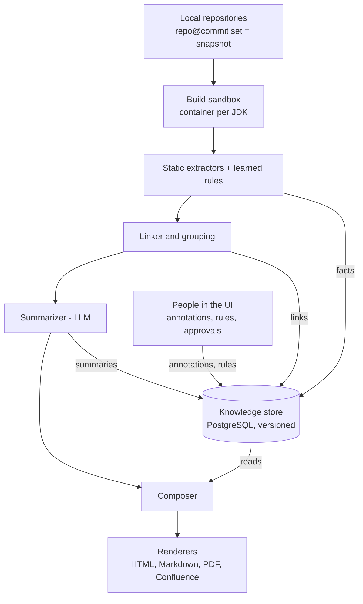

# Lantern — Design Document

Oct 27, 2026

## Overview

Lantern is a hosted service that analyzes a set of local Java repositories, builds a versioned knowledge model of the system they form, and generates architecture documents for different audiences from that model.

**Problem.** We work in a very complex ecosystem of microservices and libraries with little trustworthy documentation. The wiki exists but can't be relied on. Onboarding is slow, and architecture reviews depend on whoever happens to remember how things connect.

**Goals**

- Produce architecture documents for audiences from executives to lead architects, at the granularity each needs.
- Document repos individually, as one system, or as automatically discovered groups of related components.
- Get as much as possible from static analysis, with an LLM filling the gaps static analysis can't.
- Persist knowledge tied to exact repo versions, so later runs reuse it and update only what changed.
- Capture tribal knowledge, and control over how documents look, through annotations stored in the service.
- Keep document layout stable across versions, changing only what the changes require.
- Make single-file HTML the primary output, with other formats supported.

**Non-goals (for now)**

- Fetching repos from remote providers. Repos are cloned onto the host.
- Trusting the existing wiki. Code is the source of truth, READMEs are low-trust supporting evidence, and annotations add what code can't show.
- Non-JVM application languages as a first-class target, beyond config, SQL and build files.

## Design principles

The knowledge model is the product. Documents are views of it.

1. **Code is the source of truth.** Static analysis comes first. The LLM fills gaps and never overrides evidence from code.
2. **Every claim has provenance.** Each fact records where it came from (static extractor, LLM, human, README), at which commit, and with what confidence. Documents can trace any statement back to its evidence.
3. **Stable identity everywhere.** Entities have semantic IDs (`service:orders`, `topic:kafka:order-created`) that survive refactors. Annotations, layouts and caches all key on these IDs.
4. **Reproducible outputs.** A document is fully determined by code snapshot + annotation revision + tool version + template version.
5. **Incremental by construction.** Everything derived (facts, summaries, layouts, prose) records its inputs, so only what's affected by a change is recomputed.
6. **Stability over freshness in presentation.** Layouts, colors and prose persist across runs and change only as much as the underlying change requires.
7. **Humans can override anything, explicitly and with an audit trail.** Corrections and presentation rules are stored in the service with a full audit log. Nothing a human sets is silently discarded.
8. **Open vocabulary, stable core.** The fact envelope rarely changes. Entity and relationship types are data and can grow without a release.

## Architecture overview

Seven stages run in order for each snapshot, and every stage reads from or writes to one versioned knowledge store in PostgreSQL. People add annotations and presentation rules to the same store, so the composer sees code facts and human knowledge together.



Only the composer decides what a document says. Renderers just format its output, which keeps new output formats cheap to add.

## Ingestion and build sandbox

Repos are cloned onto the service host, and each analysis builds them for real in an isolated container, because accurate Java analysis needs the code as it actually compiles.

**Repository registry**

- Each repo is registered with a local path on the host (or a clone URL the host pulls from), a default branch, and optional per-repo settings (JDK version, Maven profiles, modules to skip).
- An analysis run targets a specific commit per repo. The set of `repo@commit` pairs is a **snapshot** (see Versioning).
- Git credentials for pulling live on the host, outside the knowledge store.

**Build sandbox**

- One container per repo build, run with Docker or Podman on the single VM.
- Images per JDK (8, 11, 17, 21, 25). The JDK is detected from `maven.compiler.release` / `source` / toolchains, with a per-repo override.
- A mounted `settings.xml` gives access to the internal Nexus or Artifactory.
- A shared, persistent local Maven repository cache across builds, for speed.
- The build runs to `compile` (which includes `generate-sources` and annotation processing), with tests skipped. The outputs the analyzer needs are the resolved classpath, generated sources and compiled classes.
- Resource limits (CPU, memory, timeout) per container, and a concurrency limit for the VM.
- **Fallback:** if a build fails, analysis continues in degraded mode (source parsing with whatever classpath resolves), and the affected facts are marked lower-confidence.

**What leaves the sandbox:** classpath, generated sources, class files and build metadata (effective POM, dependency tree, module graph). No network access from the build except to the artifact repository. How the sandbox enforces this, chooses the JDK and stores outputs is in ADR 0005.

## Static analysis and extractors

Extractors are plugins that read build outputs and source files and emit facts. Static analysis is expected to produce most of the knowledge, with the LLM covering what remains.

**Extractor contract**

- Input: a repo build workspace (sources, generated sources, classpath, class files, build metadata) plus the files the extractor declares interest in (by glob or type).
- Output: facts in the core envelope (see Knowledge model), each carrying the extractor's name and version.
- Two ways to plug in:
  - **In-process Java SPI** for core extractors (fast, shares parsed ASTs).
  - **Out-of-process protocol**: JSON over stdio, LSP-style, for extractors in other languages and for sandboxed learned scripts.
- Extractors are deterministic: same input files and extractor version give the same facts. This is what makes caching safe.

**Initial extractors**

| Extractor | Reads | Produces |
| --- | --- | --- |
| Maven | Effective POM and reactor (POMs as written when there is no effective POM) | Modules, artifacts, internal vs. third-party dependencies, deployable vs. library, and the library a thin service packages |
| Java structure | javac Tree API with symbol resolution (JavaParser as fallback) | Packages, types, members, inheritance, resolved call graph |
| Spring / Jakarta | Annotations and bean definitions | Controllers and endpoints, beans, configuration, `@Scheduled` jobs, profiles |
| HTTP clients | Feign, RestTemplate, WebClient, JAX-RS clients | Outbound calls with target URLs or property keys |
| Messaging | Kafka, JMS, RabbitMQ listeners and templates | Topics and queues produced and consumed |
| Persistence | JPA entities, repositories, JDBC templates | Entities, tables touched, datasource bindings |
| Config | `.properties`, `.yml`, Spring profiles, env-var placeholders | Resolved and unresolved config values per profile |
| SQL | Flyway and Liquibase migrations, `.sql` files (JSqlParser) | Schema as of the commit: tables, columns, keys |
| README | Markdown in the repo | Low-trust "documented claims", checked against code |

Later: Dockerfiles, Helm and Kubernetes manifests, OpenAPI and AsyncAPI specs, Terraform.

How the Maven extractor names entities, tells internal from third-party dependencies and links a thin service to its library is in ADR 0006.

**Why javac instead of only a parser:** production Spring code relies on Lombok, MapStruct and generated OpenAPI or Protobuf clients. Analyzing through the compiler, with annotation processing on, sees generated members and resolves calls exactly as the build does.

## Knowledge model and schema evolution

The schema has two layers: a small, stable **core envelope** that is code and changes only with a release, and an open **vocabulary** of entity and relationship types that is data and can grow at runtime without a release.

**Core envelope** (every fact has this shape)

| Field | Meaning |
| --- | --- |
| `id` | Content-derived fact ID |
| `subject` | Stable entity ID, e.g. `service:orders` |
| `predicate` | Relationship or attribute type, e.g. `CONSUMES`, `owner` |
| `object` | Entity ID or typed value |
| `attributes` | JSONB, validated against the vocabulary's definition for this type |
| `origin` | `static` / `llm` / `human` / `readme` / `rule`, plus extractor, model or user details |
| `evidence` | Repo, commit, file, line range, file content hash |
| `confidence` | 0–1 |
| `validity` | Snapshot range in which the fact holds |

**Vocabulary registry** (stored in the database)

- Defines entity types (`service`, `library`, `topic`, `table`, `batch-job`) and relationship types (`CALLS`, `CONSUMES`, `READS_TABLE`).
- Each type has a **parent type**, an attribute schema, a C4 level, and default presentation (shape, icon).
- Parent types mean a new type renders and behaves sensibly before any code knows about it. A new `batch-job` type that extends `component` appears in diagrams and documents as a component immediately.
- New types can come from plugins, learned rules (through the approval flow), or administrators in the UI. Every change is versioned and in the audit log.

**Do schema changes need a release?**

| Change | Release needed? |
| --- | --- |
| New entity, relationship or attribute type | No, it's a vocabulary entry |
| New learned rule producing new types | No, it goes through approval |
| Deprecating or renaming a type | No, an alias maps old to new; existing facts are migrated in the background |
| A template component that renders a new type specially | Yes for the component, but the type works with its parent's rendering until then |
| A new built-in extractor | Yes, unless it's an out-of-process plugin |
| Changing the core envelope | Yes, with a Flyway database migration |

**Versioning rules:** additive vocabulary changes are always allowed. Renames and removals go through deprecation with an alias. Each snapshot and document records the vocabulary revision it used, so older documents stay reproducible. Plugins declare which envelope version range they support.

**Typed access:** Java types for the envelope and built-in types are hand-written and kept in line with the JSON Schema by tests; TypeScript types are generated from the schema. Runtime-added types are accessed through a generic API.

**Storage:** PostgreSQL. Facts in one wide table with JSONB attributes and indexes on subject, predicate, object and snapshot range. The graph for analysis is loaded into memory per scope.

## Versioning and incremental computation

Lantern works like a build system: every derived artifact records its inputs, and a new run recomputes only what a change actually affects. "Rebuild from scratch" and "update where needed" are the same mechanism with the cache on or off.

**Snapshots**

- A snapshot is a numbered set of `repo@commit` pairs, plus the vocabulary revision, annotation revision and tool version used. Snapshots are numbered 1, 2, 3 and so on in creation order, because fact validity is a range of snapshot numbers.
- Every document is tied to exactly one snapshot.
- Only one analysis runs at a time. Starting one takes a PostgreSQL advisory lock, held on one database connection until the analysis ends; a second start fails at once with an "analysis already running" error, even from another Lantern process on the same database. If the process dies, the connection drops and the lock is released.

**Cache keys**

| Artifact | Keyed by |
| --- | --- |
| Build outputs | Repo commit + JDK image + `settings.xml` hash |
| Static facts | File content hash + extractor name and version |
| Linked graph | Set of fact IDs in scope + linker version |
| LLM summaries | Hash of input facts + child summaries + prompt version + model |
| Layouts | Diagram ID; updated incrementally, never recomputed by default |
| Document prose | Hash of the facts a section draws from + template version |

**On a new snapshot**

1. Diff each repo's commit against the previous snapshot to find changed files.
2. Rebuild only repos whose commit changed.
3. Re-run extractors only on changed files. Unchanged files reuse cached facts.
4. Re-link the graph and find which entities changed.
5. Invalidate summaries whose input facts changed, then walk up the hierarchy (class to package to module to service to group to system), regenerating only invalidated nodes.
6. Recompose only document sections whose inputs changed. Unchanged sections keep their exact text.

**Architecture diff.** Because both snapshots are fully materialized, comparing them is a query: entities and relationships added, removed or changed. This feeds the Change Report template and the change overlay on diagrams.

**Retention.** Snapshots that documents reference are kept. Intermediate build outputs can be pruned; facts are small enough to keep.

## Cross-repo linking, scoping and grouping

The linker turns per-repo facts into one system graph by matching what one repo exposes with what another uses. Scopes and groups then decide which part of that graph a document covers.

**Linking rules**

| Link | Matched by |
| --- | --- |
| Library dependency | Maven coordinates of internal artifacts |
| HTTP call | Resolved client URL or property key against service base URLs and endpoint paths |
| Messaging | Topic or queue names, produced vs. consumed |
| Shared database | Datasource URLs and table names |
| Shared config | Common property keys and config servers |

Links that static matching can't resolve (a URL assembled from several properties and an env var, for example) go to the LLM resolver with the candidate facts. If it's still unresolved, the link goes to the questions queue.

**Scope modes**

- **Per repo:** each repo is its own scope.
- **System:** all repos in the snapshot form one scope.
- **Auto-grouped:** the tool proposes groups, and each group is a scope.
- **Custom:** any saved selection of entities, using the same selectors as presentation rules.

**Auto-grouping**

1. Build a weighted graph. Edge weights reflect coupling strength: synchronous calls and shared tables weigh more than library use of a common utility.
2. Exclude ubiquitous libraries (logging, commons) from the weights so they don't pull everything into one cluster.
3. Run Leiden community detection (the CWTS Java implementation).
4. The LLM names and describes each cluster from its members' summaries.
5. Groups are stored as entities. Users can rename them, move members, pin them or dissolve them. Those changes are knowledge annotations and survive re-clustering.

On later snapshots, clustering is seeded with the previous groups so membership stays stable unless coupling has really changed.

## LLM integration

The LLM handles understanding that static analysis can't provide, always working from extracted facts and real code, never from memory alone. Providers are configurable against the OpenAI or Anthropic API formats.

**Roles** (most frequent first)

| Role | Input | Output |
| --- | --- | --- |
| Summarize | A code unit's facts, source excerpts, child summaries | Hierarchical summaries at each level |
| Resolve | Ambiguous facts plus tools to query the graph and read files | New facts with `origin=llm` and a confidence |
| Infer intent | Service summaries, README claims, glossary | Responsibilities, domain role |
| Name groups | Cluster members' summaries | Group name and description |
| Propose rules | Repeated unresolved patterns | Declarative extractor rules (see Learned rules) |
| Compose | Document model plus facts in scope | Narrative sections for an audience |
| Translate | A user's natural-language instruction | A structured annotation or presentation rule |

**Models (Anthropic):** Claude Sonnet for the high-volume roles (Summarize, Name groups, Compose, Translate); Claude Opus for the reasoning-heavy ones (Resolve, Infer intent, Propose rules).

**Provider interface**

- A thin Java interface over the official Anthropic and OpenAI SDKs, with an OpenAI-compatible endpoint option for gateways.
- **Capability flags** per configured model: tool use, structured output, prompt caching, context window, cost per token. Callers check capabilities instead of assuming them.
- Different models can be set per role, for example a cheaper model for leaf summaries and a stronger one for composition.

**Grounding**

- Every LLM output must cite the fact IDs or file ranges it used. Outputs without citations are rejected or marked low-confidence.
- The glossary (from annotations) is included in prompts.

**Cost and reliability**

- Results are cached by input hash, so unchanged code is never summarized twice.
- Per-run and per-scope token budgets, with an estimate shown before a run starts.
- Calls run in parallel on virtual threads, with rate limiting and retry with backoff per provider.

## Learned rules (self-improving extractors)

When the LLM keeps resolving the same in-house pattern, it proposes a declarative rule so static analysis handles that pattern from then on. Low-risk rules are approved automatically; the rest wait for a human.

**Rule format.** Declarative, not arbitrary code. For example: "a method annotated `@AcmeEventHandler` consumes the Kafka topic named by its `topic` attribute." Rules match on annotations, types, call signatures, config keys and file patterns, and emit facts in the core envelope. Sandboxed scripts through the out-of-process protocol are a later option.

**Lifecycle:** proposed, then tested, then risk-assessed, then auto-approved or queued for review, then active. A rule can be retired at any time.

**Risk assessment.** The LLM's own assessment is one input, combined with objective signals:

| Signal | Low risk when |
| --- | --- |
| Test result | The rule reproduces every example that motivated it |
| Blast radius | It adds few facts, and changes or removes none |
| Conflicts | It contradicts no static or human fact |
| Vocabulary | It introduces no new types |
| LLM assessment | The model rates it low risk with a stated reason |

All low: auto-approved and logged. Any other result: queued in the UI with the evidence. Administrators can bypass the review step per rule or turn auto-approval off entirely.

**Clean retraction.** Every fact records the rule and rule version that produced it. Retiring a rule removes its facts and invalidates everything derived from them through the normal incremental mechanism.

## Annotations: knowledge layer

Knowledge annotations are human-supplied facts. They are stored only in the service database, tied to the signed-in user, and never written into repositories. They add the tribal knowledge code can't show and correct what the tool got wrong.

**Kinds**

| Kind | Example | Effect |
| --- | --- | --- |
| Correction | "orders calls billing-v2, not billing-v1" | Overrides or suppresses a fact, everywhere |
| Addition | "A mainframe batch job calls this endpoint nightly" | Adds facts no repo contains, such as external systems |
| Context | "Being decommissioned Q3; replaced by ledger-service" | Narrative attached to an entity |
| Metadata | Owner team, criticality, lifecycle, PII handling | Structured attributes for filtering, selectors and views |
| Grouping | "These six services are the Pricing domain" | Pins or overrides auto-grouping |
| Glossary | "RTP = Real-Time Pricing engine" | Included in every LLM prompt |
| Exclusion | "Ignore `test-harness/` and generated code" | Removes noise before analysis |
| Answer | A reply to a question from the questions queue | Becomes a fact, usually an addition or correction |

**Anchoring.** Annotations attach to stable entity IDs, never file lines. If the anchored entity disappears, the annotation becomes **orphaned**. The tool tries rename detection (same shape, new name) and the LLM can suggest the new anchor; a human confirms. Orphaned annotations are never dropped silently.

**Staleness.** Each annotation records the snapshot it was made against. On later snapshots:

- Evidence unchanged: applied.
- Evidence the annotation depends on has changed (for example, "orders has no DB writes", but a new commit adds a JPA repository): marked **needs review**, and the conflict is shown in documents.
- Anchor gone: **orphaned**.

States: active, needs review, orphaned, retired. Precedence is human, then static, then LLM, but only while the evidence the human saw is unchanged.

**Questions queue.** When confidence is low or analysis hits a dead end, the tool asks a question in the UI, for example "Topic `inventory-sync` is produced but nothing in the analyzed repos consumes it. What does?" Questions are routed to the owners of the entities involved where owners are known.

**Storage and audit.** Annotations are append-only events: create, edit, confirm, retire, each with user and time. The audit log is that event stream, and any past annotation state can be rebuilt for reproducing an old document.

**READMEs and the wiki.** README content becomes low-trust "documented claims". Claims that contradict code are flagged, for example "README says MySQL, code connects to Postgres". The wiki is not ingested.

## Annotations: presentation layer

Presentation rules control how knowledge is shown without changing what is true. Any departure from default document behavior can be expressed as a rule.

**Knowledge vs. presentation.** "Don't show this" can mean two things. "This is wrong" is a knowledge correction, so it disappears everywhere. "This is noise here" is a presentation rule, so the fact stays true but is hidden in that scope. The UI always makes the user choose, so tidying an exec report never deletes knowledge by accident.

**Rule shape: selector + properties + scope**, like CSS.

```yaml
- selector: "type:service"
  style: { fill: blue }
- selector: "type:database"
  style: { fill: orange }
- selector: "id:service:a, id:service:b, id:service:c"
  group: { label: "Checkout", box: true }
- selector: "lifecycle:deprecated"
  style: { opacity: 0.5, badge: "deprecated" }
- selector: "id:lib:commons-utils"
  visibility: hidden
  scope: { audience: executive }
```

- **Selectors** match by ID, type (including parent types), group, tag or any attribute. Rules written against types keep working as the system grows: a new database added next month is orange automatically.
- **Properties** cover visibility, grouping and boxes, color, shape, icon, labels and renames, emphasis, level of detail ("collapse library internals"), layout hints ("A left of B", "databases at the bottom"), section order and inclusion, and tone and terminology for generated text.
- **Scopes**, from least to most specific: default theme, audience profile, document, diagram, single element. The most specific rule wins.

**Shared and personal.** Rules on a shared document apply to everyone and need edit rights on that document. Anyone can add a **personal overlay** that changes only their own view.

**Three ways to create a rule**, all stored the same way:

1. **Natural language:** "group A, B and C together". The LLM translates it into a structured rule, shows it back with its scope for confirmation, and the structured rule is stored. The original wording is kept in the audit log. Prose is never re-interpreted on later runs.
2. **Direct manipulation** in the diagram UI: drag, hide, group, recolor.
3. **A rule editor** for exact control.

**Explainability.** A "why does this look like this?" inspector, like a browser's computed-styles panel: "Hidden by rule #12 (set by User, 3 Oct, scope: executive)."

Presentation rules follow the same lifecycle as knowledge annotations: anchored to stable IDs, versioned, audited, and flagged as orphaned when their target disappears.

## Composition, layout stability and prose stability

Composition decides what a document says and shows; rendering only formats it. Composition takes the previous rendition as an input, so a rerun on the same or slightly changed knowledge produces the same or a slightly changed document.

**Composer inputs:** knowledge in scope (at the snapshot), the view definition, presentation rules, and the previous rendition (layout state, prior prose, color assignments). **Output:** a format-neutral document model of sections, diagrams, tables, callouts and cross-references, each element linked to the fact IDs it came from.

**View definitions.** A persisted spec per document: scope, audience profile, template, sections and diagrams. Regenerating a document means applying the same view definition to a new snapshot, so its structure doesn't depend on the LLM's choices each run.

**Granularity through hierarchical summaries**

| Level | Typical audience | Content |
| --- | --- | --- |
| L0 | Executive | The system on a page: capabilities, key dependencies, risks |
| L1 | Architect, new engineer | Groups, services, how they communicate, data stores |
| L2 | Engineer | Inside a service: modules, APIs, entities, config |
| L3 | Deep dive | Packages, key classes, flows |

Audience profiles choose levels, sections and tone. One HTML file can embed several levels and let the reader switch between them.

**Layout stability**

- Node positions are stored per diagram, keyed by entity ID.
- On later runs, existing nodes keep their positions and only new nodes are placed, using ELK's incremental layout around the fixed nodes.
- Removed nodes leave a gap.
- When a change passes a threshold (default 10 new nodes in one diagram, configurable per instance and per view), automatic re-layout is allowed, but **positions pinned by users never move**. Only tool-placed nodes are rearranged.
- Inputs are sorted by stable ID and no algorithm uses random seeds, so a run on identical input gives identical output.
- Colors are assigned once and persisted per entity unless a rule says otherwise.
- Dragging a node saves a pinned-position rule, recorded in the audit log.

**Prose stability**

- A section whose input facts are unchanged reuses its exact text.
- A section whose inputs changed is regenerated from the previous text plus the fact diff, with the LLM asked for a minimal edit rather than a rewrite. Documents then read as continuous across versions and diff cleanly.

**Change overlay.** Because layouts are stable, diagrams can show what changed between two snapshots: new elements highlighted, removed ones ghosted, changed relationships marked.

## Rendering and templates

Renderers turn the document model into a format and make no content decisions. Single-file HTML is the primary format. Markdown with Mermaid, PDF and Confluence follow as further renderers of the same model.

**Template structure**

- **Layout:** page structure, navigation, responsive behavior.
- **Theme tokens:** color, typography, spacing, density. Presentation rules override tokens instead of hard-coding styles.
- **Components:** diagram canvas (zoom, pan, minimap), entity card, dependency and API tables, schema view, change overlay, annotation callouts, provenance and confidence badges, glossary tooltips.

**Using the browser well**

- App-shell layout: navigation tree on the left (system, groups, services, modules), content and full-width diagrams in the center, and a context panel on the right with the selected entity's details, evidence and annotations.
- Responsive with CSS grid and container queries: three panes on wide screens, two on laptops, one pane with slide-out drawers on tablets and phones.
- Density toggle (comfortable or compact), granularity switch (L0 to L3), client-side search, deep links, light and dark themes, and a print stylesheet that makes PDF export largely free.
- Truly single-file: CSS, JS, diagram data and in-scope knowledge are inlined with no CDN, so it works offline and as an email attachment. Large scopes use lazy rendering and virtualized tables.

**Two modes, one codebase.** The same TypeScript components build the live hosted UI (editable: annotations, drag-to-pin, rule editing) and the exported file (read-only, with a "suggest a correction" link back to the service).

**Built-in templates**

| Template | Audience | Character |
| --- | --- | --- |
| Executive Brief | Leadership | One scroll, narrative-led, few large visuals, headline numbers and risks |
| Architecture Explorer | Architects, senior engineers | Dense, interactive app shell, everything navigable |
| Onboarding Guide | New engineers | Chapters, "start here", suggested reading paths |
| Service Datasheet | Anyone | One page per repo or service: APIs, dependencies, data, config, owners |
| Change Report | Reviewers | Snapshot-to-snapshot diff with the change overlay |

Templates are versioned. Upgrading a template doesn't change a published document's look until the owner opts in. Prototypes will be built against a realistic fictional dataset and refined from there, starting with Architecture Explorer and Executive Brief.

## Hosted service

Lantern runs as a single Spring Boot service on one VM, with PostgreSQL for all persistent state and Docker or Podman for build sandboxes. Repos are cloned on the same host.

**Components on the VM**

| Component | Responsibility |
| --- | --- |
| API and UI server | REST API, serves the web UI, auth, permissions |
| Job scheduler and workers | Analysis runs as resumable jobs: build, extract, link, summarize, compose, render |
| Build sandbox runner | Starts and limits build containers, collects outputs |
| PostgreSQL | Facts, vocabulary, snapshots, annotations and audit events, layouts, cached LLM results, documents |
| Workspace storage | Repo clones, Maven cache, build outputs, rendered files |

**Jobs.** Each stage is a persisted job step, so a failed or interrupted run resumes from the last completed step. Progress and estimated LLM cost are visible in the UI.

**Users and permissions**

- Every user signs in. The identity provider is chosen in the application properties with lantern.auth.provider: keycloak (OIDC via Spring Security's OAuth2 client; issuer URI, client id and secret as properties) or ldap (Spring Security LDAP bind against the directory; URL, base DN, user and group search filters as properties). Keycloak realm roles or LDAP groups map to Lantern roles through a configurable mapping. Local accounts remain as a fallback.
- Roles: viewer, contributor (annotate, answer questions), document owner (edit shared presentation rules), administrator (repos, vocabulary, rule approval, providers).
- Every write is an audit event with user and time.

**Security**

- LLM API keys and git credentials are stored encrypted, outside the fact tables.
- Build containers have network access only to the artifact repository.
- Code sent to the LLM is limited to what each task needs, and every call is logged with its purpose.

**Scaling path.** A single VM is enough to start. Workers and build runners are separate within the codebase, so they can move to their own machines later without redesign.

## Technology stack

The backend is Java 21+ on Spring Boot because the hardest part, Java analysis, depends on JVM libraries, and the target ecosystem and its maintainers are Java. The frontend is TypeScript because it runs in the browser.

| Area | Choice |
| --- | --- |
| Backend language and framework | Java 21+, Spring Boot, virtual threads |
| Database and migrations | PostgreSQL, Flyway |
| Java analysis | javac Tree API with annotation processing; JavaParser with symbol solver as fallback |
| Maven | Maven Resolver and Maven Model; `mvn` run inside build containers |
| SQL | JSqlParser; Flyway and Liquibase changelog parsing |
| Graph and clustering | In-memory graph; Leiden (CWTS Java implementation); JGraphT for algorithms |
| Diagram layout | ELK in Java on the server; elkjs in the browser (same engine) |
| LLM access | Official Anthropic and OpenAI Java SDKs behind a capability-aware interface |
| Build sandbox | Docker or Podman, per-JDK images |
| Frontend | TypeScript; a single component codebase built as the hosted app and as a single-file bundle |
| Shared schemas | JSON Schema for the fact envelope and document model; hand-written Java types checked against it by tests, generated TypeScript types |

## Phasing

Each phase delivers something usable on real repos. The knowledge model and stable IDs come first because everything later depends on them.

1. **Foundation:** a single repo through to a real document.
   - Repo registry, build sandbox, Maven and Java structure extractors
   - Fact store with envelope, vocabulary registry and snapshots
   - Bottom-up LLM summaries
   - Architecture Explorer and Executive Brief templates, single-file HTML, per-repo scope
2. **System view:** many repos as one system.
   - Spring, HTTP client, messaging, persistence, config and SQL extractors
   - Cross-repo linker and LLM resolver
   - System scope, audience profiles, granularity switch
3. **Living docs:** versions and human knowledge.
   - Incremental runs, architecture diff, Change Report template
   - Knowledge annotations, questions queue, audit log, sign-in and roles
   - Layout and prose stability
4. **Control:** presentation and grouping.
   - Presentation rules (natural language, direct manipulation, editor), personal overlays, inspector
   - Auto-grouping with Leiden
   - Onboarding Guide and Service Datasheet templates
5. **Self-improvement and reach:** learned rules and more formats.
   - Learned rules with risk assessment and approval
   - Markdown, PDF and Confluence renderers
   - Further extractors: Docker, Kubernetes, OpenAPI and AsyncAPI

## Open questions

- [x] Which identity provider will sign-in use (Azure AD / Entra ID, Okta, Keycloak, other)? Decided: Keycloak or LDAP, selectable by property (see Users and access).
- [x] Which in-house frameworks or annotations are most common, so extractors and early learned rules can target them? Decided: Spring Boot first; the Spring extractors take priority and early learned rules target Spring annotations.
- [x] Which LLM provider and models for the first deployment, and what monthly budget? Decided: Anthropic, $100/month budget. Sonnet for high-volume roles, Opus for reasoning-heavy ones (see LLM integration).
- [x] Rough scale for sizing the VM: number of repos and total lines of code in the first target set.

  Proposed open-source test set: [OpenWMS](https://openwms.github.io/org.openwms) (Apache-2.0; Spring Boot 4.1, Maven, one repo per service, shared org.openwms.parent POM, in-house ameba-lib, AMQP between services). Five services (common.service, tms.transportation, tms.routing, wms.receiving, core.uaa) plus about 10 shared libraries (core.util, core.units, core.test.arch, common.service.lib and other .lib modules).

  Decided: OpenWMS is the first target set. Measured from shallow clones on 27 Oct 2026: 15 repos, 958 Java files, about 57,000 non-blank lines of main code and 13,400 of test code, 14 MB on disk. There is no separate core.util repo. Four of the five service repos are thin (52–112 lines each) and mainly package their .lib artifact, so the Maven extractor must treat a service and its lib as one deployable. Host: the existing development VM (20 cores, 37 GB RAM with about 19 GB free, 106 GB free disk, Docker 29.9). That is enough for this set, with up to 4 build containers at 4 GB each. The repositories and their pinned commits are listed in `testsets/openwms/repos.txt`; `testsets/openwms/clone.sh` clones them into `workspace/openwms` (see ADR 0004).
- [x] Re-layout threshold: how many new nodes in one diagram before automatic re-layout? Decided: 10 by default, configurable.
- [x] Who are the first users, and which document do they need first? Decided: User is the first user. First outputs: C4 diagrams (context, container, component), sequence diagrams, dependency trees, and runtime environment details where the sources hold them.
