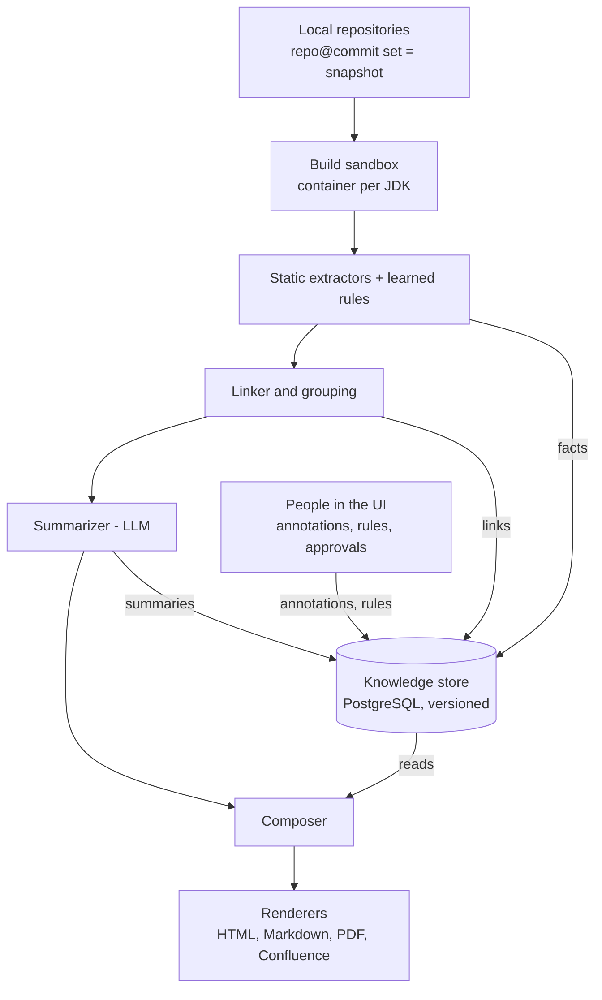

# Lantern — Design Document

Oct 27, 2026

## Overview

Lantern is a hosted service that analyzes a set of local Java repositories, builds a versioned knowledge model of the system they form, and generates architecture documents for different audiences from that model.

**Problem.** We work in a very complex ecosystem of microservices and libraries with little trustworthy documentation. The wiki exists but can't be relied on. Onboarding is slow, and architecture reviews depend on whoever happens to remember how things connect.

**Goals**

- Produce architecture documents for audiences from executives to lead architects, at the granularity each needs.
- Document repos individually, as one system, or as automatically discovered groups of related components.
- Get as much as possible from static analysis, with an LLM filling the gaps static analysis can't.
- Persist knowledge tied to exact repo versions, so later runs reuse it and update only what changed.
- Capture tribal knowledge, and control over how documents look, through annotations stored in the service.
- Keep document layout stable across versions, changing only what the changes require.
- Make single-file HTML the primary output, with other formats supported.

**Non-goals (for now)**

- Fetching repos from remote providers. Repos are cloned onto the host.
- Trusting the existing wiki. Code is the source of truth, READMEs are low-trust supporting evidence, and annotations add what code can't show.
- Non-JVM application languages as a first-class target, beyond config, SQL and build files.

## Design principles

The knowledge model is the product. Documents are views of it.

1. **Code is the source of truth.** Static analysis comes first. The LLM fills gaps and never overrides evidence from code.
2. **Every claim has provenance.** Each fact records where it came from (static extractor, LLM, human, README), at which commit, and with what confidence. Documents can trace any statement back to its evidence.
3. **Stable identity everywhere.** Entities have semantic IDs (`service:orders`, `topic:kafka:order-created`) that survive refactors. Annotations, layouts and caches all key on these IDs.
4. **Reproducible outputs.** A document is fully determined by code snapshot + annotation revision + tool version + template version.
5. **Incremental by construction.** Everything derived (facts, summaries, layouts, prose) records its inputs, so only what's affected by a change is recomputed.
6. **Stability over freshness in presentation.** Layouts, colors and prose persist across runs and change only as much as the underlying change requires.
7. **Humans can override anything, explicitly and with an audit trail.** Corrections and presentation rules are stored in the service with a full audit log. Nothing a human sets is silently discarded.
8. **Open vocabulary, stable core.** The fact envelope rarely changes. Entity and relationship types are data and can grow without a release.

## Architecture overview

Seven stages run in order for each snapshot, and every stage reads from or writes to one versioned knowledge store in PostgreSQL. People add annotations and presentation rules to the same store, so the composer sees code facts and human knowledge together.



Only the composer decides what a document says. Renderers just format its output, which keeps new output formats cheap to add.

## Ingestion and build sandbox

Repos are cloned onto the service host, and each analysis builds them for real in an isolated container, because accurate Java analysis needs the code as it actually compiles.

**Repository registry**

- Each repo is registered with a local path on the host (or a clone URL the host pulls from), a default branch, and optional per-repo settings (JDK version, Maven profiles, modules to skip).
- An analysis run targets a specific commit per repo. The set of `repo@commit` pairs is a **snapshot** (see Versioning).
- Git credentials for pulling live on the host, outside the knowledge store.

**Build sandbox**

- One container per repo build, run with Docker or Podman on the single VM.
- Images per JDK (8, 11, 17, 21, 25). The JDK is detected from `maven.compiler.release` / `source` / toolchains, with a per-repo override.
- A mounted `settings.xml` gives access to the internal Nexus or Artifactory.
- The Maven repositories builds may download from are configured per analysis (`lantern.sandbox.maven-repositories`, an id and URL each, exact locations, no wildcards); Maven Central alone by default. Test sets name extra ones in their own settings. Downloads are only used to compile; third-party code is never analyzed.
- Optionally, one Maven mirror (`lantern.sandbox.maven-mirror`, an id and URL) stands in for every repository: all downloads of a build, dependencies and plugins alike, go through it, and it is then the only host builds reach. Unlike the repositories, it may be plain `http` and a private-network IPv4 address, so a caching proxy on the local network can serve builds. Its address is the host's own setting, kept in a properties file outside the repository.
- A shared, persistent local Maven repository cache across builds, for speed.
- A snapshot's repositories are built in the order of their internal Maven dependencies, and each build gets, read-only, the artifacts (POMs and jars of compiled classes) of the successful builds of the repositories it depends on, so a repository can use a library or parent POM another repository builds. They never enter the shared cache, so builds of other snapshots cannot pick them up. Repositories that depend on each other are built as if alone.
- The build runs to `compile` (which includes `generate-sources` and annotation processing), with tests skipped. The outputs the analyzer needs are the resolved classpath, generated sources and compiled classes.
- Resource limits (CPU, memory, disk, timeout) per container, builds run as a non-root user, and a concurrency limit for the VM.
- **Fallback:** if a build fails, analysis continues in degraded mode (source parsing with whatever classpath resolves), and the affected facts are marked lower-confidence.

**What leaves the sandbox:** classpath, generated sources, class files and build metadata (effective POM, dependency tree, module graph). No network access from the build except to the configured artifact repositories, or to the mirror when one is set. How the sandbox enforces this, chooses the JDK and stores outputs is in ADR 0005; the build user and disk limit are in ADR 0019; removing what killed builds leave is in ADR 0053; the configured repositories are in ADR 0023; the mirror is in ADR 0030; the build order and other repositories' artifacts are in ADR 0041.

## Static analysis and extractors

Extractors are plugins that read build outputs and source files and emit facts. Static analysis is expected to produce most of the knowledge, with the LLM covering what remains.

**Extractor contract**

- Input: a repo build workspace (sources, generated sources, classpath, class files, build metadata) plus the files the extractor declares interest in (by glob or type).
- Output: facts in the core envelope (see Knowledge model), each carrying the extractor's name and version.
- Two ways to plug in:
  - **In-process Java SPI** for core extractors (fast, shares parsed ASTs).
  - **Out-of-process protocol**: JSON over stdio, LSP-style, for extractors in other languages and for sandboxed learned scripts.
- Extractors are deterministic: same input files and extractor version give the same facts. This is what makes caching safe.

**Initial extractors**

| Extractor | Reads | Produces |
| --- | --- | --- |
| Maven | Effective POM and reactor (POMs as written when there is no effective POM) | Modules, artifacts, internal vs. third-party dependencies, deployable vs. library, the library a thin service packages, and each module's parent and Java release |
| Java structure | javac Tree API with symbol resolution (JavaParser as fallback) | Packages, types, members, inheritance, resolved call graph |
| Spring / Jakarta | Annotations, including meta-annotations (a custom annotation carrying `@RestController` or `@Service` counts as one), and bean definitions | Application main classes, controllers and endpoints, beans by stereotype, configuration, `@Scheduled` jobs, `@Profile` gates |
| HTTP clients | Feign, Spring HTTP interfaces (`@HttpExchange`), RestTemplate, RestClient, WebClient, JAX-RS and MicroProfile clients, `java.net.http`, OkHttp and Apache HttpClient | Outbound calls with target service name, URL or property key, and path. The caller of a client interface is the code that enables or injects it, not the jar that defines it |
| Messaging | Kafka, JMS, RabbitMQ listeners and templates; Spring Cloud Stream bindings and `StreamBridge` | Topics, exchanges, queues, bindings and routing keys produced and consumed |
| Persistence | JPA entities, repositories, JDBC templates | Entities, tables touched, datasource bindings |
| Config | `.properties`, `.yml` (`application*` and `bootstrap*`), Spring profiles, env-var placeholders | Resolved and unresolved config values per profile, including `spring.application.name` |
| SQL | Flyway and Liquibase migrations, `.sql` files (JSqlParser) | Schema as of the commit: tables, columns, keys |
| README and ADR | Markdown READMEs and architecture decision records in the repo | Low-trust "documented claims", checked against code; observed decisions with title, status, date and rationale |

**Following values.** Paths, queue, exchange and topic names and routing keys are rarely literals where they are used. Extractors resolve `${...}` placeholders against config per profile, fold constants, and follow a value one hop from a `@Value` field or constructor argument into the template or client call that uses it. A value that can't be resolved keeps its placeholder key, which still says what it is.

Later: Dockerfiles, Helm and Kubernetes manifests, OpenAPI and AsyncAPI specs, Terraform.

How the Maven extractor names entities, tells internal from third-party dependencies and links a thin service to its library is in ADR 0006.

How the Java structure extractor names packages, types and members, which annotation processors it runs, which calls it keeps and how its parsing fallback matches the compiler is in ADR 0007; calls to methods a type inherits from third-party code, such as a Spring Data repository's `save`, are in ADR 0049.

Which config files the Config extractor reads, in what order, how it models profiles and placeholders, and how it keeps secrets out of its facts is in ADR 0032.

Which files the README and ADR extractor reads, which decision record formats it understands, and the facts and confidence it gives claims and decisions is in ADR 0033.

Which migrations and SQL files the SQL extractor reads, in what order, and how it names and models schemas, tables, columns and keys is in ADR 0034.

How the Spring / Jakarta extractor reads annotations and meta-annotations through the Java extractor's reading of the code, what facts it makes of stereotypes, main classes, endpoints, scheduled jobs and profile gates, and which config resolves their placeholders is in ADR 0035.

How the Persistence extractor finds entities, repositories and SQL in code, names the tables they touch, and records datasource URLs per profile without credentials is in ADR 0036.

Which listeners, templates and bindings the Messaging extractor reads, how it follows a name from a constant, a placeholder or a `@Value` into the call that uses it, and what facts it makes of listeners, sends and RabbitMQ bindings is in ADR 0037. How it reads Spring Cloud Stream, whose destinations come from config through bindings, into the same facts is in ADR 0040.

Which HTTP clients the HTTP client extractor reads, how it follows a URL one hop through the code, what facts it makes of calls and of the code that enables or injects a client, and what a recorded URL leaves out is in ADR 0038.

**Why javac instead of only a parser:** production Spring code relies on Lombok, MapStruct and generated OpenAPI or Protobuf clients. Analyzing through the compiler, with annotation processing on, sees generated members and resolves calls exactly as the build does.

## Knowledge model and schema evolution

The schema has two layers: a small, stable **core envelope** that is code and changes only with a release, and an open **vocabulary** of entity and relationship types that is data and can grow at runtime without a release.

**Core envelope** (every fact has this shape)

| Field | Meaning |
| --- | --- |
| `id` | Content-derived fact ID |
| `subject` | Stable entity ID, e.g. `service:orders` |
| `predicate` | Relationship or attribute type, e.g. `CONSUMES`, `owner` |
| `object` | Entity ID or typed value |
| `attributes` | JSONB, validated against the vocabulary's definition for this type |
| `origin` | `static` / `llm` / `human` / `readme` / `rule`, plus extractor, model or user details |
| `evidence` | Repo, commit, file, line range, file content hash |
| `confidence` | 0–1 |
| `validity` | Snapshot range in which the fact holds |

**Vocabulary registry** (stored in the database)

- Defines entity types (`service`, `library`, `topic`, `table`, `batch-job`) and relationship types (`CALLS`, `CONSUMES`, `READS_TABLE`).
- Each type has a **parent type**, an attribute schema, a C4 level, and default presentation (shape, icon). An attribute type can also set the kind of value its facts hold (its object kind).
- Saving a fact checks it against the vocabulary: its entities' types, its predicate, its object (an entity for a relationship, a value for an attribute, of the kind the attribute type sets) and its attributes (ADR 0002).
- Parent types mean a new type renders and behaves sensibly before any code knows about it. A new `batch-job` type that extends `container` appears in diagrams and documents as a container immediately.
- C4 levels follow the definitions under Diagrams in Composition: applications and jobs (deployable units, such as `service`), data stores, and queues and topics (`topic`) are containers; `library`, `module`, `package` and `table` (part of a data store) carry no C4 level; components are found by role, not from a type (#90).
- New types can come from plugins, learned rules (through the approval flow), or administrators in the UI. Every change is versioned and in the audit log. A type belongs to the source that first defined it, and another source that defines it differently is refused (ADR 0002).

**Do schema changes need a release?**

| Change | Release needed? |
| --- | --- |
| New entity, relationship or attribute type | No, it's a vocabulary entry |
| New learned rule producing new types | No, it goes through approval |
| Giving a type another parent, or none | No, it is a new vocabulary revision; older revisions keep the old parent |
| Deprecating or renaming a type | No, an alias maps old to new; existing facts are migrated in the background |
| A template component that renders a new type specially | Yes for the component, but the type works with its parent's rendering until then |
| A new built-in extractor | Yes, unless it's an out-of-process plugin |
| Changing the core envelope | Yes, with a Flyway database migration |

**Versioning rules:** additive vocabulary changes are always allowed, and so is giving a type another parent (or none), as a new revision that keeps stored facts valid, except that declaring a new attribute or object kind constrains new facts only (ADR 0002). Renames and removals go through deprecation with an alias. Each snapshot and document records the vocabulary revision it used, so older documents stay reproducible. Plugins declare which envelope version range they support.

**Typed access:** Java types for the envelope and built-in types are hand-written and kept in line with the JSON Schema by tests; TypeScript types are generated from the schema. Runtime-added types are accessed through a generic API.

**Storage:** PostgreSQL. Facts in one wide table with JSONB attributes and indexes on subject, predicate, object and snapshot range. The graph for analysis is loaded into memory per scope.

## Versioning and incremental computation

Lantern works like a build system: every derived artifact records its inputs, and a new run recomputes only what a change actually affects. "Rebuild from scratch" and "update where needed" are the same mechanism with the cache on or off.

**Snapshots**

- A snapshot is a numbered set of `repo@commit` pairs, plus the vocabulary revision, annotation revision and tool version used. Snapshots are numbered 1, 2, 3 and so on in creation order, because fact validity is a range of snapshot numbers.
- A snapshot always describes the whole system: a repo that a run does not analyze is carried forward at its commit in the latest snapshot that analyzed it (stored its facts), and its facts keep holding. A run only ends facts of the repos it re-extracted.
- Every document is tied to exactly one snapshot.
- Only one analysis runs at a time. Starting one takes a PostgreSQL advisory lock, held on one database connection until the analysis ends; a second start fails at once with an "analysis already running" error, even from another Lantern process on the same database. If the process dies, the connection drops and the lock is released.

**Cache keys**

| Artifact | Keyed by |
| --- | --- |
| Build outputs | Repo commit + JDK image + `settings.xml` hash |
| Static facts | File content hash + extractor name and version |
| Linked graph | Set of fact IDs in scope + linker version |
| LLM summaries | Hash of the prompt (the facts, source files and child summaries it shows, without fact IDs) + prompt version + model |
| LLM link resolutions | Hash of the prompt (the facts it shows, without fact IDs) + prompt version + model |
| LLM wordings of units | Hash of the prompt (the facts it shows, without fact IDs) + prompt version + model |
| Layouts | Diagram ID; updated incrementally, never recomputed by default |
| Document prose | Hash of the facts a section draws from + template version |

**On a new snapshot**

1. Diff each repo's commit against the previous snapshot to find changed files.
2. Rebuild only repos whose commit changed, or whose stored build failed (ADR 0016).
3. Re-run extractors only on changed files. Unchanged files reuse cached facts.
4. Re-link the graph and find which entities changed.
5. Invalidate summaries whose prompt changed (their facts, source files or child summaries), then walk up the hierarchy (class to package to module to service to group to system), regenerating only invalidated nodes.
6. Recompose only document sections whose inputs changed. Unchanged sections keep their exact text.

**Architecture diff.** Because both snapshots are fully materialized, comparing them is a query: entities and relationships added, removed or changed. This feeds the Change Report template and the change overlay on diagrams.

**Retention.** Snapshots that documents reference are kept. Intermediate build outputs can be pruned; facts are small enough to keep.

## Cross-repo linking, scoping and grouping

The linker turns per-repo facts into one system graph by matching what one repo exposes with what another uses. Scopes and groups then decide which part of that graph a document covers.

**Deployable units.** Before matching, the linker folds each deployable unit together: a service (or a library with a Spring Boot main class that no service packages) with the in-set libraries on its runtime classpath, its `spring.application.name` and its technology. These units are the containers of the diagrams, and a library's code runs as part of every unit that packages it. The linker derives its facts from everything that holds in the snapshot and records them for the whole snapshot, so a derived fact stops holding when what it came from changes, in whichever repository. Which facts the units get, and how their name, main class and technology are chosen, is in ADR 0039.

**Linking rules**

| Link | Matched by |
| --- | --- |
| Library dependency | Maven coordinates of internal artifacts |
| HTTP call | Client name (Feign `name`) against the target's `spring.application.name`, else resolved client URL or property key against service base URLs; then the path against the target's endpoints |
| Messaging | Topic, exchange or queue names and routing keys, produced vs. consumed, with AMQP topic wildcards (`order.*`) matched as the broker matches them |
| Shared database | Datasource URLs and table names |
| Shared config | Common property keys and config servers |

A link that holds only under a Spring profile records that profile. Service discovery, config servers and tracing are linked as infrastructure, not as business dependencies.

Links that static matching can't resolve (a URL assembled from several properties and an env var, for example) go to the LLM resolver with the candidate facts. If it's still unresolved, the link goes to the questions queue. What the resolver is shown, how its answer is checked, the confidence of what it picks and how answers are cached are in ADR 0045; tools to query the graph and read files come with #169, the questions queue with #170.

What the links look like (one relationship per call, send, datasource or setting between units and the topics, queues, exchanges, databases, brokers, external systems and infrastructure they reach, each with the facts on both ends, its protocol, its profile and a stable link ID), how profiles are applied, and how a library's code takes the config of each unit that bundles it are in ADR 0042.

**Scope modes**

- **Per repo:** each repo is its own scope.
- **System:** all repos in the snapshot form one scope.
- **Auto-grouped:** the tool proposes groups, and each group is a scope.
- **Custom:** any saved selection of entities, using the same selectors as presentation rules.

**Auto-grouping**

1. Build a weighted graph. Edge weights reflect coupling strength: synchronous calls and shared tables weigh more than library use of a common utility.
2. Exclude ubiquitous libraries (logging, commons) from the weights so they don't pull everything into one cluster.
3. Run Leiden community detection (the CWTS Java implementation).
4. The LLM names and describes each cluster from its members' summaries.
5. Groups are stored as entities. Users can rename them, move members, pin them or dissolve them. Those changes are knowledge annotations and survive re-clustering.

On later snapshots, clustering is seeded with the previous groups so membership stays stable unless coupling has really changed.

## LLM integration

The LLM handles understanding that static analysis can't provide, always working from extracted facts and real code, never from memory alone. Providers are configurable against the OpenAI or Anthropic API formats.

**Roles** (most frequent first)

| Role | Input | Output |
| --- | --- | --- |
| Summarize | A code unit's facts and child summaries; for a type, its whole source file with secrets masked; for a module or repository, a fact sheet of its parts | Hierarchical summaries at each level |
| Resolve | A link left open, its facts and its candidates' facts; later also tools to query the graph and read files (#169) | New facts with `origin=llm` and a confidence |
| Infer intent | A deployable unit's facts and README claims; a data store's or destination's facts and uses; a system's units' responsibilities with the facts they cite, and its README claims; the glossary once annotations exist | Responsibilities of units, components, data stores and destinations, intent of their links, domain role, a system's purpose |
| Name groups | Cluster members' summaries | Group name and description |
| Propose rules | Repeated unresolved patterns | Declarative extractor rules (see Learned rules) |
| Compose | Document model plus facts in scope; a main flow's traced facts | Narrative sections for an audience; a flow's walkthrough and pre- and post-conditions |
| Translate | A user's natural-language instruction | A structured annotation or presentation rule |

**Models (Anthropic):** Claude Sonnet for the high-volume roles (Summarize, Name groups, Compose, Translate); Claude Opus for the reasoning-heavy ones (Resolve, Infer intent, Propose rules).

**Provider interface**

- A thin Java interface over the official Anthropic and OpenAI SDKs, with an OpenAI-compatible endpoint option for gateways.
- **Capability flags** per configured model: tool use, structured output, prompt caching, context window, cost per token. Callers check capabilities instead of assuming them.
- Different models can be set per role, for example a cheaper model for leaf summaries and a stronger one for composition.

**Grounding**

- Every LLM output must cite the facts or summaries it used; a source file is cited through the fact observed in it. An output that fails its checks, for example one that cites nothing, is sent back once with the reason, and dropped if it fails again (see ADR 0010). A summary sentence that cites nothing is left out of the summary (ADR 0061).
- The glossary (from annotations) is included in prompts, once annotations exist (Phase 3).
- The LLM words what extraction found: names, the responsibility sentence of each element, the intent phrase of each relationship, a system's purpose and "start here". It never invents elements or relationships. Every box and line in a document comes from a static or rule fact, an annotation, or a Resolve result that picks among candidates the code shows.
- What code can't show (people, owners, rationale, quality goals, production topology) comes from annotations or README claims, or is stated once, plainly, as unknown. Business purpose comes from what people wrote (Lantern annotations, README claims, Javadoc) where there is any; otherwise it is inferred from the code and every document shows it as inferred, never as fact. Each summary's purpose sentence, and each responsibility sentence, is marked as evidenced or inferred.

How summaries are built bottom-up, cached and cited is in ADR 0010, and how their cache keys on the prompt in ADR 0055; how type prompts show their source files, and how a unit too large for one prompt is summarized in parts, is in ADR 0024; how secrets are masked in those files before they are sent is in ADR 0054; how module and repository prompts show a fact sheet of their parts' entry points, links, data stores and technology is in ADR 0057; how the prompt asks for plain, purpose-first wording at each level is in ADR 0025; how a summary marks its purpose as evidenced or inferred, and how documents show it, is in ADR 0059. How the LLM words the responsibility sentences of units and components and the intent phrases of their links, and how documents use them, is in ADR 0050; the responsibility sentences of databases, topics, queues, exchanges and external systems are in ADR 0056; how documents show a responsibility sentence that cites no README claim as inferred is in ADR 0063. How the LLM narrates each main flow, its walkthrough and pre- and post-conditions, from the facts of its trace is in ADR 0058. What Resolve is shown about a link left open, and how its answer is checked and cached, is in ADR 0045. How it words the system's purpose from its units' responsibility sentences and its README claims, and how the system's report marks a purpose inferred from the units, or states it as unknown, is in ADR 0060.

**Cost and reliability**

- Results are cached by what the model sees (prompt version, provider, model and prompt), so a commit that changes nothing a prompt shows makes no call.
- Per-run and per-scope budgets in tokens and dollars, with an estimate shown before a run starts (configured run budgets and the estimate are #42).
- Every call is logged with its role, purpose, model, tokens and cost.
- Tests never call a real provider: they use a fake or recorded responses (see ADR 0008).
- Calls run in parallel on virtual threads, with concurrency and rate limits per model and retry with backoff (see ADR 0021).
- Models that think by default can have thinking turned off or extra output room per model, and an answer cut off at its output limit is logged as such (see ADR 0022).

## Learned rules (self-improving extractors)

When the LLM keeps resolving the same in-house pattern, it proposes a declarative rule so static analysis handles that pattern from then on. Low-risk rules are approved automatically; the rest wait for a human.

**Rule format.** Declarative, not arbitrary code. For example: "a method annotated `@AcmeEventHandler` consumes the Kafka topic named by its `topic` attribute." Rules match on annotations, types, call signatures, config keys and file patterns, and emit facts in the core envelope. Sandboxed scripts through the out-of-process protocol are a later option.

**Lifecycle:** proposed, then tested, then risk-assessed, then auto-approved or queued for review, then active. A rule can be retired at any time.

**Risk assessment.** The LLM's own assessment is one input, combined with objective signals:

| Signal | Low risk when |
| --- | --- |
| Test result | The rule reproduces every example that motivated it |
| Blast radius | It adds few facts, and changes or removes none |
| Conflicts | It contradicts no static or human fact |
| Vocabulary | It introduces no new types |
| LLM assessment | The model rates it low risk with a stated reason |

All low: auto-approved and logged. Any other result: queued in the UI with the evidence. Administrators can bypass the review step per rule or turn auto-approval off entirely.

**Clean retraction.** Every fact records the rule and rule version that produced it. Retiring a rule removes its facts and invalidates everything derived from them through the normal incremental mechanism.

## Annotations: knowledge layer

Knowledge annotations are human-supplied facts. They are stored only in the service database, tied to the signed-in user, and never written into repositories. They add the tribal knowledge code can't show and correct what the tool got wrong.

**Kinds**

| Kind | Example | Effect |
| --- | --- | --- |
| Correction | "orders calls billing-v2, not billing-v1" | Overrides or suppresses a fact, everywhere |
| Addition | "A mainframe batch job calls this endpoint nightly" | Adds facts no repo contains, such as external systems |
| Context | "Being decommissioned Q3; replaced by ledger-service" | Narrative attached to an entity |
| Metadata | Owner team, criticality, lifecycle, PII handling | Structured attributes for filtering, selectors and views |
| Grouping | "These six services are the Pricing domain" | Pins or overrides auto-grouping |
| Glossary | "RTP = Real-Time Pricing engine" | Included in every LLM prompt |
| Exclusion | "Ignore `test-harness/` and generated code" | Removes noise before analysis |
| Answer | A reply to a question from the questions queue | Becomes a fact, usually an addition or correction |

**Anchoring.** Annotations attach to stable entity IDs, never file lines. If the anchored entity disappears, the annotation becomes **orphaned**. The tool tries rename detection (same shape, new name) and the LLM can suggest the new anchor; a human confirms. Orphaned annotations are never dropped silently.

**Staleness.** Each annotation records the snapshot it was made against. On later snapshots:

- Evidence unchanged: applied.
- Evidence the annotation depends on has changed (for example, "orders has no DB writes", but a new commit adds a JPA repository): marked **needs review**, and the conflict is shown in documents.
- Anchor gone: **orphaned**.

States: active, needs review, orphaned, retired. Precedence is human, then static, then LLM, but only while the evidence the human saw is unchanged.

**Questions queue.** When confidence is low or analysis hits a dead end, the tool asks a question in the UI, for example "Topic `inventory-sync` is produced but nothing in the analyzed repos consumes it. What does?" Questions are routed to the owners of the entities involved where owners are known.

**Storage and audit.** Annotations are append-only events: create, edit, confirm, retire, each with user and time. The audit log is that event stream, and any past annotation state can be rebuilt for reproducing an old document.

**READMEs and the wiki.** README content becomes low-trust "documented claims". Claims that contradict code are flagged, for example "README says MySQL, code connects to Postgres". The wiki is not ingested. Which claims are checked, how, and what a flag records is in ADR 0043; how documents show the flags is in ADR 0051.

## Annotations: presentation layer

Presentation rules control how knowledge is shown without changing what is true. Any departure from default document behavior can be expressed as a rule.

**Knowledge vs. presentation.** "Don't show this" can mean two things. "This is wrong" is a knowledge correction, so it disappears everywhere. "This is noise here" is a presentation rule, so the fact stays true but is hidden in that scope. The UI always makes the user choose, so tidying an exec report never deletes knowledge by accident.

**Rule shape: selector + properties + scope**, like CSS.

```yaml
- selector: "type:service"
  style: { fill: blue }
- selector: "type:database"
  style: { fill: orange }
- selector: "id:service:a, id:service:b, id:service:c"
  group: { label: "Checkout", box: true }
- selector: "lifecycle:deprecated"
  style: { opacity: 0.5, badge: "deprecated" }
- selector: "id:lib:commons-utils"
  visibility: hidden
  scope: { audience: executive }
```

- **Selectors** match by ID, type (including parent types), group, tag or any attribute. Rules written against types keep working as the system grows: a new database added next month is orange automatically.
- **Properties** cover visibility, grouping and boxes, color, shape, icon, labels and renames, emphasis, level of detail ("collapse library internals"), layout hints ("A left of B", "databases at the bottom"), section order and inclusion, and tone and terminology for generated text.
- **Scopes**, from least to most specific: default theme, audience profile, document, diagram, single element. The most specific rule wins.

**Shared and personal.** Rules on a shared document apply to everyone and need edit rights on that document. Anyone can add a **personal overlay** that changes only their own view.

**Three ways to create a rule**, all stored the same way:

1. **Natural language:** "group A, B and C together". The LLM translates it into a structured rule, shows it back with its scope for confirmation, and the structured rule is stored. The original wording is kept in the audit log. Prose is never re-interpreted on later runs.
2. **Direct manipulation** in the diagram UI: drag, hide, group, recolor.
3. **A rule editor** for exact control.

**Explainability.** A "why does this look like this?" inspector, like a browser's computed-styles panel: "Hidden by rule #12 (set by User, 3 Oct, scope: executive)."

Presentation rules follow the same lifecycle as knowledge annotations: anchored to stable IDs, versioned, audited, and flagged as orphaned when their target disappears.

## Quality bar

Every diagram and document is judged against these checks, each yes or no. The composer checks every check not marked *(review)* on every document and puts the failures into the document as a quality report block (ADR 0028). Checks marked *(review)* are judged by reviewing the documents of the test sets in each phase. The evidence behind the checks is in `docs/research/architecture-documentation-quality-bar.md`.

**Every diagram:** a title naming its type and scope; a legend for every shape, color, line style and arrowhead used; one abstraction level; at most 15 elements, else split into several at the same level (for example one per container with its direct neighbours). Every element has a name, a type and a responsibility sentence that doesn't restate the name *(review)*, and containers and components a technology. Every line is one-way, labelled with an intent phrase (never just "uses" or "depends on"), links to the facts behind it, and is marked conditional, naming the profile, when it holds only under a Spring profile; lines between containers name a protocol (`[JSON/HTTPS]`, `[AMQP]`, `[JDBC]`). Acronyms are explained in the glossary. What each diagram type contains is under Diagrams in Composition.

| Document | Passes only if |
| --- | --- |
| Every document | It states its reader and pins its snapshot (commits) and date. Its first paragraph gives the system's purpose and the most important fact about it *(review)*. Every specific claim links to a fact or source. README claims agree with the code (ADR 0051). Unknowns are stated once, plainly (see LLM integration, Grounding) *(review)*. No sentence that would be true of any Spring application *(review)*. One name per concept across text, diagrams and glossary *(review)*. No diagram repeated across sections |
| Architecture Explorer | An orientation section of at most 300 words followed by a "start here" list of the entry points and files to read first; the container diagram first; the main flows as sequence diagrams; a catalog of containers, components, endpoints, queues, tables and config, each linked to source; change guidance ("to add an endpoint, follow X in Y") *(review)*; observed decisions, with rationale quoted from ADRs or READMEs or marked unknown |
| Executive Brief | Business purpose first, in one sentence *(review)*. Who depends on it and what it depends on (blast radius). Technology currency: runtime and framework versions against their end of life. Risks ranked by impact, each with its consequence and confidence. Quality evidence (tests, architecture tests and coverage where present), with quality goals marked unrecorded when absent. The decisions or options the reader faces *(review)*. No implementation detail *(review)* |

Change-history measures (activity level, hotspots of complex code that changes often) need git history beyond the snapshot and come later. Until then the Brief doesn't present static findings as ranked debt.

## Composition, layout stability and prose stability

Composition decides what a document says and shows; rendering only formats it. Composition takes the previous rendition as an input, so a rerun on the same or slightly changed knowledge produces the same or a slightly changed document.

**Composer inputs:** knowledge in scope (at the snapshot), the view definition, presentation rules, and the previous rendition (layout state, prior prose, color assignments). **Output:** a format-neutral document model of sections, diagrams, tables, callouts and cross-references, each element linked to the fact IDs it came from.

What the document model contains, and how its TypeScript types are generated and checked, is in ADR 0011; sequence diagrams and the quality report block are in ADR 0028. How templates show a summary's citations of other summaries is in ADR 0027.

How the first composer builds per-repository documents from view definitions is in ADR 0012. How the composer draws the context, container and component views below, and composes the system scope's C4 report, is in ADR 0044. How it traces, stitches, ranks and caps the sequence flows is in ADR 0047, and how it uses the LLM's walkthrough and conditions of each in ADR 0058. Which Quality bar checks the composer makes, and how it reports them, is in ADR 0046. How it composes the Architecture Explorer's start-here list, catalog, change guidance and decisions with their rationale, and orders the Explorer's sections, is in ADR 0048.

**View definitions.** A spec per document: scope, audience profile, template, sections and diagrams. Lantern's defaults are kept in code, so their new sections reach every workspace; a changed view is persisted (ADR 0047). Regenerating a document means applying the same view definition to a new snapshot, so its structure doesn't depend on the LLM's choices each run.

**Diagrams.** Lantern uses the C4 levels with c4model.com's definitions. The software system is the scope: all repos in system scope, a group in grouped scope; a per-repo document shows its repo's containers inside that system. External systems are outbound targets the linker can't resolve to a container in scope, or come from annotations. A container is a runtime unit (an application, job, data store, or queue or topic), never a Maven module or jar; a component is a group of functionality behind an interface, never just a package. Each diagram must also pass the Quality bar. The document model holds sequence diagrams as a `sequence` diagram kind (ADR 0028).

| Diagram | Contains | Built from |
| --- | --- | --- |
| Landscape | Every system in scope and the people using them; no internals | Container relationships, aggregated per system |
| System context | One system in focus, its users and the external systems it talks to directly; no technology. Unknown users are marked unknown, not invented | Relationships leaving the system; annotations for people and for external systems no code names |
| Container | One box per deployable unit, folding in the in-set libraries it packages (a thin service and its library are one box); each service's own schema as a separate data store; queues, topics and exchanges as elements or "via" labels, never one broker box | Deployable evidence (a Spring Boot main class, a repackaged executable artifact, a Dockerfile once the Docker extractor exists), `spring.application.name`, linked HTTP client, messaging and persistence facts |
| Component | Inside one container, one component per role: each controller, message listener or scheduled job with the services and repositories reachable only from it; a bean reachable from several entry points is its own component. Domain and util classes are left out. Drawn only when it adds value: more than one component, and not a repeat of the container diagram | Spring stereotypes (including meta-annotations) and the resolved call graph |
| Sequence | See Sequence diagrams below | Entry points and the resolved call graph, linked across containers |
| Deployment | Nodes and container instances in one environment | Dockerfiles, compose files and Kubernetes manifests (later extractors); omitted with a note when there are none |
| Dependency | Modules and artifacts with their build-time dependencies; not a C4 view | Maven facts |
| Code | Not drawn; the Explorer links types to their source | |

Build-time library dependencies are not container or component relationships; they appear only in the dependency tree and dependency views.

**Sequence diagrams.** A few architecturally significant flows per scope, as the runtime view.

- Traced from entry points (REST endpoints, message listeners, scheduled jobs) through the resolved call graph, keeping only steps that cross a container boundary: HTTP calls, messages, database access. Traces are stitched across containers: an HTTP call continues in the callee's endpoint, a published message in each listener bound to it.
- Participants are all at one C4 level, containers by default, with the container diagram's names: one lifeline per container (its internals collapsed), one per queue or exchange, and actors for people and external systems.
- Labels put intent first and protocol second ("Create order [POST /orders]"). Async messages are drawn as async and followed by a note that the rest happens later. Replies are drawn only when they carry meaning. Profile-gated steps are conditional (Quality bar); at most one level of fragments.
- Candidate flows are ranked by the containers they touch, whether they hand off asynchronously and whether they handle failure, ties broken by stable ID. As a guide, a system scope shows three to seven, plus one or two error flows; a narrower scope shows those that start in or pass through it.
- Each has a title naming the scenario and its trigger, and two to four sentences of prose.

**Granularity through hierarchical summaries**

| Level | Typical audience | Content |
| --- | --- | --- |
| L0 | Executive | The system on a page: capabilities, key dependencies, risks |
| L1 | Architect, new engineer | Groups, services, how they communicate, data stores |
| L2 | Engineer | Inside a service: components, APIs, entities, config |
| L3 | Deep dive | Packages, key classes, flows |

Audience profiles choose levels, sections and tone. One HTML file can embed several levels and let the reader switch between them.

**Layout stability**

- Node positions are stored per diagram, keyed by entity ID.
- On later runs, existing nodes keep their positions and only new nodes are placed, using ELK's incremental layout around the fixed nodes.
- Removed nodes leave a gap.
- When a change passes a threshold (default 10 new nodes in one diagram, configurable per instance and per view), automatic re-layout is allowed, but **positions pinned by users never move**. Only tool-placed nodes are rearranged.
- Inputs are sorted by stable ID and no algorithm uses random seeds, so a run on identical input gives identical output.
- Colors are assigned once and persisted per entity unless a rule says otherwise.
- Dragging a node saves a pinned-position rule, recorded in the audit log.

**Prose stability**

- A section whose input facts are unchanged reuses its exact text.
- A section whose inputs changed is regenerated from the previous text plus the fact diff, with the LLM asked for a minimal edit rather than a rewrite. Documents then read as continuous across versions and diff cleanly.

**Change overlay.** Because layouts are stable, diagrams can show what changed between two snapshots: new elements highlighted, removed ones ghosted, changed relationships marked.

## Rendering and templates

Renderers turn the document model into a format and make no content decisions. Single-file HTML is the primary format. Markdown with Mermaid, PDF and Confluence follow as further renderers of the same model.

**Template structure**

- **Layout:** page structure, navigation, responsive behavior.
- **Theme tokens:** color, typography, spacing, density. Presentation rules override tokens instead of hard-coding styles.
- **Components:** diagram canvas (zoom, pan, minimap), entity card, dependency and API tables, schema view, change overlay, annotation callouts, provenance and confidence badges, glossary tooltips.

**Using the browser well**

- App-shell layout: navigation tree on the left (system, groups, services, modules), content and full-width diagrams in the center, and a context panel on the right with the selected entity's details, evidence and annotations.
- Responsive with CSS grid and container queries: three panes on wide screens, two on laptops, one pane with slide-out drawers on tablets and phones.
- Density toggle (comfortable or compact), granularity switch (L0 to L3), client-side search, deep links, light and dark themes, and a print stylesheet that makes PDF export largely free.
- Truly single-file: CSS, JS, diagram data and in-scope knowledge are inlined with no CDN, so it works offline and as an email attachment. Large scopes use lazy rendering and virtualized tables.

**Two modes, one codebase.** The same TypeScript components build the live hosted UI (editable: annotations, drag-to-pin, rule editing) and the exported file (read-only, with a "suggest a correction" link back to the service).

**Built-in templates**

| Template | Audience | Character |
| --- | --- | --- |
| Executive Brief | Leadership | One scroll, narrative-led, few large visuals, headline numbers and risks |
| Architecture Explorer | Architects, senior engineers | Dense, interactive app shell, everything navigable |
| Onboarding Guide | New engineers | Chapters, "start here", suggested reading paths |
| Service Datasheet | Anyone | One page per repo or service: APIs, dependencies, data, config, owners |
| Change Report | Reviewers | Snapshot-to-snapshot diff with the change overlay |

What the Executive Brief shows, which risks it checks for and how it lays out is in ADR 0015; its blast radius, technology currency and the consequence and confidence of its risks are in ADR 0052, and its quality evidence in ADR 0062.

Target documents that Lantern is to generate are in [`report-specs/`](../report-specs/), one folder per document with its template, schema and sample data. Each schema says what data its document needs. A renderer per report spec writes a document model into the spec's template, as that schema describes; the analyze run writes the C4 report for each repository and for the whole system (ADR 0031, ADR 0044).

Templates are versioned. Upgrading a template doesn't change a published document's look until the owner opts in. Prototypes will be built against a realistic fictional dataset and refined from there, starting with Architecture Explorer and Executive Brief.

## Hosted service

Lantern runs as a single Spring Boot service on one VM, with PostgreSQL for all persistent state and Docker or Podman for build sandboxes. Repos are cloned on the same host.

**Components on the VM**

| Component | Responsibility |
| --- | --- |
| API and UI server | REST API, serves the web UI, auth, permissions |
| Job scheduler and workers | Analysis runs as resumable jobs: build, extract, link, summarize, compose, render |
| Build sandbox runner | Starts and limits build containers, collects outputs |
| PostgreSQL | Facts, vocabulary, snapshots, annotations and audit events, layouts, cached LLM results, documents |
| Workspace storage | Repo clones, Maven cache (a host folder of its own, ADR 0005), build outputs, rendered files |

**Jobs.** Each stage is a persisted job step, so a failed or interrupted run resumes from the last completed step. Progress and estimated LLM cost are visible in the UI. Until jobs exist, an `analyze` command runs all stages in one process (ADR 0016, #56).

**Users and permissions**

- Every user signs in. The identity provider is chosen in the application properties with lantern.auth.provider: keycloak (OIDC via Spring Security's OAuth2 client; issuer URI, client id and secret as properties) or ldap (Spring Security LDAP bind against the directory; URL, base DN, user and group search filters as properties). Keycloak realm roles or LDAP groups map to Lantern roles through a configurable mapping. Local accounts remain as a fallback.
- Roles: viewer, contributor (annotate, answer questions), document owner (edit shared presentation rules), administrator (repos, vocabulary, rule approval, providers).
- Every write is an audit event with user and time.

**Security**

- LLM API keys and git credentials are stored encrypted, outside the fact tables.
- Build containers have network access only to the configured artifact repositories.
- Code sent to the LLM is limited to what each task needs, and every call is logged with its purpose.

**Scaling path.** A single VM is enough to start. Workers and build runners are separate within the codebase, so they can move to their own machines later without redesign.

## Technology stack

The backend is Java 21+ on Spring Boot because the hardest part, Java analysis, depends on JVM libraries, and the target ecosystem and its maintainers are Java. The frontend is TypeScript because it runs in the browser.

| Area | Choice |
| --- | --- |
| Backend language and framework | Java 21+, Spring Boot, virtual threads |
| Database and migrations | PostgreSQL, Flyway |
| Java analysis | javac Tree API with annotation processing; JavaParser with symbol solver as fallback |
| Maven | Maven Resolver and Maven Model; `mvn` run inside build containers |
| SQL | JSqlParser; Flyway and Liquibase changelog parsing |
| Graph and clustering | In-memory graph; Leiden (CWTS Java implementation); JGraphT for algorithms |
| Diagram layout | ELK in Java on the server; elkjs in the browser (same engine) |
| LLM access | Official Anthropic and OpenAI Java SDKs behind a capability-aware interface |
| Build sandbox | Docker or Podman, per-JDK images |
| Frontend | TypeScript; a single component codebase built as the hosted app and as a single-file bundle |
| Shared schemas | JSON Schema for the fact envelope and document model; hand-written Java types checked against it by tests, generated TypeScript types |

## Phasing

Each phase delivers something usable on real repos. The knowledge model and stable IDs come first because everything later depends on them.

**Test sets.** From Phase 2, each phase is checked on several open-source test sets, chosen together to cover different styles: messaging technology, package-by-feature and package-by-layer code, thin services that package a library, and a monolith. No single test set shapes the design. Each one's repos are in its ADR and its pins in `testsets/<set>/` (ADR 0029). No open-source test set is chosen yet: OpenWMS, the first, was dropped in #100, and choosing them is #88. Alongside them, the made-up set project-0 (ADR 0029) covers the cases the open-source sets miss.

1. **Foundation** (built; remaining fixes tracked in its milestone): a single repo through to a real document.
   - Repo registry, build sandbox, Maven and Java structure extractors
   - Fact store with envelope, vocabulary registry and snapshots
   - Bottom-up LLM summaries
   - Architecture Explorer and Executive Brief templates, single-file HTML, per-repo scope
2. **System view** (next, before the remaining Phase 1 fixes; see ADR 0026): many repos as one system.
   - Spring, HTTP client, messaging, persistence, config and SQL extractors, following values
   - Cross-repo linker and LLM resolver
   - Deployable units, container, component and sequence views, and Quality bar checks
   - Executive Brief blast radius, technology currency, ranked risks and quality evidence
   - System scope, audience profiles, granularity switch
3. **Living docs:** versions and human knowledge.
   - Incremental runs, architecture diff, Change Report template
   - Knowledge annotations, questions queue, audit log, sign-in and roles
   - Layout and prose stability
4. **Control:** presentation and grouping.
   - Presentation rules (natural language, direct manipulation, editor), personal overlays, inspector
   - Auto-grouping with Leiden
   - Onboarding Guide and Service Datasheet templates
5. **Self-improvement and reach:** learned rules and more formats.
   - Learned rules with risk assessment and approval
   - Markdown, PDF and Confluence renderers
   - Further extractors: Docker, Kubernetes, OpenAPI and AsyncAPI

## Open questions

- [x] Which identity provider will sign-in use (Azure AD / Entra ID, Okta, Keycloak, other)? Decided: Keycloak or LDAP, selectable by property (see Users and access).
- [x] Which in-house frameworks or annotations are most common, so extractors and early learned rules can target them? Decided: Spring Boot first; the Spring extractors take priority and early learned rules target Spring annotations.
- [x] Which LLM provider and models for the first deployment, and what monthly budget? Decided: Anthropic, $100/month budget. Sonnet for high-volume roles, Opus for reasoning-heavy ones (see LLM integration).
- [x] Rough scale for sizing the VM: number of repos and total lines of code in the first target set. Decided: the first test set (OpenWMS, since dropped, #100) fits the existing development VM with up to 4 build containers at 4 GB each; its measurements are in ADR 0004.
- [x] Where does end-of-life data for technology currency come from? Decided: a table of Java, Spring Boot and Spring Framework end-of-life dates bundled with Lantern and updated each release, so no network call or new dependency is needed (ADR 0052).
- [x] Re-layout threshold: how many new nodes in one diagram before automatic re-layout? Decided: 10 by default, configurable.
- [x] Who are the first users, and which document do they need first? Decided: User is the first user. First outputs: C4 diagrams (context, container, component), sequence diagrams, dependency trees, and runtime environment details where the sources hold them.
