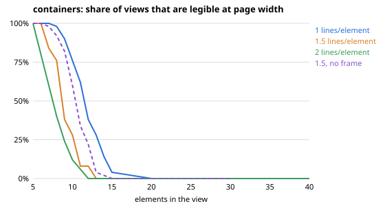
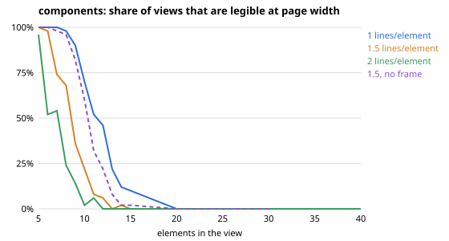
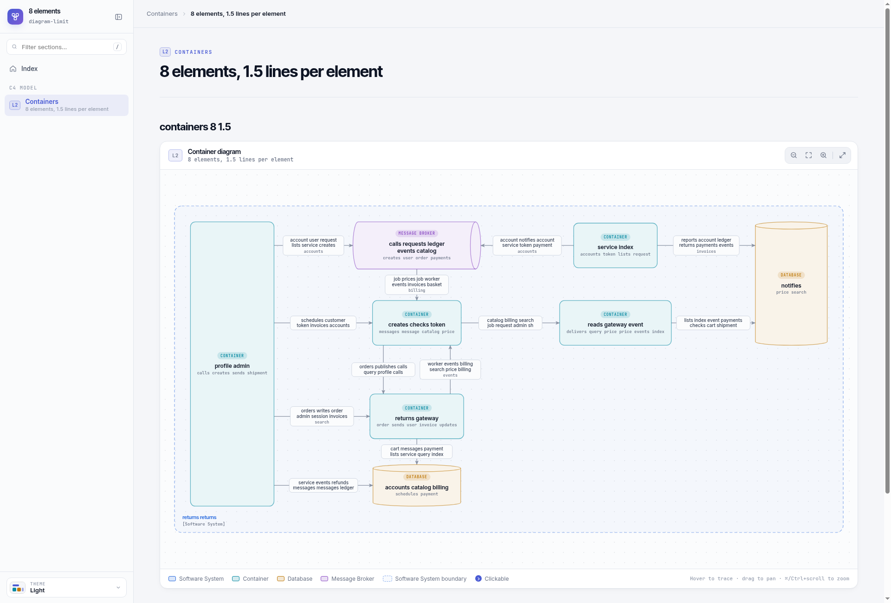
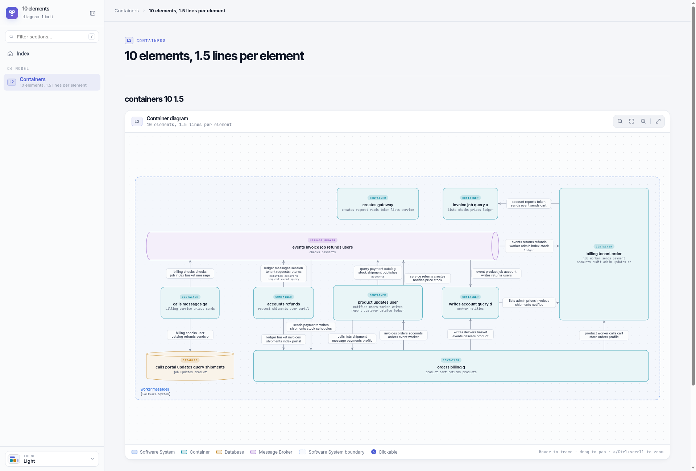
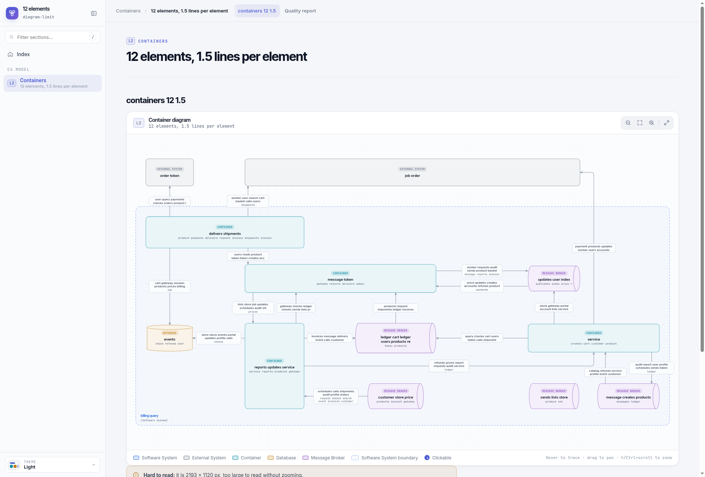
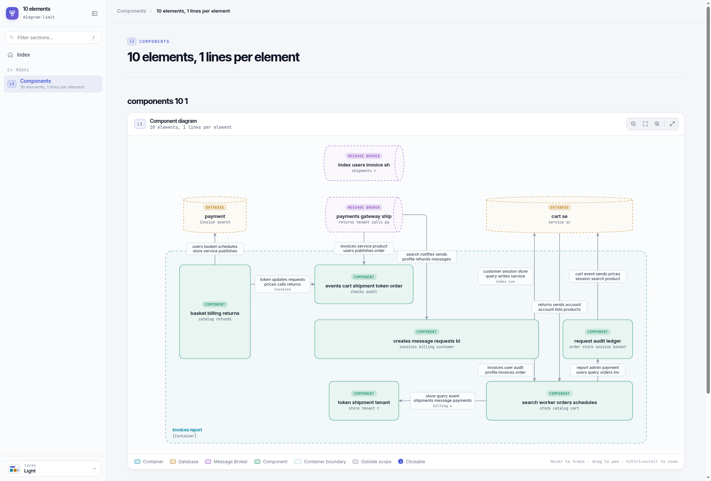

# How many elements a Lantern diagram can hold

## Question

At what number of elements does the C4 report template stop drawing a container or component view
well, and how wide should the tolerance around a soft target be (#836)?

## Depth and why

**High.** It sets a rule of the bar (Diagrams stay readable) and of the design (Readable diagrams),
and how to measure it is itself open. Following the owner's decision of 4 Nov 2026 on #836, the
main evidence is a measurement of the template's own layout on synthetic views shaped like
Lantern's; the sources below say what to measure and how to read the curve. A research subagent
read the sources in full; the measurement is in this folder and reruns with one command.

## What the sources say

- **C4 guidance gives no number.** The C4 FAQ calls large diagrams hard to read "because the
  cognitive load is too high" and advises splitting them, one diagram per service, at the cost of
  the big picture ([C4 FAQ](https://c4model.com/faq); the
  [container diagram page](https://c4model.com/diagrams/container) sets only the scope). Simon
  Brown, its author, warns that "any diagram with 20+ elements (perhaps fewer) starts to get
  complicated quickly", and that one picture of a system "falls apart very quickly once you start
  getting to 10 services, or 20"
  ([Brown](https://dev.to/simonbrown/diagramming-distributed-architectures-with-the-c4-model-51cm)).
- **7 ± 2 is not a diagram rule.** Miller's sevens limit absolute judgement and immediate memory;
  he calls their agreement "a pernicious, Pythagorean coincidence", and grouping into chunks raises
  what can be held ([Miller 1956](http://psychclassics.yorku.ca/Miller/)). A course summary of
  Moody's Physics of Notations gives "7 ± 2 elements per diagram"; the original was not read, so
  it carries no weight.
- **Studies of graph reading.** Readers of node-link diagrams without labels, on 1920 × 1080 px,
  were wrong or unsure more than half the time from 100 nodes at 2 lines per node, 75 at 4 and 50
  at 6; the total of crossings was among the best single predictors of difficulty (adjusted
  R² ≈ 0.70) ([Yoghourdjian et al. 2020](https://arxiv.org/pdf/2008.07944)). A survey of 152
  studies finds the usual sizes (20, 50, 100 nodes) chosen arbitrarily, "not identified by
  empirical research" ([Yoghourdjian et al. 2018](https://arxiv.org/pdf/1809.00270)). Each
  crossing costs about 0.21 s on a path task, and the number of crossings matters more than their
  angle ([Huang and Huang 2010](https://opus.lib.uts.edu.au/bitstream/10453/16557/1/2010001394OK.pdf)).
  Labelled boxes reach these limits much sooner than dots, so the studies bound the answer from
  above but do not give it.
- **A fixed frame means shrinking.** Layout engines fit a drawing larger than its frame by scaling
  it down uniformly ([Graphviz size](https://graphviz.org/docs/attrs/size/)); ELK's layered
  layout publishes effort settings but no quality threshold
  ([ELK layered](https://eclipse.dev/elk/reference/algorithms/org-eclipse-elk-layered.html)). So on
  a fixed page, the scale a view is shrunk to is the measure that turns into a hard failure: below
  the scale at which labels stay legible, no layout quality helps.
- **Reading a knee.** Kneedle defines a knee as the point of greatest curvature and warns that a
  steep drop is not one ([Satopää et al. 2011](https://raghavan.usc.edu/papers/kneedle-simplex11.pdf)).
  A share-of-views-that-pass curve against size avoids the problem: it shows the spread directly
  and reads off a target and a soft limit.

## The measurement

`node lantern-web/scripts/diagram-limit.mjs measure` (about two hours with `--jobs 12`) draws every
synthetic view with the report template in headless Chrome and records, per view, its crossings,
the scale it is shrunk to, its size, lines through boxes, labels on other labels or boxes, and the
layout's cost and missed rules (`views.csv`, `summary.json`, the charts). The views come from a
fixed seed and the layout is deterministic: a rerun of the 5- and 10-element steps gave the same
800 rows byte for byte. `summary` rebuilds the summary and charts from `views.csv` without drawing.

**Shape.** `shape.json` is read from the fake-run reports of project-1, project-2, project-3,
project-4 and project-8 at `fb308343` (`diagram-limit.mjs shape`): 5 container and 39 component
views.

| | Container views | Component views |
| --- | --- | --- |
| Elements, each view / median | 9, 11, 18, 19, 39 / 18 | 3 to 35 / 8 (90% of views at most 22) |
| Lines per element, each view / median | 1.0, 1.45, 1.49, 1.53, 1.83 / 1.49 | 0.67 to 2.89 / 1.06 (90% at most 1.89) |
| Element kinds | containers 43%, databases 22%, queues 21%, external systems 8%, people 6% | components 69% (nearly all inside the frame), containers 13%, queues 10%, databases 7% |
| Name length, median (characters) | containers 13, databases 9, queues 21 | components 23 |

Each synthetic view draws its elements' kinds and places (inside or outside the frame) as often as
the real views of its level do, its lines between kinds as often as theirs, and names,
technologies and labels of their lengths. The fake model words every line label alike (43
characters), so label length is the least realistic part; real labels are shorter or longer.

**Variants.** 5 to 15 elements in steps of 1, then 20 to 40 in steps of 5; 1.0, 1.5 and 2.0 lines
per element, which span the real views; framed as Lantern draws them, and unframed at 1.5. 50
views per variant up to 30 elements, 10 at 35 and 40: 5,720 views. Laying out a view takes time
that grows about with the fourth power of its size (5 s at 20 elements, 2 minutes at 40), which is
why the large steps are sampled less, and is #876.

**The measure that decides.** A view passes when it is legible at page width: the 1632 px canvas
over its width is at least the scale 0.8, at which an 11.5 px label stays 9 px tall; height does
not count (owner's decision of 4 Nov 2026 on #764). Crossings only warn (decision (e) on #764),
and they turn out not to bind: up to 15 elements at up to 1.5 lines per element, 90% or more of
views cross at most 5 times, while at 15 elements at most 10% fit. So fit decides, as the sources
predict.

## Results

Share of views legible at page width, with the lower end of its 95% interval:

| Elements | Containers, 1.0 | Containers, 1.5 | Containers, 1.5 unframed | Components, 1.0 | Components, 1.5 | Components, 2.0 |
| --- | --- | --- | --- | --- | --- | --- |
| 6 | 100% (93) | 100% (93) | 100% (93) | 100% (93) | 98% (90) | 52% (39) |
| 7 | 100% (93) | 84% (71) | 98% (90) | 100% (93) | 74% (60) | 54% (40) |
| 8 | 98% (90) | 76% (63) | 92% (81) | 98% (90) | 68% (54) | 24% (14) |
| 9 | 90% (79) | 38% (26) | 82% (69) | 90% (79) | 36% (24) | 14% (7) |
| 10 | 76% (63) | 28% (17) | 60% (46) | 70% (56) | 22% (13) | 2% (0) |
| 11 | 62% (48) | 8% (3) | 34% (22) | 52% (39) | 8% (3) | 6% (2) |
| 12 | 38% (26) | 8% (3) | 22% (13) | 46% (33) | 6% (2) | 0% |
| 15 | 4% (1) | 0% | 0% | 10% (4) | 0% | 0% |
| 20 and more | 0% | 0% | 0% | 0% | 0% | 0% |

`containers-readable.svg` and `components-readable.svg` add the crossing warning, and
`*-clean.svg` also lines through boxes and labels on others; both follow the same curve a little
lower. The median view is shrunk to 0.77 at 10 elements, 0.53 at 15 and 0.43 at 20 (containers,
1.5 lines per element).

**The real views agree, a little more kindly** (`real-views.csv`, the same 44 views measured the
same way): 23 of the 24 views of up to 10 elements fit, 2 of 7 views of 11 to 15, and none of the
13 larger ones. Real views keep more of their lines in a tree than random ones do, so they fit a
little better than the synthetic views at the same size and density.

**Why so few.** The template draws each box at least 150 px wide, widened for its name, tag and
technology up to a cap, with gaps of 110 px or more between columns for line labels. Three to five
boxes and their labels fill 1632 px at full size, so a view of about ten already has to shrink.
The limit is a property of this renderer: a more compact layout would move it, and the script
measures any change again.

## Options

1. **Keep the bar's sizes (about 10 to 20 boxes, warn above 25).** No change to what is merged.
   Almost every view above 10 elements stays too wide to read at page width; the warning becomes
   noise.
2. **Relax fit** (a smaller scale, or fit by height as well). More views pass on paper; labels drawn
   at 7 px are not readable, so the reader zooms, which the bar rules out.
3. **Set the limit from the measurement** (recommended). Target 8, tolerance 2: a view of up to 10
   elements is fine; above 10, what can be merged is merged (#764). At 1.0 lines per element, the
   median of component views, 98% of views of 8 elements fit (at least 90%) and about half of
   views of 11; at 1.5, the median of container views, 76% fit at 8 and 28% at 10. Among the real
   views, 23 of 24 up to 10 fit.
4. **Make the layout more compact first** (narrower boxes, smaller gaps, labels inside lines), then
   measure again. It would raise the limit and lets more views keep their detail, but it is a change
   to the renderer and its own task; the setting carries whatever value the measurement then gives.

## Recommendation

Option 3 now: **target 8 elements, tolerance 2**, so a view merges what it can above 10 elements.
The target is the largest size at which the lower end of the 95% interval of views that fit is
still 90% at the median component density (1.0 lines per element); the tolerance reaches the
size at which the real views stop fitting and the synthetic ones at 1.0 pass about two times in
three. Container views, denser at 1.5 lines per element, pass less often at 9 and 10; that is the
tolerance's cost, and the after-layout check still names each one that does not fit. The lines
per element (2), the scale (0.8) and the crossings (5) stay as they are. Option 4 is worth its own
issue if the owner wants larger overviews; the measurement then sets the new value.

## What it changes

- **Bar, Diagrams stay readable:** the sizes come from this measurement, not from guides: an
  overview or component view aims at 8 boxes and is merged above 10; "about 10 to 20 boxes, a
  warning above 25" and the 10 to 15 heuristic go. Brown's "20+ (perhaps fewer)" stays as the
  outside check. This waits for the owner's approval of the value on #836.
- **Design, Readable diagrams:** the limits are one setting, `lantern.diagrams` (target, tolerance,
  lines per element, scale, crossings), read by the composer and its quality report and carried
  in each report as `document.readable` for the template and the scorer; the measured soft limit,
  not a per-view layout in the run, decides when to merge; the value is the setting's, measured
  by `diagram-limit.mjs`. Done in this change, with the defaults unchanged (target 50, no
  tolerance) until the value is approved.
- **ADR 0117 and ADR 0123**, amendments for #836.

## Sources

Read in full by the research subagent:

- C4 model FAQ: https://c4model.com/faq
- C4 container diagram: https://c4model.com/diagrams/container
- Simon Brown, Diagramming distributed architectures with the C4 model:
  https://dev.to/simonbrown/diagramming-distributed-architectures-with-the-c4-model-51cm
- Yoghourdjian et al., Scalability of Network Visualisation from a Cognitive Load Perspective
  (2020): https://arxiv.org/pdf/2008.07944
- Yoghourdjian et al., Exploring the Limits of Complexity (2018): https://arxiv.org/pdf/1809.00270
- Huang and Huang, Exploring the Relative Importance of Crossing Number and Crossing Angle (2010):
  https://opus.lib.uts.edu.au/bitstream/10453/16557/1/2010001394OK.pdf
- Satopää et al., Finding a "Kneedle" in a Haystack (2011):
  https://raghavan.usc.edu/papers/kneedle-simplex11.pdf
- Miller, The Magical Number Seven (1956): http://psychclassics.yorku.ca/Miller/
- ELK layered reference: https://eclipse.dev/elk/reference/algorithms/org-eclipse-elk-layered.html
- ELK thoroughness option:
  https://eclipse.dev/elk/reference/options/org-eclipse-elk-layered-thoroughness.html
- Graphviz size attribute: https://graphviz.org/docs/attrs/size/
- Course slides summarising Moody's Physics of Notations (second-hand):
  https://cs.uwaterloo.ca/~jmatlee/Teaching/CS846/Schedule/Jan30/Kevin.pdf

Not read, no weight: Moody, The Physics of Notations (IEEE TSE 2009, no open copy); Purchase, Which
aesthetic has the greatest effect on human understanding? (GD 1997, known only through Huang and
Huang); Ghoniem, Fekete and Castagliola on node-link and matrix readability (the fetch was
blocked); Huang, Hong and Eades, Effects of crossing angles (embargoed); third-party blogs giving
"10 to 12 boxes" or "6 to 8 boxes" (search snippets only).

## Example renders

Synthetic container views at 1.5 lines per element (`diagram-limit.mjs example`), drawn on a
1920 px screen. The 8-element view fits; this 10-element view is one of the 28% that fit at its
density; the 12-element view does not ("Hard to read" under it). A component view of 10 elements
at 1.0 lines per element fits.

